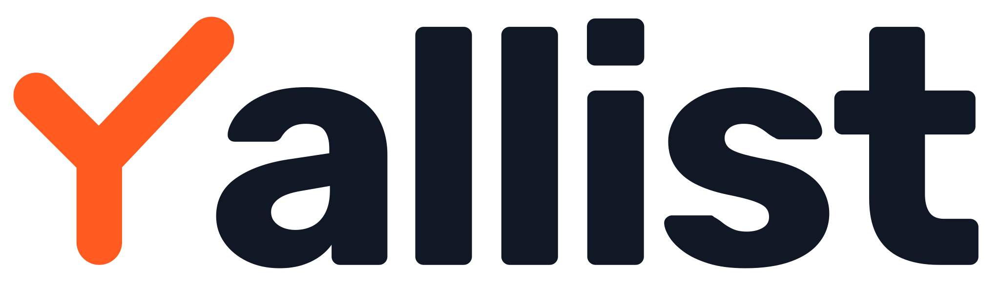

# Yallist

Yallist is a group-trip app for Israel: one shared list for who brings what and what still needs buying. It is Hebrew-first and right-to-left, warm, quick, and a little playful, like the WhatsApp group it replaces.

**Where this came from.** The colors were sampled pixel-exact from a 2× screenshot of the trips home screen (the empty state), and the logo is the chosen Check-Y. Sizes, spacing and type sizes are that screenshot halved, so treat them as close estimates until they are synced from the code. Lines marked *proposed* are recommendations, not yet in the app.

## Voice

- **Hebrew first, said the way friends say it.** Plural present tense, not commands: “פותחים טיול, שולחים קישור לחברים”, not “פתח טיול”. Buttons are nouns of action: “פתיחת טיול ראשון”.
- **Short.** Titles run to four words, and explanations take one line. The three-step explainer is the model: a bold item-title, then one caption.
- **Real trip stuff in examples.** Hummus ×3, a tent, a speaker, ice. Never lorem ipsum.
- **English mirrors the same tone**: “Who’s bringing what?”, not “Manage your trip inventory.”

## Logo

The Check-Y is a Y whose arms form a checkmark, and it *is* the Y of the name. The lockup reads “[mark]allist”. Never set the mark next to the full word “yallist”, which doubles the y.

| Use | File |
|---|---|
| Light backgrounds | `yallist-lockup.svg`: orange mark, ink letters |
| Dark backgrounds | `yallist-lockup-reversed.svg`: orange mark, white letters |
| In-app and web favicon | `yallist-icon.svg`: orange tile, white mark |
| App Store / Play Store | `yallist-app-icon-fullbleed.svg`: square, because the OS applies its own corner mask |
| Tight spots, avatars, loaders | `yallist-mark.svg` |

- **Clear space.** Keep at least half the mark’s height free on every side of the lockup.
- **Minimum sizes.** The icon works down to 24px. Keep the lockup at least 24px tall.
- **Live reference.** The Logo card below shows both lockups, the icon at real sizes and the clear-space zone, all drawn from the files in Logos.
- **Don’ts.** Don’t recolor the mark blue, put it on a blue fill, add shadows, or retype the letters. The wordmark is Rubik Bold, outlined in the files.

## Color

Two hues, each with one job:

- **Primary blue (`primary`) means *do something*.** It colors the floating button, links, the avatar and step numerals. Its quiet form, `primary-tint`, is for tonal buttons and step circles.
- **Brand orange (`brand`) means *Yallist*.** It is for the logo and the app icon. *Proposed:* also use it for the one moment the product is about, an item checked as brought, so the check in the logo and the check in the list are the same thing. Never use orange for buttons, and never use blue for the logo.
- **Neutrals.** Use `surface` for the page, `card` for content, `ink` for headings, and `ink-muted` for everything secondary. No borders: separation comes from card on surface.
- **Illustration.** The `illo-*` sunset palette is for illustrations only. Its warm sky is why the orange logo sits comfortably beside the blue UI.

**Contrast to watch.** The app sets `primary` text on `primary-tint` (4.4:1). That passes for the 18px/800 step numerals, which count as large text, but not for the 15px “טיול לדוגמה” label. Use `primary-strong` there (4.9:1). `brand` on white is 3.1:1, which is fine for the logo and icons but not for text; use `brand-strong` for text.

## Type

Rubik covers Latin and Hebrew in one family. Use 800 for display and button-lg, 700 for item titles and small buttons, and 400 for reading. Load it with `@expo-google-fonts/rubik` on native and Google Fonts on web, at weights 400, 700 and 800. Display sizes get slightly tight tracking (`-0.01em`). Hebrew needs no other adjustment.

## Layout

- **One column, at most `content-max` (448px)**, centered on web. The screen is a stack of cards on `surface` with `space-4` between them.
- **Cards** use `card` on `surface`, `radius-card`, `space-5` padding, and no border or shadow.
- **One floating primary action per screen**, bottom-centered, `space-6` from the edge, with `shadow-float`. It is the only element with a shadow.
- **RTL is the default.** Lay out with start/end, never left/right (`paddingStart`, `marginInlineStart`). The page title sits at the start (right) and the avatar at the end.
- **Touch targets** are at least 44px (`size-avatar`, `size-button-sm`).

## Iconography

So far there is one icon, the plus in the floating button: a rounded 2.5px stroke on a 24px grid, set in `on-primary`. *Proposed:* keep every icon in that style, using a rounded-stroke set such as Lucide at a matching stroke weight. Icons sit before their label, so they land on the right in RTL. No emoji as icons.

## Components

Logo, Header, Button, Card, Steps and Avatar are specified below, and each has a static preview in `reference/components/`. The empty-state illustration is a separate asset to export from the code. It is not reproduced here.

### Logo

The Yallist logo: the orange Check-Y mark standing in for the Y, followed by “allist” in outlined Rubik Bold.

| Where | File | Notes |
|---|---|---|
| Light grounds (`surface`, `card`) | `yallist-lockup.svg` | Orange mark, `ink` letters |
| Dark grounds (`ink` or photos) | `yallist-lockup-reversed.svg` | Orange mark, white letters |
| In-app tile, web favicon | `yallist-icon.svg` | `brand` tile, `radius-icon` corners, white mark |
| App Store / Play Store | `yallist-app-icon-fullbleed.svg` | Square. Export it at 1024×1024 for iOS; on Android use the white mark as the adaptive foreground over a `brand` background |
| Loaders, tiny spots | `yallist-mark.svg` | The mark alone, `brand` only |

- **Clear space:** half the mark’s height on every side, shown as the dashed zone in the preview.
- **Minimums:** the icon at 24px, the lockup at 24px tall.
- **Never** set the mark beside the full word “yallist”, retype the letters, recolor the mark (no blue, no white-on-blue), or add shadows or outlines.
- The logo is the only place `brand` appears at full size. Screens stay blue for actions.

The consumer provides only placement and size, because the files are final artwork.

### Header

The screen header: a page-title at the start edge and the account avatar at the end.

- Title in `page-title`, `ink`. One per screen and no subtitle; context goes in the first card.
- The avatar is the Avatar component at `size-avatar` and opens the account menu.
- The row is `space-between` with `space-4` above it and `space-4` down to the first card, inside the `content-max` column.
- In RTL the title is on the right. Build with start/end so it flips by itself.

The consumer provides the title text and the user’s initial.

### Button

Pill buttons in two strengths: the floating primary for the one main action on a screen, and the tonal pill for secondary actions inside cards.

| Variant | Height | Fill | Label | Use |
|---|---|---|---|---|
| Floating primary | `size-button-lg` | `primary` + `shadow-float` | `button-lg` in `on-primary` | The screen’s one main action, bottom-centered, `space-6` from the edge |
| Tonal | `size-button-sm` | `primary-tint` | `button-sm` in `primary-strong` | Secondary actions inside a card, such as “טיול לדוגמה” |

- Both use `radius-pill` and the Rubik label, with no border.
- The icon comes before the label (`space-4` gap), so it sits on the right in RTL. It is a 2.5px rounded stroke in the label color.
- Labels are actions as nouns (“פתיחת טיול ראשון”), at most three words.
- Never more than one floating primary per screen, and never orange: `brand` is reserved for the logo.

The consumer provides the label, an optional leading icon, and the press handler.

### Card

The white card is Yallist’s only container: every block of content on a screen is one card on `surface`.

- `card` fill, `radius-card` corners, `space-5` padding, no border or shadow. Cards stack with `space-4` between them inside the `content-max` column.
- **Text card:** a `section-title` in `ink`, then `space-3`, then `body` in `ink-muted`.
- **Action row:** an `item-title` and `caption` at the start, with a tonal Button at the end, vertically centered.
- **Illustrated card:** the illustration bleeds to the card edges at the top, sharing the top `radius-card` corners, with the text card content below it. Illustrations use only `illo-*` colors.

The consumer provides the content. A card never nests another card.

### Steps

A numbered how-it-works list inside a card: a circled numeral at the start, then a bold title and a one-line caption.

- Circle is `size-step`, `primary-tint` fill, `radius-pill`. The numeral is `step-number` in `primary`, which passes as large text.
- Title in `item-title`/`ink`, caption in `caption`/`ink-muted`, with `space-1` between them. The circle sits `space-4` from the text.
- Rows are `space-6` apart. Use three steps; four at most.
- Write each step as a plural-present action plus its payoff: “שולחים קישור בוואטסאפ / החברים מצטרפים מהדפדפן”.

The consumer provides the ordered items (title and caption). Numbering is automatic.

### Avatar

A circular initial badge for a trip member, used in the header for the signed-in user.

- `size-avatar`, `radius-pill`, `primary` fill, the initial in `on-primary` at 18px/800.
- Show the first letter of the Google display name, in whatever script the name uses (Hebrew or Latin).
- As a button it needs an `aria-label` (“החשבון שלי”), because the letter alone says nothing.

The consumer provides the member’s display name.
