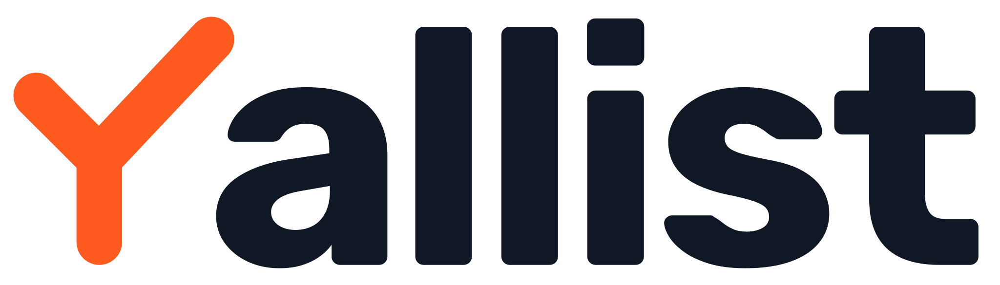

# Yallist

Yallist is a group-trip app for Israel: one shared list for who brings what and what still needs buying. It is Hebrew-first and right-to-left, warm, quick, and a little playful, like the WhatsApp group it replaces.

**The look in one line.** Warm paper, night ink, sunset violet for what you tap and orange for what's done: the colors of the cover illustrations' evening sky, not of a generic blue app.

## Voice

- **Hebrew first, said the way friends say it.** Plural present tense, not commands: “פותחים טיול, שולחים קישור לחברים”, not “פתח טיול”. Buttons are nouns of action: “פתיחת טיול ראשון”.
- **Short.** Titles run to four words, and explanations take one line. The three-step explainer is the model: a bold item-title, then one caption.
- **Real trip stuff in examples.** Hummus ×3, a tent, a speaker, ice. Never lorem ipsum.
- **English mirrors the same tone**: “Who’s bringing what?”, not “Manage your trip inventory.”

## Logo

The Check-Y is a Y whose arms form a checkmark, and it *is* the Y of the name. The lockup reads “[mark]allist”. Never set the mark next to the full word “yallist”, which doubles the y.

| Use | File |
|---|---|
| Light backgrounds | `yallist-lockup.svg`: orange mark, ink letters |
| Dark backgrounds | `yallist-lockup-reversed.svg`: orange mark, white letters |
| In-app and web favicon | `yallist-icon.svg`: orange tile, white mark |
| App Store / Play Store | `yallist-app-icon-fullbleed.svg`: square, because the OS applies its own corner mask |
| Tight spots, avatars, loaders | `yallist-mark.svg` |

- **Clear space.** Keep at least half the mark’s height free on every side of the lockup.
- **Minimum sizes.** The icon works down to 24px. Keep the lockup at least 24px tall.
- **Live reference.** The Logo card below shows both lockups, the icon at real sizes and the clear-space zone, all drawn from the files in Logos.
- **Don’ts.** Don’t recolor the mark, add shadows, or retype the letters. The wordmark is Rubik Bold, outlined in the files.

## Color

Four roles, each with one job:

- **Paper (`surface`, `line`, `hairline`) is the place.** The page is warm paper, and cards are white on it with a `hairline` outline. No cold grays.
- **Night ink (`ink`, `ink-muted`) is for reading.** Headings and text.
- **Sunset violet (`primary`, `primary-tint`, `primary-strong`) means *do something*.** Solid buttons, selected chips and tabs, links, the default avatar, step numerals. `primary-tint` is the quiet fill for tonal buttons, step circles and tips. The screen's key number may be set in `primary-strong` (the money balance).
- **Brand orange (`brand`) means *done* and *Yallist*.** The logo, a done check, progress. Never a button fill, and never text; `brand-strong` is the orange that can be read (“אצלך”, errors, delete).
- **Category accents (`accent-*`)** give each category card on a list its own hue: a dot beside its name and the color of its items' icons. A category uses the accent picked for it when it was edited, else the one at its position, cycling in order. They are decoration; the name always says which category it is.
- **Money has a direction.** What someone owes is `brand-strong`; what someone gets back is `owed`, the teal of `accent-2`. The same two colors mark a balance on the trip card, the money tab's top card, the balances and an expense's effect on me ("החלק שלך" / "הלווית"). A word always says which way it goes; settled is `ink-muted`.
- **Avatar colors (`avatar-1`…`avatar-7`)** are pale fills with an `ink` initial. Everyone gets one at random when they sign up and can change it in their profile. A profile photo covers it, and then the picker is hidden. An avatar with no color (sample data) falls back to `primary` with a white initial.
- **Illustration.** The `illo-*` sunset palette is for illustrations, trip tiles and covers only. Violet and orange are taken from it, which is why the UI and the covers sit together.

**Contrast to watch.** White on `primary` is 6.6:1; `primary` on paper is 5.9:1. `brand` on white is 3.1:1, fine for the logo and icons but not text: use `brand-strong` (5.9:1 on card, 5.2:1 on paper). Every accent is at least 4.3:1 on card. `owed` is 5.1:1 on card and 4.5:1 on paper, so money in it sits on cards. Avatar fills take an `ink` initial at 13:1 or more. Placeholders (`ink-faint`) are 3.3:1 on card and are never the only label.

## Type

Rubik covers Latin and Hebrew in one family. Use 800 for titles, numbers and stats, 700 for item titles, labels and buttons, and 400 for reading. `big-number` (56/60) is for a screen's one key number, such as the money total; `stat` (28/32) for countdowns and counts. Titles get slightly tight tracking (`-0.01em`). Numbers that change use tabular digits. Load it with `@expo-google-fonts/rubik`, one file per weight. In React Native each weight is its own family, so the app's styles set `fontFamily` and never `fontWeight`, which makes web synthesize bold and Android fall back to the system font.

## Layout

- **One column, at most `content-max` (448px)**, centered on web. The screen is a stack of cards on `surface` with `space-4` between them.
- **Cards** use `card` on `surface`, `radius-card`, `space-5` padding, a 1px `hairline` outline, and no shadow.
- **One floating primary action per screen**, bottom-centered, `space-6` from the edge, with `shadow-float`. Only what floats has a shadow (this button and the toast).
- **RTL is the default.** Lay out with start/end, never left/right (`paddingStart`, `marginInlineStart`). The page title sits at the start (right) and the avatar at the end.
- **Touch targets** are at least 44px (`size-avatar`, `size-button-sm`).
- **Wide screens** (tablet ≥ 600, desktop ≥ 1024) keep the same cards. Single-column screens cap at `content-max`; home becomes a grid, the trip screen and the profile get a sticky side column, and sheets become centered dialogs.

## Iconography

Icons are a rounded stroke on a 24px grid (Lucide), in the color of the text beside them. Item icons on a list take their category's accent. Icons sit before their label, so they land on the right in RTL. No emoji as icons.

## Components

Logo, Header, Button, Card, Steps and Avatar are specified first, and each has a static preview in `reference/components/` (in v2 colors). The rest of the kit follows under [More components](#more-components). Every component lives in `apps/mobile/src/components`, and the dev route `/dev/components` shows them all in their states, in the current colors.

### Logo

The Yallist logo: the orange Check-Y mark standing in for the Y, followed by “allist” in outlined Rubik Bold.

| Where | File | Notes |
|---|---|---|
| Light grounds (`surface`, `card`) | `yallist-lockup.svg` | Orange mark, `ink` letters |
| Dark grounds (`ink` or photos) | `yallist-lockup-reversed.svg` | Orange mark, white letters |
| In-app tile, web favicon | `yallist-icon.svg` | `brand` tile, `radius-icon` corners, white mark |
| App Store / Play Store | `yallist-app-icon-fullbleed.svg` | Square. Export it at 1024×1024 for iOS; on Android use the white mark as the adaptive foreground over a `brand` background |
| Loaders, tiny spots | `yallist-mark.svg` | The mark alone, `brand` only |

- **Clear space:** half the mark’s height on every side, shown as the dashed zone in the preview.
- **Minimums:** the icon at 24px, the lockup at 24px tall.
- **Never** set the mark beside the full word “yallist”, retype the letters, recolor the mark, or add shadows or outlines.
- The logo is the only place `brand` appears at full size. On screens it marks what's done: a check, a ring.

The consumer provides only placement and size, because the files are final artwork.

### Header

The screen header: a page-title at the start edge and the account avatar at the end.

- Title in `page-title`, `ink`. One per screen and no subtitle; context goes in the first card.
- The avatar is the Avatar component at `size-avatar` and opens the account menu.
- The row is `space-between` with `space-4` above it and `space-4` down to the first card, inside the `content-max` column.
- In RTL the title is on the right. Build with start/end so it flips by itself.

The consumer provides the title text and the user’s initial.

### Button

Pill buttons in two strengths: the floating primary for the one main action on a screen, and the tonal pill for secondary actions inside cards. In the app both are `PillButton`; the floating one is `FloatingAction`.

| Variant | Height | Fill | Label | Use |
|---|---|---|---|---|
| Floating primary | `size-button-lg` | `primary` + `shadow-float` | `button-lg` in `on-primary` | The screen’s one main action, bottom-centered, `space-6` from the edge |
| Tonal | `size-button-sm` | `primary-tint` | `button-sm` in `primary-strong` | Secondary actions inside a card, such as “טיול לדוגמה” |

- Both use `radius-pill` and the Rubik label, with no border.
- `PillButton` has three more fills for less weight: `quiet` (`surface` fill, `ink` label) on a card, `card` (white, optionally `hairline`-outlined) on the page, and `danger` (no fill, `brand-strong` label) for leave and delete. Sizes are `sm` and `md` at `size-button-sm` (sm is tighter, for row chips) and `lg` at `size-button-lg`.
- The icon comes before the label (`space-3` gap), so it sits on the right in RTL. It is a rounded stroke in the label color.
- Labels are actions as nouns (“פתיחת טיול ראשון”), at most three words.
- Never more than one floating primary per screen, and never an orange fill.

The consumer provides the label, an optional leading icon, and the press handler.

### Card

The white card is Yallist’s only container: every block of content on a screen is one card on `surface`.

- `card` fill, `radius-card` corners, `space-5` padding, a 1px `hairline` outline, no shadow. Cards stack with `space-4` between them inside the `content-max` column.
- **Text card:** a `section-title` in `ink`, then `space-3`, then `body` in `ink-muted`.
- **Action row:** an `item-title` and `caption` at the start, with a tonal Button at the end, vertically centered.
- **Illustrated card:** the illustration bleeds to the card edges at the top, sharing the top `radius-card` corners, with the text card content below it. Illustrations use only `illo-*` colors.

The consumer provides the content. A card never nests another card.

### Steps

A numbered how-it-works list inside a card: a circled numeral at the start, then a bold title and a one-line caption.

- Circle is `size-step`, `primary-tint` fill, `radius-pill`. The numeral is `step-number` in `primary`, which passes as large text.
- Title in `item-title`/`ink`, caption in `caption`/`ink-muted`, with `space-1` between them. The circle sits `space-4` from the text.
- Rows are `space-6` apart. Use three steps; four at most.
- Write each step as a plural-present action plus its payoff: “שולחים קישור בוואטסאפ / החברים מצטרפים מהדפדפן”.

The consumer provides the ordered items (title and caption). Numbering is automatic.

### Avatar

A circular badge for a trip member: their photo, else their initial.

- `radius-pill`, at one of the `avatar-*` sizes: `md` (32) by default, `sm` (28) in stacks, `lg` (44) in the header and people rows, `xxl` (96) on the profile.
- The initial is in `ink` on the person's `avatar-*` color, or in `on-primary` on `primary` when there is no color. `dimmed` (someone left out of an expense) is `primary-tint` with a `primary-strong` initial.
- A profile photo covers the badge; the initial shows while it loads or if it fails. Photos are kept on the device, so they show offline.
- `AvatarStack` overlaps up to `max` avatars, each ringed in `card`, with a `+N` bubble in `primary-tint`, and names them beside the stack (“דנה, אבי ונועה”).
- Show the first letter of the Google display name, in whatever script the name uses (Hebrew or Latin).
- As a button it needs an `aria-label` (“החשבון שלי”), because the letter alone says nothing.

The consumer provides the member’s display name.

## More components

The rest of the kit, in `apps/mobile/src/components`. Each is drawn with the tokens above and nothing else.

### Controls

| Component | Look | Use |
|---|---|---|
| `SegmentedControl` | Pill segments on a white `hairline` track; the selected one is a `primary` pill with an `on-primary` label. Pass a `surface` track on a card | The trip's tabs (ציוד / קניות / כסף / ניהול), and a choice of two to four inside a form |
| `SubTabs` | Equal halves over a `line` rule; the selected label is `primary-strong`, underlined in `primary` | The views inside a tab (“משותף” / “הרשימה שלי”, “הוצאות” / “התחשבנות”). Lighter than the tabs above it |
| `FilterChip` | Outlined `card` with an `ink` label; selected is solid `primary`. An optional count in tabular digits | Filters over a list (הכול / חסר / אצלי) |
| `PersonChip` | Outlined `card` with an `ink-muted` name; selected is solid `primary` with a check | Who shares an expense |
| `SuggestionChip` | `surface` fill, a muted “+” and an `ink` label | Quick fills on a card |
| `Switch` | `primary` track when on, `line` when off, a white knob that moves to the end when on | Settings and “אני אביא את זה” |
| `CheckRow` | A `primary` checkbox, an `item-title` and a muted detail at the end | Picking several items (copy from a trip, take from my bag) |

Every control has a `primary` focus ring on web, and chips in a group are announced as one choice.

### Fields

- **`TextField`**: a bold 15px label over a `surface`-filled box with `radius-input`, `ink` text and an `ink-faint` placeholder. An error line under it is bold 13px `brand-strong`; a hint is `ink-muted`.
- **`AmountField`**: the big “₪ 120” input, in `md` (an item's price) or `lg` (an expense). The ₪ is 800 in `ink-muted`.
- **`DateField`**: a tile with its label over the date and a calendar icon at the end. Hover and press fill it `primary-tint`; keyboard focus outlines it in `primary`.
- Hebrew inputs are pinned right to left on web, where an empty input would otherwise start left to right.

### Status and progress

- **`StatusRing`**: the 28px check at the start of a list row. Dashed `ink-muted` when nobody has it, a solid `ink-muted` ring when someone does, a filled `brand` circle with a white check when it's done (the states are in [HANDOFF.md](HANDOFF.md)).
- **`ProgressRing`**: an orange ring on a `line` track, `size-ring-hero` on the trip hero and `size-ring-card` on a trip card, with “3/16” inside in `stat`. It fills clockwise from 12 o'clock in both directions, because clocks don't mirror, and shows a check once everything is covered.
- **`Progress`**: the same as a bar.
- **`Pill`**: a badge, not a button: a count or a state (“חסרים 13”, “אצלך 2”, “עוד 14 ימים”) in tabular digits. `neutral` is `surface`/`ink`, `primary` is `primary-tint`/`primary-strong`, and `brand` is `brand-strong` on `card` with a `hairline`, because the orange needs white under it.
- **`Stat`**: a `stat` value over its `caption` label. A row of them sits in a plain card.
- **`Countdown`**: how long until the trip, or which day of it, as a `stat` on the hero or a pill on a cover.

### Containers and overlays

- **`Card` and `ListGroup`**: the card above, and a card of rows under a small `label` title in `ink-muted`. Rows are spaced, never divided.
- **`Sheet`**: modal routes render one. A white card with a `line` grabber, inset 8 from the screen edges, over `scrim`, with an optional footer pinned at the bottom. On tablet and desktop it becomes a centered dialog sized to its content. Escape closes it on web.
- **`Toast`**: a short message at the top, on `ink` with white text and `shadow-float`. `success` adds a `brand` check, `error` an alert icon and interrupts screen readers. An action (undo) is in `primary-tint` and keeps it up longer.
- **`Callout`**: one tip per screen on `primary-tint`, all in `primary-strong`: an info icon, a title, one line and an optional button.

### States

- **`EmptyState`**: empty, error, not-found and waiting states. An optional spot (`size-spot`), a title, one line, and up to two actions, tonal then quiet. Without a spot it is the small text-only card for secondary cases. `StateScreen` centers one as a whole screen.
- **`Skeleton`**: the shape of a screen while it loads, in `surface` fills that pulse (and stay still under reduced motion).
- **`Loader`**: full-screen waits only (app start, the join preview). Nothing for 300ms, then the Check-Y drawing itself in `brand` on a loop, and one line of copy after 2s.

### Trips and items

- **`Cover`**: a trip's cover scene, cropped around the scene's focal point so a thin band still shows its subject. There are 20 scenes (`COVER_IDS`), flat layered illustrations in the style of the `illo-*` palette. Upcoming trip cards and the trip screen's banner show the cover; `CoverPicker` is the grid of thumbnails, five a row, with the picked one outlined in `primary`.
- **`TripTile`**: the rounded icon tile (`radius-icon`) for a trip's template, in an illustration color: tent on `illo-tent`, mountain on `illo-hill`, and so on. Past trips and templates use it.
- **`TemplateTile`**: a template to start from, with its tile, name and item count. Selected is `primary-tint` outlined in `primary`.
- **`ItemIcon`**: an item's thin line icon, chosen by its name, in `ink-muted` or its category's accent. It has no background, so the name leads. People can turn item icons off in their profile.
