# Design system v2.1: richer without clutter

Design plan, 2026-10-24. Scope: tokens, components and the dev gallery, so the screen plans ([home and trip](home-and-trip.md), PR #63, and the onboarding/content plan) can fill the app without each screen inventing styles. Inputs: [DESIGN.md](../DESIGN.md), `docs/design/tokens/`, `apps/mobile/src/theme`, every file in `apps/mobile/src/components`, a grep of screens for one-off styles, and WCAG ratios computed from the token hexes.

"Before" images are screenshots of the dev site (v0.6.1, guest account); "after" images are HTML mockups built from the proposed tokens.

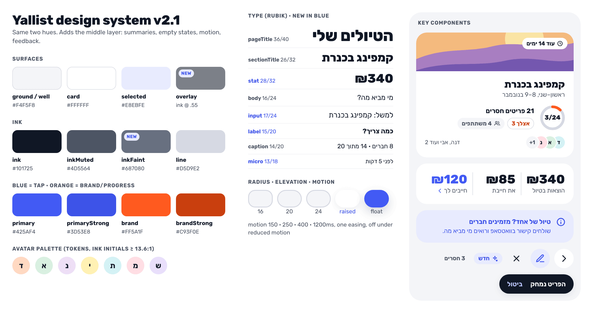

## Diagnosis

v2 is a good _thin_ system: two hues, flat cards, Rubik, one shadow. The app feels empty because the middle layer is missing, not because it lacks color:

1. **No vocabulary for summaries.** Card and ListGroup exist, but nothing for a number with a label, a ring, a person doing something, a countdown or a callout. Countdown, readiness and "who's in" fall back to caption lines.
2. **One empty state, text only.** The illustrated first-run card and the template tiles live inline in screens.
3. **No motion, no loading shape.** Reanimated is installed but unused; three screens show a centered spinner.
4. **Screens re-implement components.** Card, round button, section title and form field each exist 2–4 times, with sizes and radii drifting apart.

v2.1 keeps every v2 rule (blue = tap, orange = brand/progress, flat cards, one floating action) and adds the missing layer. No new hues.

## Accessibility fixes

Text needs 4.5:1 (3:1 at ≥ 24px, or ≥ 18.66px bold); graphics and control edges need 3:1.

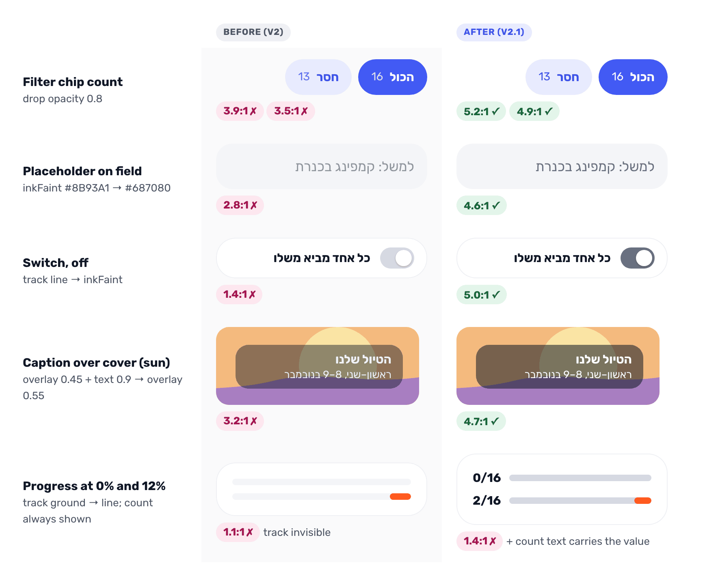

| Pair                                    | Before → after | Fix                                                                                       |
| --------------------------------------- | -------------- | ----------------------------------------------------------------------------------------- |
| FilterChip count, unselected / selected | 3.5 / 3.9 → 4.9 / 5.2 | Drop `opacity: 0.8`.                                                               |
| `inkFaint` placeholder on field         | 2.8 → 4.6      | Darken `inkFaint` to `#687080` (5.0 on card). Also fixes MoneyTab's arrow (3.1).          |
| Switch off track on card                | 1.4 → 5.0      | Off track `line` → `inkFaint`.                                                            |
| White caption over the cover (sun)      | 3.2 → 4.7      | `overlay` 0.55, no text opacity (5.9 over sky).                                           |
| `brand` fill vs. track                  | 2.9 → 2.2      | No orange/gray pair reaches 3:1, so the count text always carries the value; track `line` makes 0% visible. |
| Field `ground` on `card`                | 1.1            | Labels are always shown; add a 2px `primary` focus border, as DateTile has.               |

Already passing, keep: `primary` on `primaryTint` 4.4 (large step numerals only), `brand` on card 3.1 (graphics only), white on `ink` 17.9, `inkMuted` 7.5 on card, `brandStrong` 5.0 on card (4.6 on ground: keep "אצלך" on cards), avatar initials ≥ 13.6.

Also:

- **Focus rings on web** for every pressable (PillButton, chips, SegmentedControl, IconButton, TripCard): one `focusRing` style, 2px `primary`, offset 2.
- **AvatarStack** gets a spoken name ("דנה, אבי ועוד 2"); `+N` is silent today.
- **Toast**: `assertive` for errors only, `polite` otherwise.
- **Reduced motion**: one hook gates every animation; celebrations become copy only.
- **Touch targets**: the 36px category-edit button and item-status chip go to 44 via `minWidth`/`minHeight` (`hitSlop` does nothing on web).

## Tokens

Each addition goes in `tokens.json` first, then `theme/index.ts`, `theme.ts`, `tokens.css` and a line in DESIGN.md.

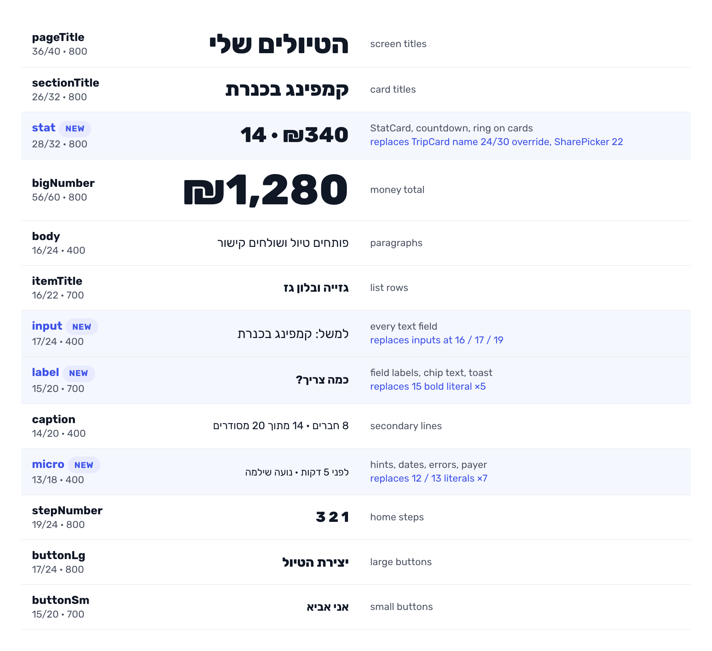

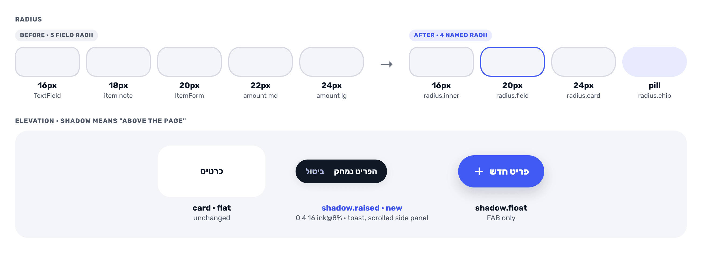

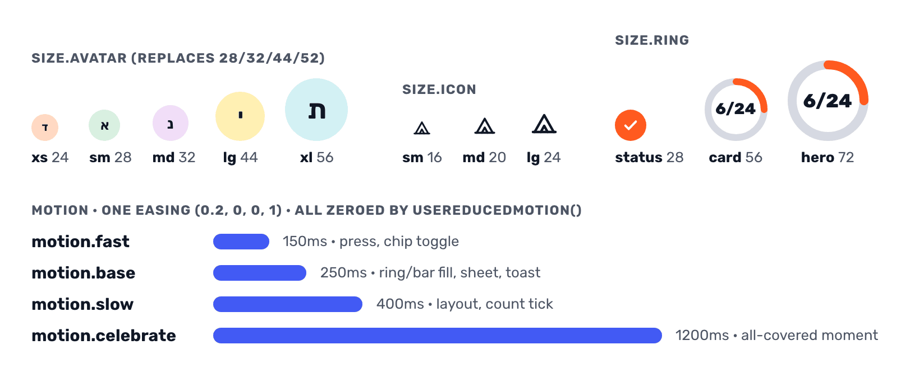

| Group         | Adds                                                                                                                                                                                  |
| ------------- | ------------------------------------------------------------------------------------------------------------------------------------------------------------------------------------- |
| Surfaces      | Names for what exists: `ground` (page), `card`, `well` (= ground inside a card), `selected` (= `primaryTint`). New `overlay` `rgba(16,23,37,0.55)` replaces the 0.45 literal; `scrim` stays for modals. |
| Elevation     | `shadow.raised` `0 4px 16px rgba(16,23,37,0.08)` for things floating over content (Toast, scrolled side panel). `shadow.float` stays the FAB's. Shadow means "above the page", never decoration. |
| Motion        | `fast` 150, `base` 250, `slow` 400, `celebrate` 1200 ms. `easing.out` cubic-bezier(0.2, 0, 0, 1), `easing.inOut` for sheets. `useReducedMotion()` zeroes all of them.                    |
| Progress      | `progress.fill` = `brand`, `progress.track` = `line`. Money: "you owe" `ink`, "owed to you" `primaryStrong` (tappable), settled `inkMuted` + done ring. No red/green.                       |
| Sizes         | `size.ring` 28 / 56 / 72; `size.avatar` xs 24, sm 28, md 32, lg 44, xl 56; `size.icon` 16 / 20 / 24; `size.tile` 40 / 48.                                                              |
| Radius        | `radius.field` 20 for every input-like box, `radius.inner` 16 for tiles in a card, `radius.chip` = pill. Retire 18 and 22.                                                             |
| Type          | `stat` 28/32 800, `input` 17/24, `label` 15/20 700, `micro` 13/18. Replace the 12/13/15/19/22 literals.                                                                               |
| Opacity       | `opacity.disabled` 0.4, `pressed` 0.75, `hover` 0.85 (three disabled values and three press/hover values today).                                                                      |
| Illustration  | Scene palettes as `illustration.<scene>.*` (camp already is; ~40 raw hexes elsewhere). Cover sizes `band` 88, `card` 390/240, `hero` 320; empty-state spots 120×90.                     |
| Avatar        | `AVATAR_COLORS` moves from `@yallist/domain` to theme `avatar.*` (Q2); the domain keeps an id.                                                                                       |
| Layout        | `layout.contentMax` 448 (phone column), `column` 640 (tablet; a literal in 3 screens), `page` 1160, `sidePanel` 340, `gutter` = `space[6]`. No compact density.                       |

## Components

All in `apps/mobile/src/components`, built from Card, tokens and Reanimated. Feature components (ReadinessHero, NextTripCard, Celebration) stay in `features/` and are made of these.

### Summaries: ProgressRing, Stat, Countdown, Pill, AvatarStack

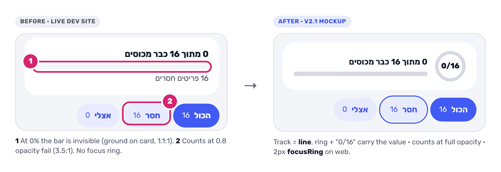

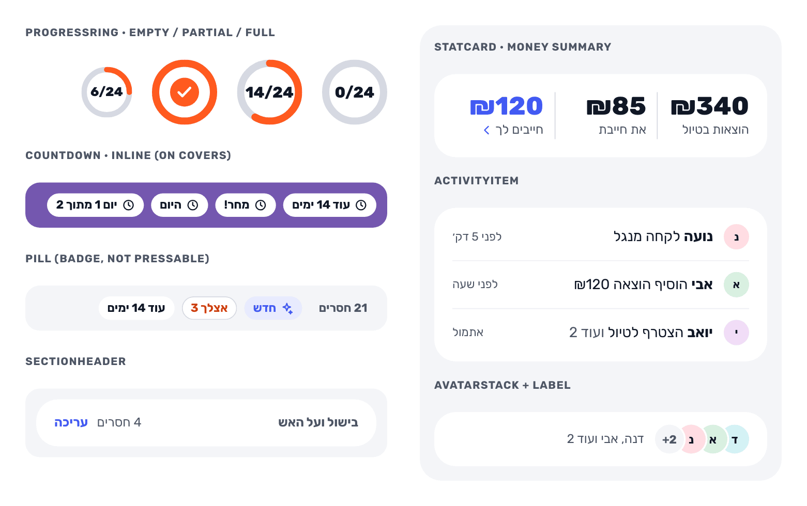

### Empty, loading, feedback: EmptyState v2, Skeleton, Toast v2, Callout

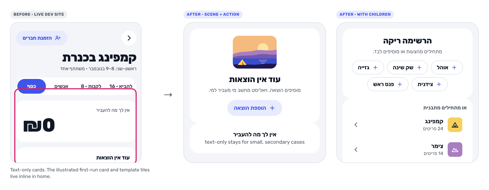

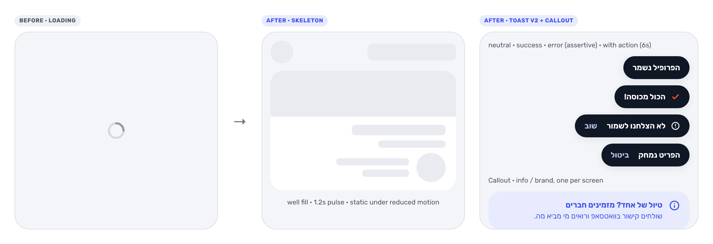

### Controls: IconButton, Stepper, fields, danger button

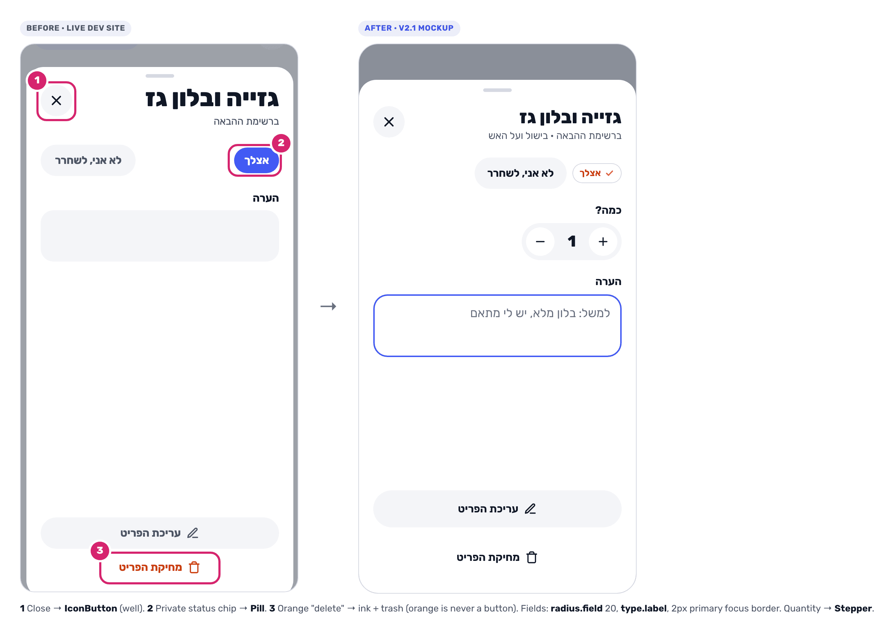

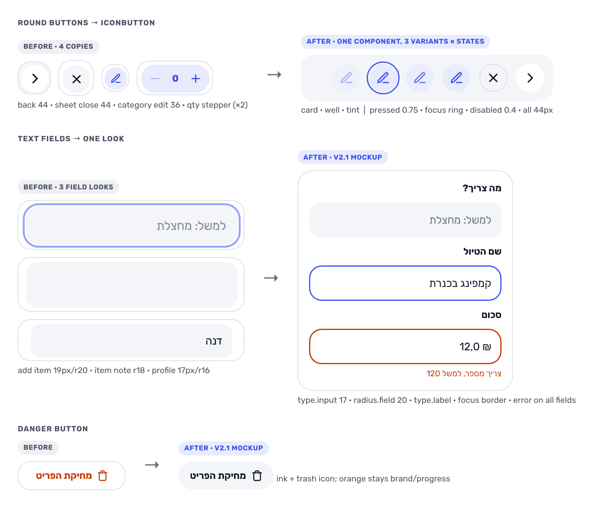

### Wide layouts: CardGrid, SidePanel

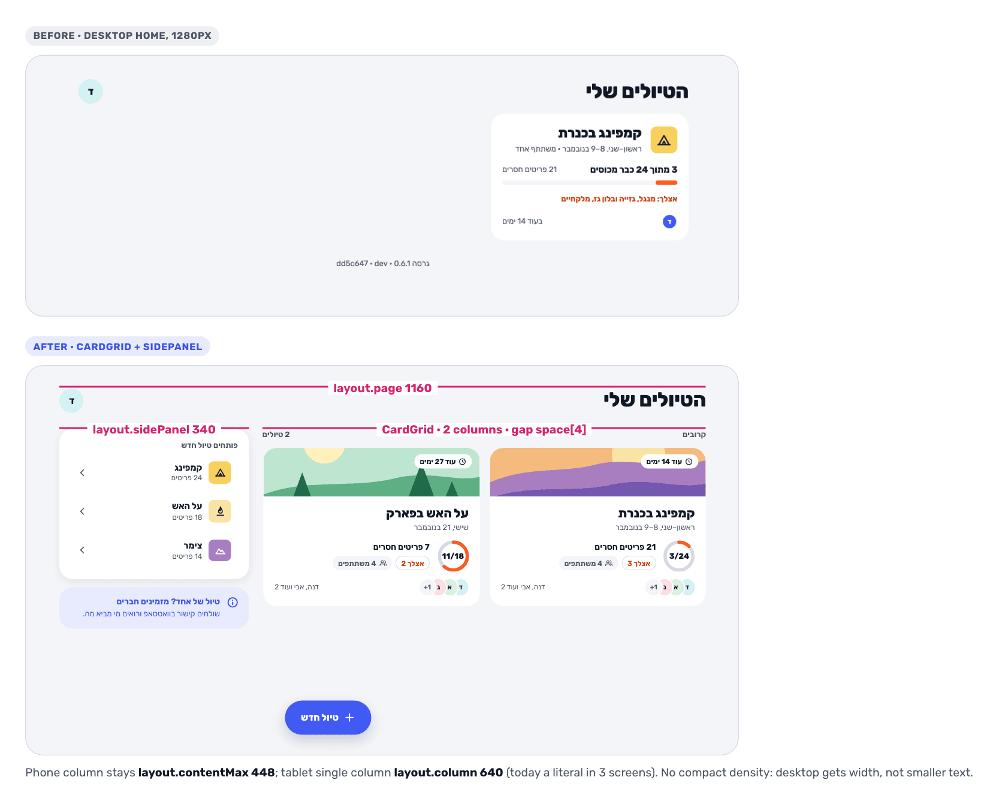

| Component              | API sketch                                                                    | Notes                                                                                                   | Needed by                                  |
| ---------------------- | ----------------------------------------------------------------------------- | ------------------------------------------------------------------------------------------------------- | ------------------------------------------ |
| `ProgressRing`         | `{ done, total, size?: 'card' \| 'hero', label? }`                            | Empty (track only), partial, full (check). SVG, animates (`base`), `progressbar` role. Shares math with `Progress`. | readiness hero, NextTripCard     |
| `Stat` / `StatCard`    | `{ value, label, tone?: 'ink' \| 'brand' \| 'primary', onPress? }`             | Value `type.stat`, label `caption`. Card of 2–3 Stats; pressable = primary + chevron.                     | money summary, home, recap                 |
| `Countdown`            | `{ startsOn, endsOn, size?: 'hero' \| 'inline' }`                              | Before / tomorrow / today / "יום 1 מתוך 2" / hidden after. Pure formatter in `lib/dates`.                | hero, NextTripCard, TripCard               |
| `Pill`                 | `{ label, tone: 'neutral' \| 'primary' \| 'brand' \| 'onCover', icon? }`        | Badge, 24–28px, `micro` bold. Not pressable (chips are).                                                 | TripCard, Cover, item status               |
| `ActivityItem`         | `{ person, text, time, icon? }`                                               | Avatar `sm`, `body` sentence, `micro` time. Grouped ("+2") and mine variants.                            | activity strip, feed                       |
| `SectionHeader`        | `{ title, aside?, action? }`                                                  | Replaces three header copies; action is a 44px `primary` text link; `header` role.                       | ListGroup, ListTab, home, side panel       |
| `AvatarStack` (extend) | `+ label?, size?, onPress?`                                                   | Spoken name; pressable opens People.                                                                    | hero, TripCard                             |
| `EmptyState` v2        | `{ title, text?, scene?, action?, children? }`                                | Text-only, illustrated (scene spot), with tonal action, with children (chips, template tiles).           | home, list, filters, money                 |
| `Skeleton`             | `Line`, `Circle`, `Card`                                                      | `well` fill, 1.2s pulse (static under reduced motion), one "טוען" label on the container.               | home, trip, profile                        |
| `Toast` v2             | `showToast(text, { tone?, action?, icon? })`                                  | neutral / success (brand check) / error (alert icon, assertive). Action keeps it 6s. `raised`, slides in. | undo delete, celebrations, saves          |
| `Callout`              | `{ text, icon?, action?, tone?: 'info' \| 'brand' }`                           | info = tint + `primaryStrong` (4.9); brand = card + `brandStrong`. One per screen.                       | solo-trip nudge, offline, pending invite   |
| `IconButton`           | `{ icon, label, variant?: 'card' \| 'well' \| 'tint' }`        | Always 44px. Pressed, hover, focus, disabled. Replaces back (×2), Sheet close, category edit.                        | everywhere                                 |
| `Stepper`              | `{ value, min, max, onChange, label }`                                        | Merges `ClaimStepper` and ItemForm's qty row.                                                           | item sheet, add item                       |
| `TemplateTile`         | `{ template, selected?, onPress, meta? }`                                     | Extracted from `trips/new.tsx`.                                                                        | new trip, home empty, side panel           |
| `CardGrid` / `SidePanel` | `CardGrid { columns: { phone, tablet, desktop } }`, `SidePanel { sticky? }` | Replaces `width: '48.8%'` math; SidePanel gets `raised` only once scrolled.                             | home, trip desktop, new trip               |

Not proposed: carousels, tabs inside cards, charts beyond ring and bar, colored avatars by default, gradients.

Audit: issues in today's components

| Component                          | Issue                                                                                                                              |
| ---------------------------------- | ---------------------------------------------------------------------------------------------------------------------------------- |
| `Avatar`                           | 7 pale colors live in `@yallist/domain`, not tokens; README says "one color". Free-form sizes 28/32/44/52.                          |
| `AvatarStack`                      | `+N` not announced.                                                                                                                |
| Chips                              | Count at 0.8 opacity fails; no pressed/hover/focus.                                                                                |
| `SegmentedControl`, `Switch`       | Only Switch has a web focus ring. Switch off track 1.4:1.                                                                          |
| `Cover`, `TripTile`                | 4 of 5 scenes use ~40 raw hexes; no size tokens (160/220/320, 390/240).                                                             |
| `PillButton`                       | No hover/focus. `danger` is orange text, against "never orange buttons" (Q3).                                                       |
| `FloatingAction`                   | `FLOATING_CLEARANCE = 120` is a hidden layout token.                                                                               |
| `Card` / `ListGroup` / `EmptyState` | TripCard, new trip and home hand-roll the card; ListGroup's header copied twice; EmptyState has no scene or action.                 |
| `Progress`                         | 2.9:1 fill; invisible at 0%; no animation.                                                                                          |
| `StatusRing`                       | Hard-coded 28px; ListTab's add ring copies it.                                                                                      |
| `Sheet`                            | Paddings 20/10/12, `top = 64`, free `titleSize`: literals.                                                                          |
| `Toast`                            | One tone for success and error; no action, icon or motion; `fontSize: 15`.                                                          |
| Fields                             | Radius 16/18/20/22/24, text 16/17/19, error state only on AmountField, label is not a `type` style.                                  |
| `Icon`                             | Sizes 16/18/20/22 ad hoc. Missing: clock, users, wallet, sparkle, arrow-up-right, info, alert.                                        |

Feature-level pieces that are really system parts: `ProgressCard`, the home Steps list, the template grid, the round back button (×2), `ClaimStepper` and the qty stepper.

## Consistency fixes

Mechanical replacements, all in PR 1 so later PRs build on clean code.

| Where                                                                                 | Today                                  | Becomes                                         |
| ------------------------------------------------------------------------------------- | -------------------------------------- | ----------------------------------------------- |
| `TripCard`, `trips/new.tsx` card/tile, home illustrated card                          | hand-written card style                | `<Card>` (gains `padding`, `overflow`)          |
| `TripCard.tsx:92` name                                                                | `sectionTitle` overridden to 24/30     | `type.sectionTitle` or `type.stat`              |
| `trips/new.tsx:261` cover label                                                       | 0.45 overlay, radius 20, text at 0.9   | `colors.overlay`, `radius.inner`, full white    |
| back (trip, new trip), `Sheet` close, `ListTab` edit                                  | four round buttons, 44/44/44/36        | `IconButton`                                    |
| `ListTab` title, home `h2`, `ListGroup` title                                         | three copies                           | `SectionHeader`                                 |
| `ListTab` `addRing`                                                                   | copy of StatusRing geometry            | `size.ring.status`                              |
| `ItemForm` 19/r20, `Fields` 17/r16, `[itemId]` note 16/r18                            | three field looks                      | `type.input`, `radius.field`                    |
| 15 bold labels (ItemForm ×2, Fields, `[itemId]` chip, Toast)                          | literals                               | `type.label`                                    |
| 12/13 hints (ItemForm, expenses/new ×2, Fields ×2, SharePicker, GoogleButton)         | literals                               | `type.micro`                                    |
| `SharePicker.tsx:71` per-person 22                                                    | literal                                | `type.stat`                                     |
| `[itemId].tsx` status chip (36px, r18)                                                | private chip                           | `Pill`                                          |
| ItemForm qty row, `ClaimStepper`                                                      | two steppers                           | `Stepper`                                       |
| disabled 0.35 / 0.3 / 0.4; pressed/hover 0.75 / 0.8                                   | ad hoc                                 | `opacity.*`                                     |
| `maxWidth: 640` (×3), 1040/960 desktop                                                | literals                               | `layout.column`, `layout.page`                  |
| `Sheet` 20/10/12                                                                      | literals                               | `space[5]`, `space[3]`                          |
| `Cover.tsx` scene hexes                                                               | ~40 raw hexes                          | `illustration.<scene>.*`                        |
| `AVATAR_COLORS` in `@yallist/domain`                                                  | colors in the domain package           | theme `avatar.*` (Q2)                           |
| README "single-column screens cap at 448"                                             | code uses 640                          | `layout.*` names                                |

## RTL and motion rules (DESIGN.md additions)

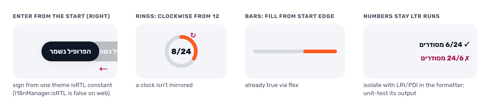

- Directional motion enters from the _start_ (right in Hebrew). Sign translateX from one `isRTL` constant in theme (the app is Hebrew-only); `I18nManager.isRTL` is always false on react-native-web.
- Rings fill clockwise from 12 in both directions (a clock isn't mirrored); bars fill from the start edge (already true via flex).
- Numbers in Hebrew text ("6/24", "₪120") must not flip to "24/6". A nested `<Text>` doesn't isolate bidi on Android or web: the formatter wraps mixed runs in LRI/PDI (U+2066/U+2069). Unit-test its output.
- `Icon.tsx` already draws `back` and `arrowEnd` for RTL, so don't flip them at runtime; new directional glyphs are drawn the same way. The checkmark and the logo never flip.

## Dev gallery (`/dev/components`)

Today: one unlabeled scroll, `__DEV__` only, missing Sheet, Toast, DateField and every non-default state.

1. **Sections** with `SectionHeader`: Foundations (colors with contrast pairs, type, spacing, radius, elevation, motion), Actions, Inputs, Display, Feedback, Layout; a jump list on top.
2. **States side by side**: default / pressed / disabled / focused / loading / empty, plus long-text and LTR-name cases.
3. **Breakpoint toggle**: phone / tablet / desktop frames on one page.
4. **Reduced-motion toggle** overriding the hook.
5. **On the dev stage**: gate on `EXPO_PUBLIC_STAGE !== 'production'`, not `__DEV__`. No link from the app.
6. **`theme.contrast.test.ts`** asserts the text pairs above stay ≥ 4.5 and graphic pairs ≥ 3.

## PR plan

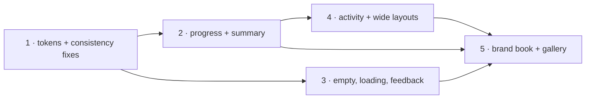

Each PR updates `tokens.json` → theme → DESIGN.md → gallery together and runs lint, typecheck, unit tests and the e2e smoke.

| PR  | Title                                             | Scope                                                                                                                                       | Unblocks                                 | Size |
| --- | ------------------------------------------------- | ------------------------------------------------------------------------------------------------------------------------------------------- | ---------------------------------------- | ---- |
| 1   | `refactor(ui): v2.1 tokens and consistency fixes` | All new tokens, the contrast fixes, every consistency fix except Cover scenes, `IconButton`, `SectionHeader`, contrast test. No visual change beyond the fixes. | everything                               | M    |
| 2   | `feat(ui): progress and summary components`       | `ProgressRing`, animated `Progress` on `line`, `Stat`/`StatCard`, `Countdown` (+ date tests), `Pill`, `AvatarStack` label/press, `useReducedMotion`. | home-and-trip PR 1 (readiness), PR 2 (home hero) | M |
| 3   | `feat(ui): empty, loading and feedback states`    | `EmptyState` v2, `Skeleton`, `Toast` v2, `Callout`, `TemplateTile`, Cover scene tokens + spots.                                             | home-and-trip PR 2, PR 4; onboarding     | M    |
| 4   | `feat(ui): activity item and wide layouts`        | `ActivityItem`, `CardGrid`, `SidePanel`, `Stepper`; migrate home and new-trip grids.                                                         | home-and-trip PR 3                       | S–M  |
| 5   | `docs(design): v2.1 brand book and gallery`       | DESIGN.md v2.1 sections, README token table, gallery restructure + stage gating.                                                            | review of all of the above               | S    |

2 and 3 can run in parallel. The DESIGN.md text can ride along in each PR instead; the gallery restructure is best done once, early (PR 5 or folded into PR 1).

## Open questions

| #   | Question                                                         | Recommendation                                                                                                   |
| --- | ---------------------------------------------------------------- | ---------------------------------------------------------------------------------------------------------------- |
| Q1  | A second shadow (`raised`) when v2 says "only the FAB"?          | **Yes, floating layers only** (Toast, scrolled side panel). Cards stay flat.                                      |
| Q2  | Keep the pale per-person avatar colors or go back to one?        | **Keep, as tokens.** Telling people apart is the point of stacks and feeds; all pass 13.6:1. Update the README.  |
| Q3  | `danger` PillButton is orange: an exception?                     | **No: `ink` + trash icon.** The sheet copy already makes it a confirmation.                                      |
| Q4  | Darken `inkFaint` or use `inkMuted` for placeholders?            | **Darken to `#687080`.** Placeholders must still look lighter than typed text.                                   |
| Q5  | Progress track `line` (fill contrast 2.9 → 2.2)?                 | **Yes, with the count always shown.** No orange/gray pair reaches 3:1 anyway; today's 0% bar is invisible.        |
| Q6  | Gallery on the deployed dev stage?                               | **Yes, non-production only.** Cheapest way to review on real devices; no data access.                             |
| Q7  | Skeletons or spinners?                                           | **Skeletons** for home, trip, profile; keep the spinner for the join link, whose shape is unknown.                |
| Q8  | Compact density on desktop?                                      | **No.** Use width (CardGrid, SidePanel). Revisit if desktop use grows.                                            |
