# UI plan: from thin to full

Design plan, 2026-10-25. One plan for making Yallist feel full: home, trip, join, states, content and the system pieces under them. Replaces three overlapping drafts (#63 home and trip, #65 design system v2.1, #66 onboarding and content) and answers both reviews on #65. Inputs: [DESIGN.md](../DESIGN.md), `apps/mobile/src`, research #51, fix list #67, Maestro testIDs from #72 and #75.

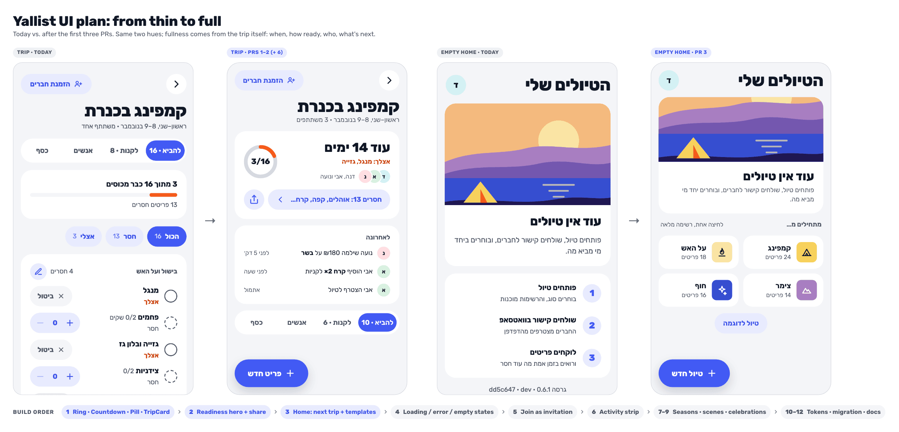

**One fixture trip** in every "after" frame and every sentence: קמפינג בכנרת, 8–9 בנובמבר, 16 items (10 להביא, 6 לקנות), 3 covered, חסרים 13 (אוהלים, קפה, קרח…), 3 people (דנה = you, אבי, נועה), אצלך 2 (מנגל, גזייה). Second card: על האש בפארק, 11/18, 4 people. "Before" frames are the live dev site, where the trip is solo.

## Why it feels empty

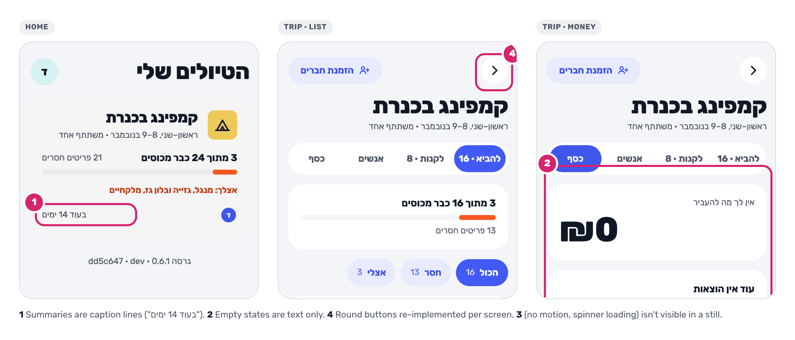

| Cause                                                      | Fix                                                                |
| ---------------------------------------------------------- | ------------------------------------------------------------------ |
| Countdown, readiness and "my part" are buried in captions  | Readiness hero on the trip, next trip first on home (PRs 2, 3)     |
| The loop lives in the group chat, but nothing goes there   | "Share what's missing" to WhatsApp from the hero (PR 2, #51 P0)    |
| Nothing shows other people acting                          | Activity strip, avatars in their own colors (PRs 1, 6)             |
| Empty states explain instead of offering one tap           | Template tiles, suggestion chips, illustrated `EmptyState` (3, 4)  |
| Loading, errors and the join page were never designed      | Skeleton, Loader, state spots, join as an invitation (4, 5)        |
| Thin content: 4 templates, no season, "בקרוב" placeholders | Seasonal catalog, notes, microcopy, no "בקרוב" (4, 7, 8)           |
| Nothing reacts when you finish something                   | Three celebrations, ring/bar motion, haptics (9)                   |

## Where warmth comes from

No new UI hues, no gradients. Personality lives in five places only:

| Source                    | Where it shows                                                                       | Rule                                                       |
| ------------------------- | ------------------------------------------------------------------------------------ | ---------------------------------------------------------- |
| Illustration scenes/spots | Trip card cover, join card, `EmptyState` spot, new-trip preview, success `Toast`     | `illustration.scenes.<id>` palette only, one warm light    |
| Per-person avatar colors  | `AvatarStack`, activity strip, join "already in", money                              | Pale `avatar.*` fill, `ink` initial (≥ 13:1)               |
| Orange progress           | `ProgressRing`, `Progress`, done checks                                              | Graphics only; the count text always carries the value     |
| Celebrations + haptics    | All covered, everyone settled, trip-day morning; light haptic on claim and "packed"  | Three milestones, once per device; off with reduced motion |
| Copy                      | Loader lines, empty/404/pending states, tips, celebration lines                      | Dry humor only where nothing is at stake; never money/data |

## Build order

Visible first, cleanup last. Every PR: lands after #72 and #75, runs unit tests + the Maestro flows, forwards `testID` through any new wrapper, and is accepted on **before/after screenshots** at 390px and 1280px of the scenes listed.

| #   | PR                                                         | You'll see                                                                  | Needs        |
| --- | ---------------------------------------------------------- | --------------------------------------------------------------------------- | ------------ |
| 1   | `feat(ui): progress ring, countdown, pills, trip card`     | Trip cards with a cover, "עוד 14 ימים", a 3/16 ring, "חסרים 13" / "אצלך 2" | —            |
| 2   | `feat(app): trip readiness hero and share`                 | Trip opens on "עוד 14 ימים", the ring, "חסרים 13: אוהלים…" and a WhatsApp share | 1            |
| 3   | `feat(app,api): next trip and template tiles on home`      | Home leads with the next trip's missing names; empty home offers 4 one-tap templates | 1            |
| 4   | `feat(app): designed loading, error and empty states`      | Skeletons instead of spinners; illustrated empties, 404, offline; no "בקרוב" | 1            |
| 5   | `feat(api,web): join page as an invitation`                | Join shows the scene, who invites, faces, what's missing                    | 4            |
| 6   | `feat(api,app): recent activity strip`                     | "נועה שילמה ₪180 על בשר · לפני 5 דק׳" under the hero                        | 2            |
| 7   | `feat(domain,api): seasonal template catalog`              | 6 Israeli seasonal templates with quantity notes                            | — (any time) |
| 8   | `feat(app): scenes and season-aware new trip`              | "עכשיו בעונה" row, 11 scenes, real item chips in the preview                | 7            |
| 9   | `feat(app): celebrations, motion and haptics`              | Ring fills on claim; "הכול מכוסה. נשאר רק לצאת."                            | 2            |
| 10  | `refactor(ui): v2.1 tokens, no pixel changes`              | Nothing (by design); contrast test                                          | 1            |
| 11  | `refactor(ui): migrate screens to v2.1`                    | Unified fields, focus rings, 44px targets, contrast fixes                   | 10           |
| 12  | `docs(design): DESIGN.md v2.1 and gallery`                 | Gallery on the dev stage, sections, states                                  | 11           |
| —   | `feat(app): sample trip` (optional, Q3)                    | "טיול לדוגמה" opens a read-only demo                                        | 3, 7         |

1 → 2 → 3 is the critical path; 4, 6, 7 and 10 can run beside it.

**Status (2026-10-27):** 1 (#92), 2 (#98), 3 (#97) and 4 (#107) are done; 5–12 are not started.

### 1. Progress ring, countdown, pills, trip card

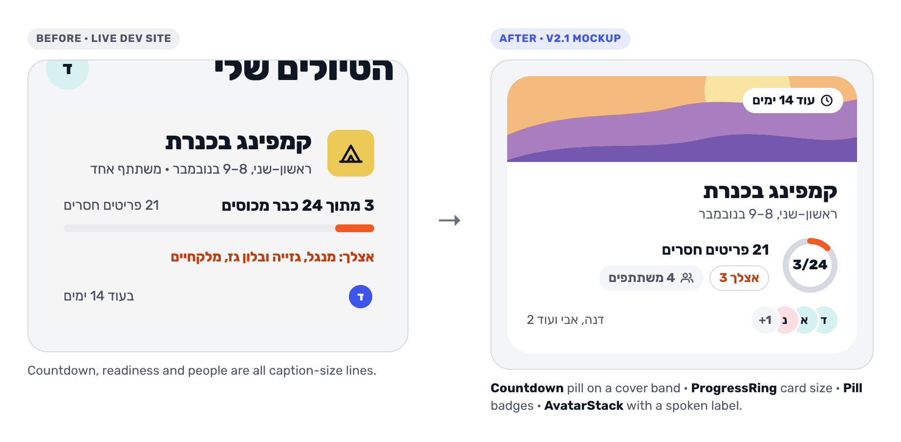

- **Scope:** `ProgressRing`, `Countdown` (+ phase logic and a `useToday()` hook in `lib/dates` that refreshes on focus and `AppState` active, so "היום" is never stale), `Pill`, `Stat`. **One `TripCard`** for every trip: `Cover` band 88 + countdown `Pill` (onCover) + ring `card` + "חסרים 13" / "אצלך 2" pills + `AvatarStack`. `toAvatar` keeps `member.color` (the API already sends it, `dal/trips.ts`), so avatars get their colors here. Tokens: `size.ring`, `size.spot`, `type.stat`, `motion.*`, `avatarSize`, progress track `line`, `isRTL`, `lib/bidi`. `Cover` crops anchor on the scene's focal point (camp: the tent), not the center.
- **Files:** `components/{ProgressRing,Countdown,Pill,Stat}.tsx`, `components/{Cover,Avatar}.tsx`, `theme/index.ts`, `docs/design/tokens/*`, `lib/{dates,bidi}.ts`, `features/home/TripCard.tsx`, `features/trip/derive.ts`, `app/dev/components.tsx`
- **testIDs:** None changed.
- **Verify:** RN `Animated` on `react-native-svg` needs `Animated.createAnimatedComponent(Circle)` and `useNativeDriver: false` (`strokeDashoffset` is not a native-driver prop); check it on react-native-web first, fallback = a CSS transition on web. Rubik ships `tnum` (checked in the bundled TTFs), so `type.stat` uses `fontVariant: ['tabular-nums']`. `expo export -p web` gzip size before/after in the PR body (Reanimated is installed but not yet bundled).
- **Accept:** Home with 2 trips (phone, desktop).

### 2. Trip readiness hero and share

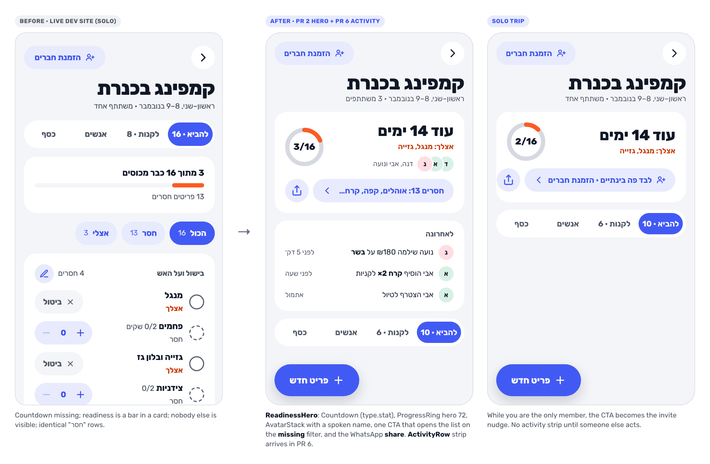

- **Scope:** `ReadinessHero` above the tabs: countdown (`type.stat`), ring "3/16", `AvatarStack` with a spoken label, "אצלך: מנגל, גזייה" (`brandStrong`), one tonal CTA "חסרים 13: אוהלים, קפה, קרח…" and a **share** `IconButton`. Phases: before / tomorrow / today / during ("יום 1 מתוך 2") / after (settle-up line) / all covered. Solo trip: CTA becomes "לבד פה בינתיים · הזמנת חברים". Desktop: hero moves into the existing side panel. Deletes `ProgressCard`.
- **Missing filter:** no URL param. ListTab's filter is local state today and `[tripId]/index.tsx` clears params on focus, so the trip screen owns `tab` + `filter` state (lifted from `ListTab`), and the CTA sets tab = the list with more missing items, filter = `missing`.
- **Share what's missing** (#51 P0): `lib/share.ts` builds the text and opens `https://wa.me/?text=` (Q7). Text: `חסרים לקמפינג בכנרת (8–9 בנובמבר): אוהלים, קפה, קרח ועוד 10. מי מביא? {invite link}`; up to 5 names, then "ועוד N"; all covered → "הכול מכוסה לקמפינג בכנרת 🎉 {link}". Unit-test the formatter (bidi isolation of the date and the link).
- **Files:** `features/trip/ReadinessHero.tsx` (new), `features/trip/ProgressCard.tsx` (deleted), `app/(app)/trips/[tripId]/index.tsx`, `features/trip/ListTab.tsx`, `lib/share.ts`, `i18n/he.ts`
- **testIDs:** Keep `trip-title`, `trip-tab`, `trip-add`. New: `trip-hero-missing`, `trip-hero-share`, `trip-hero-invite`.
- **Accept:** Solo trip (phone); trip with 3 people (desktop).

### 3. Next trip and template tiles on home

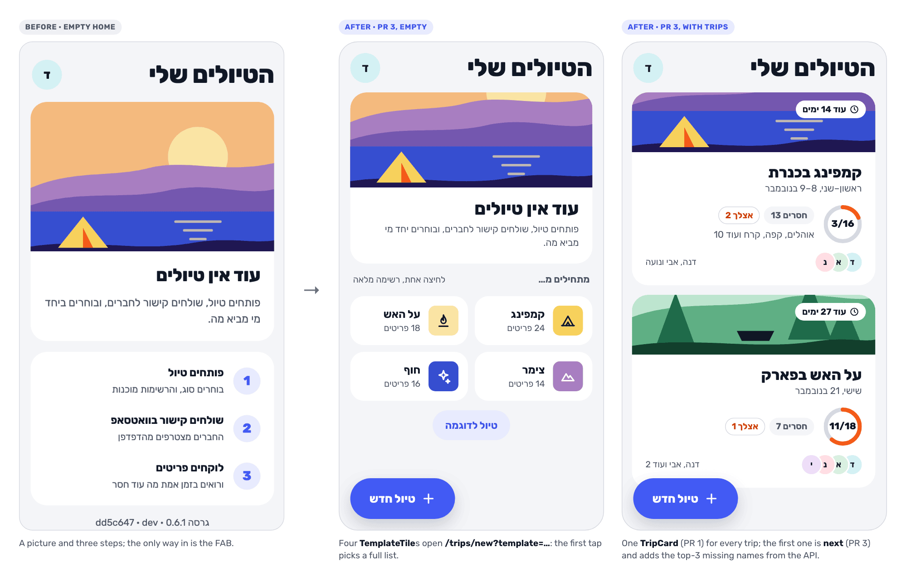

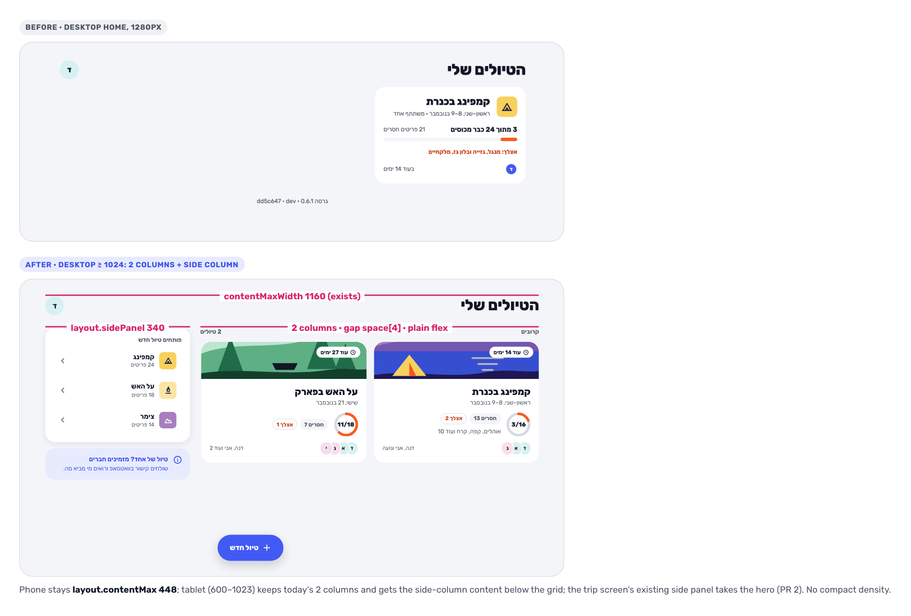

- **Scope:** The first upcoming `TripCard` gets `next`: a line with the top-3 missing names from `missingNames` on `GET /trips`. Same card, same layout, nothing else changes. Empty home: four `TemplateTile`s under the steps ("מתחילים מ…") opening `/trips/new?template=…`. Desktop (≥ 1024): 2 card columns + a 340 side column (template tiles, invite `Callout`) instead of today's 3 columns; tablet (600–1023) keeps today's 2 columns and gets the side-column content below the grid. Plain flex rows in `index.tsx`, no `CardGrid`/`SidePanel`.
- **Files:** `features/home/TripCard.tsx`, `components/TemplateTile.tsx` (extracted from `trips/new.tsx`), `app/(app)/index.tsx`, `app/(app)/trips/new.tsx` (`?template=`), `apps/api` trips route + test
- **testIDs:** Keep `home-new-trip`, `home-profile`; `new-trip-template-<id>` moves into `TemplateTile` and must be forwarded. New: `home-template-<id>`, `home-next-trip`.
- **Accept:** Empty home (phone); desktop and tablet home with 2 trips.

### 4. Designed loading, error and empty states

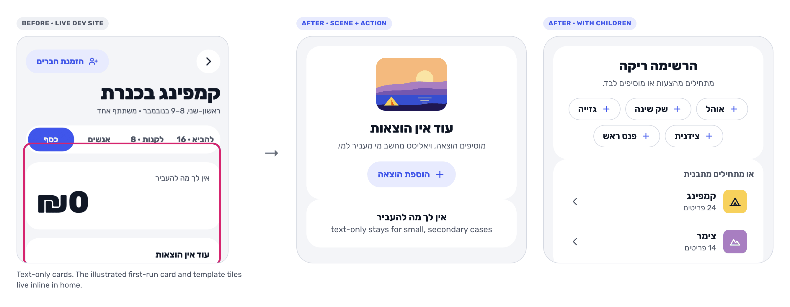

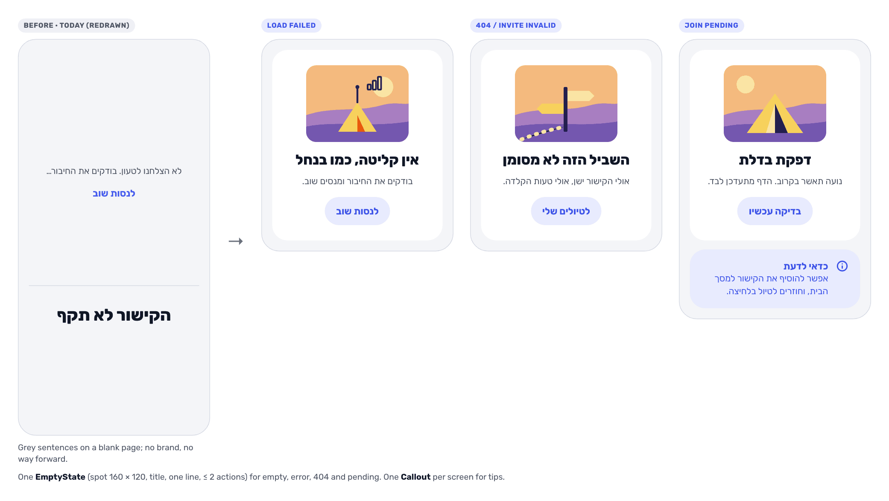

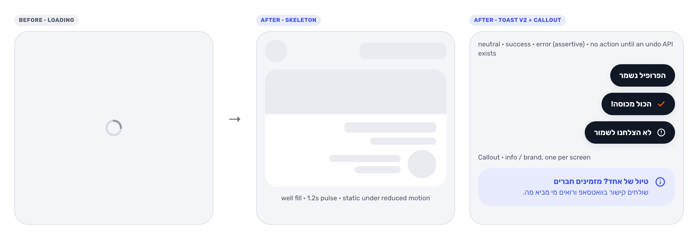

- **Scope:** `EmptyState` v2 (spot, ≤ 2 actions, `children`) for the list ("אצלי" empty, suggestion chips), money, load failed (`noSignal`), 404 and invite invalid (`signpost`), join pending (`tentDoor`). `Skeleton` (home, trip, profile) replaces the `ActivityIndicator`s. `Loader` (Check-Y draw) for full-screen waits only: app boot and the join preview; appears after 300ms, one copy line after 2s. `Callout` for tips (new trip, empty money, join pending) and to replace profile's three "בקרוב" switches ("התראות בדרך"). `Toast` tones neutral/success/error, `polite` except errors; **no action** (retry or undo) until an undo API exists. Microcopy library applied.
- **Files:** `components/{EmptyState,Skeleton,Loader,Callout,Toast}.tsx`, `components/Cover.tsx` (3 spots), `features/trip/{ListTab,MoneyTab}.tsx`, `app/+not-found.tsx`, `app/(app)/{index,profile}.tsx`, `app/(app)/trips/[tripId]/index.tsx`, `app/j/[token].tsx`, `i18n/he.ts`
- **testIDs:** Keep `profile-title`. New: `empty-state-action`. Loading screens get `loading` on the Skeleton container so flows can wait on its absence.
- **Accept:** Home loading; trip with the "אצלי" filter empty; 404; profile.

### 5–9, briefly

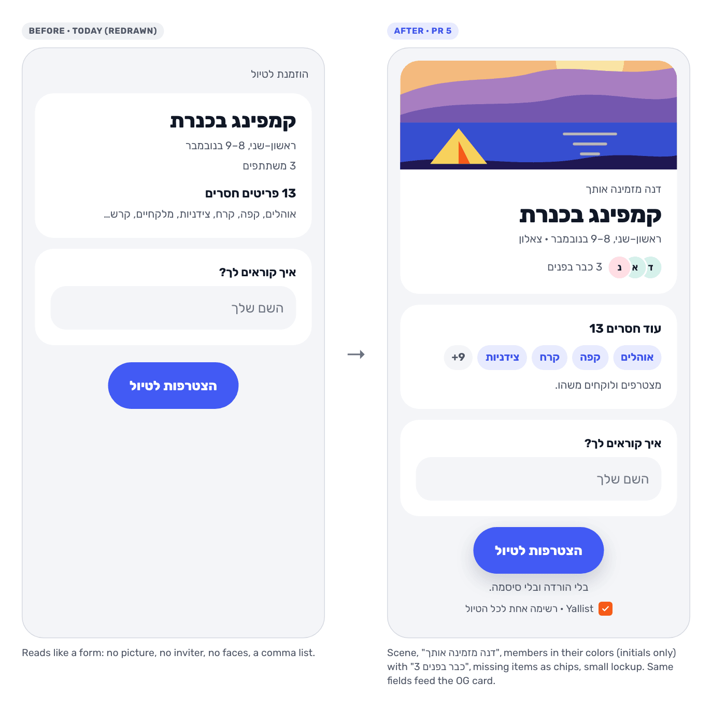

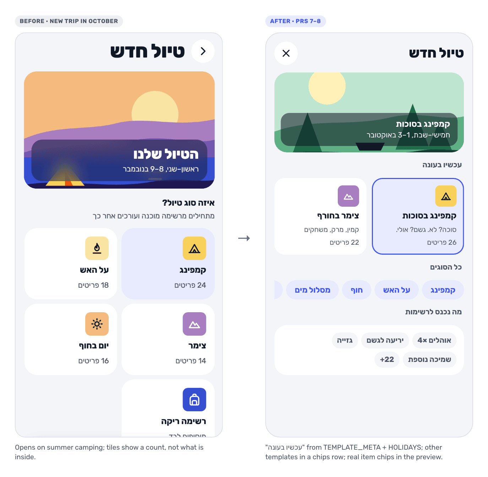

| #   | Scope                                                                                                                                                                                                                                                                                                                                                                                                                                                                                                                                                                                                      | testIDs                                    | Accept (before/after)      |
| --- | ---------------------------------------------------------------------------------------------------------------------------------------------------------------------------------------------------------------------------------------------------------------------------------------------------------------------------------------------------------------------------------------------------------------------------------------------------------------------------------------------------------------------------------------------------------------------------------------------------------- | ------------------------------------------ | -------------------------- |
| 5   | Join: illustrated card with the scene, "דנה מזמינה אותך", `AvatarStack` (≤ 5 initials + colors, "{n} כבר בפנים" only when n ≥ 2), missing items as chips, small lockup. API: `GET /invites/:token` adds `template`, `placeText`, `organizerName`, `members` (initial + color only). Same fields feed the OG card.                                                                                                                                                                                                                                                                                         | none today; new `join-name`, `join-submit` | Join (phone), join pending |
| 6   | **API:** `claim_set` payload gains `name` and `list` (`routes/items.ts:174`); `item_*` rows already carry `name`. `GET /trips/:id/activity?limit=5` (first slice of the Phase 6 route) returns `{ id, type, actor: { userId, displayName, color }, payload, createdAt }`, newest first, **bursts collapsed server-side** (same actor + type within 10 min → one entry with `count` and up to 3 names), rows without a `name` skipped. **App:** `ActivityRow` phrases in `he.activity` ("אבי הוסיף 3 פריטים לקניות"); strip = 3 rows under the hero, 5 in the desktop panel; hidden until someone _else_ acted. Query key `[...tripKey(id), 'activity']`, so every existing `invalidateQueries({ queryKey: tripKey(id) })` (mutations, join, receipts) refreshes it by prefix. | new `trip-activity`                        | Trip with 3 people         |
| 7   | Templates `pesach`, `sukkot`, `bonfire`, `beachCamp`, `winterZimmer`, `nahal` + `note` hints, `TEMPLATE_META`, static `HOLIDAYS` 2026–2029, `QUICK_SUGGESTIONS` ×10. Widening `TemplateId` touches every exhaustive site in the same PR: domain `TEMPLATES`, API `TEMPLATE_IDS` (`trips.template`, `template_items.template`, the `z.enum` in `routes/trips.ts`), mobile `TripTile` `TILES`, `he.newTrip.templates` / `previews`, and `Cover` via a new `sceneFor(template)` map so `Scene` stays at 5 until PR 8. Migration `0005_seasonal_templates.sql`: drop and recreate `trips_template_check` with the 11 ids, add `template_items.note text`; `migrate.ts` already reseeds `template_items` from `TEMPLATES` on every run. Item lists, notes, scenes, microcopy and tips: [#66 content plan](https://github.com/nadavgihasi/yallist/blob/49be4c90aec3dd235fa06dde7291c24892a32231/docs/design/plans/onboarding-and-content.md#content-plan). | none                                       | n/a (content; unit tests)  |
| 8   | 6 new scenes (`Scene` = `TemplateId`, `sceneFor` deleted), `illustration.scenes.*` tokens for all 11, "עכשיו בעונה" row + "כל הסוגים" chips, item chips in the preview, holiday caption, name placeholder = template name. Back chevron at the start, like every pushed screen; × is for sheets only.                                                                                                                                                                                                                                                                                                       | `new-trip-template-<id>` kept              | New trip in October        |
| 9   | Ring/bar/StatusRing animate (`motion.base`), counts tick, `Celebration` (Check-Y burst in `illo-*`, ≤ 1.2s, 3 milestones, once per device: AsyncStorage key `yallist/celebrated` = `{ "<tripId>:<milestone>": true }`), `expo-haptics` via `lib/haptics.ts` + `lib/haptics.web.ts` (no-op, so it never enters the web bundle; `android.yml` prebuilds, so autolinking is fine, new APK). CI Maestro is web-only: haptics are checked by hand on the APK.                                                                                                                                                  | none                                       | All-covered moment (video) |

### 10–12, cleanup

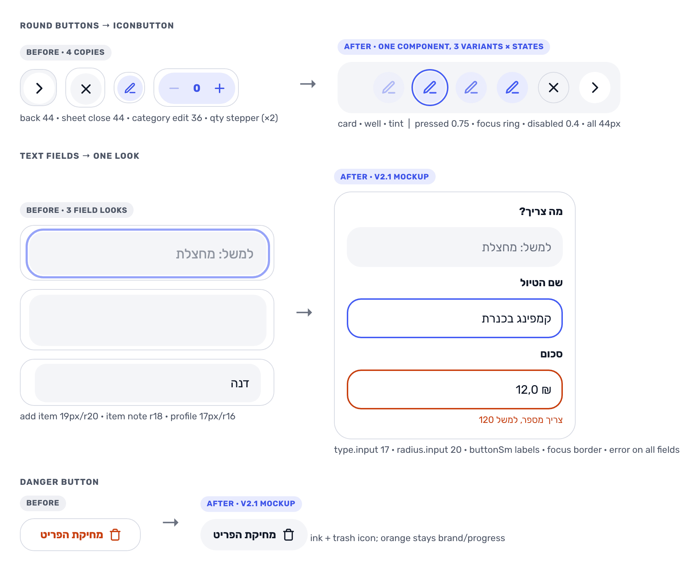

| #   | Scope                                                                                                                                                                                                                                                                                                                                                                                                                                                                                      |
| --- | ------------------------------------------------------------------------------------------------------------------------------------------------------------------------------------------------------------------------------------------------------------------------------------------------------------------------------------------------------------------------------------------------------------------------------------------------------------------------------------------ |
| 10  | Remaining tokens with old values kept, so no pixel moves: `well`, `selected`, `overlay`, `avatar.*`, `size.icon`, `radius.chip/inner`, `type.micro/input`, `opacity.*`, `layout.column/sidePanel`, `focusRing`. `theme.contrast.test.ts` reads `tokens.json` and asserts the pairs below; the four token copies stay in sync.                                                                                                                                                              |
| 11  | Per-screen migration: `IconButton` (44 only; replaces back ×3 (new, trip, profile), `sheet-close`, the receipt viewer's close (`hitSlop={8}` today), category edit), `SectionHeader`, `Stepper` (ClaimStepper + qty row), `radius.input` 16→20, inputs 17px, darker `inkFaint`, opacity tokens, focus rings, a11y fixes table. Forward every #72 and #75 testID: `sheet-close`, `item-form-name`, `item-form-save`, `item-claim`, `item-release`, `item-edit`, `item-delete`, `expense-receipt`, `receipt-choose`, `receipt-delete`, `receipt-image`, `receipt-thumb`. Full Maestro run. |
| 12  | DESIGN.md v2.1 (motion, data viz, RTL, warmth, humor rule), README token table, gallery with sections + states, reachable when `EXPO_PUBLIC_STAGE !== 'production'`. 200% text: react-native-web ignores the OS font scale and `maxFontSizeMultiplier`, so the large-text check is a device run (Android, font size at max) with screenshots in the PR, not a gallery state.                                                                                                                  |

## One vocabulary

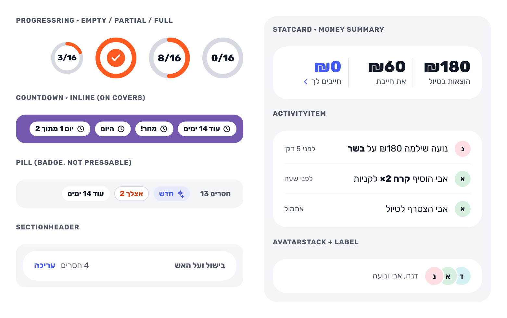

### Components

| Name                                     | Is                                                                                                      | Replaces / merges                               | PR  |
| ---------------------------------------- | ------------------------------------------------------------------------------------------------------- | ----------------------------------------------- | --- |
| `ProgressRing`                           | SVG ring, `hero` 72 / `card` 56; label inside; `progressbar` role with value                            | —                                               | 1   |
| `Countdown`                              | Formatter + Text; `hero` (`type.stat`) or `inline` (a `Pill`)                                           | countdown captions                              | 1   |
| `Pill`                                   | Non-interactive badge, `minHeight` 28, tones `neutral`/`primary`/`brand`/`onCover`                      | `[itemId]` status chip                          | 1   |
| `Stat`                                   | Value (`type.stat`) + label (`caption`); a row of them goes in a plain `Card`                           | `StatCard` (cut)                                | 1   |
| `TripCard`                               | Cover band + countdown pill + ring + pills + avatars; `next` adds the top-3 missing names               | `NextTripCard` (#63, cut: same card)            | 1/3 |
| `ReadinessHero`                          | Feature card on the trip, with the share button                                                         | `ProgressCard`                                  | 2   |
| `TemplateTile`                           | `TripTile` + name + meta                                                                                | inline tiles in `trips/new.tsx`                 | 3   |
| `EmptyState`                             | Optional spot (scene crop or state spot), title, one line, ≤ 2 actions, `children` (chips, tiles)       | `EmptyState` v2 (#65) **and** `StateCard` (#66) | 4   |
| `Skeleton`                               | `.Line`, `.Circle`, `.Card`; `well` fill; pulse off with reduced motion; one "טוען" label per container | `ActivityIndicator` in screens                  | 4   |
| `Loader`                                 | Check-Y check-stroke draw; full-screen waits only                                                       | spinner on boot and join                        | 4   |
| `Callout`                                | Card variant, `info` (`primaryTint`) or `brand`; optional dismiss "הבנתי"; one per screen               | `Callout` (#65) **and** `TipCard` (#66)         | 4   |
| `Toast`                                  | Tones `neutral`/`success`/`error`; `shadow.float`; no action until an undo API exists                   | `Toast` v2 action (dropped)                     | 4   |
| `ActivityRow`                            | Avatar `sm` + sentence + relative time                                                                  | `ActivityItem` (#65) = `ActivityRow` (#63)      | 6   |
| `Celebration`                            | Check-Y burst + success toast                                                                           | —                                               | 9   |
| `IconButton`, `SectionHeader`, `Stepper` | 44px only; header with optional text action (44px tall); merged stepper                                 | 5 round buttons, 3 headers, 2 steppers          | 11  |
| ~~`CardGrid`, `SidePanel`~~              | Cut: home and trip already lay out columns; revisit if a third screen needs them                        | —                                               | —   |

### Tokens

| Token                                      | Value                                                                                | PR     |
| ------------------------------------------ | ------------------------------------------------------------------------------------ | ------ |
| `size.ring`                                | `hero` 72, `card` 56, `status` 28                                                    | 1      |
| `size.spot`                                | 160 × 120 (4:3 crop of a scene, or a state spot)                                     | 1      |
| `type.stat`                                | 28/32 extraBold, `tabular-nums`                                                      | 1      |
| `motion`                                   | `fast` 150, `base` 250, `slow` 400, `celebrate` 1200 ms; `easing.out` (0.2, 0, 0, 1) | 1      |
| `progress.fill` / `progress.track`         | `brand` / `line`                                                                     | 1      |
| `isRTL`                                    | `true` (constant; the app is Hebrew-only)                                            | 1      |
| `avatarSize`                               | `xs 24, sm 28, md 32, lg 44, xl 56, xxl 96` (profile); `size.avatar` stays 44 until PR 11 removes it | 1      |
| `illustration.scenes.<id>`                 | ≤ 6 colors per scene; base `illustration` stays the camp scene                       | 4 (spots), 8 |
| `avatar.*`                                 | The 7 pale colors, moved from `@yallist/domain` (domain keeps an id)                 | 10     |
| `well`, `selected`, `overlay`              | = `ground`, = `primaryTint`, `rgba(16,23,37,0.55)`                                   | 10     |
| `radius.input`                             | 16 → 20 in PR 11 (no `radius.field`); `radius.inner` 16; `radius.chip` = pill        | 10/11  |
| `type.micro` / `type.input`                | 13/18 (metadata only) / 17/24; labels use `buttonSm` (no `type.label`, same values)  | 10     |
| `opacity`                                  | `disabled` 0.4, `pressed` 0.75, `hover` 0.85                                         | 10     |
| `focusRing`                                | 2px `primary`, offset 2, on the `focused` state                                      | 10     |
| `layout`                                   | `contentMax` 448, `column` 640, `sidePanel` 340; page width stays `contentMaxWidth` 1160 in `theme/breakpoint.ts` | 10     |
| `inkFaint`                                 | `#8B93A1` → `#687080`                                                                | 11     |

### Conflicts resolved

| Topic               | #63              | #65                         | #66                        | Decision                                                                              |
| ------------------- | ---------------- | --------------------------- | -------------------------- | ------------------------------------------------------------------------------------- |
| Empty / error card  | —                | `EmptyState` v2             | `StateCard`                | One `EmptyState` (keeps today's name, no rename churn)                                |
| Tip card            | —                | `Callout`                   | `TipCard`                  | `Callout` with optional dismiss                                                       |
| Skeleton fill       | —                | `well`                      | `line` @ 40%               | `well`: a named token, no alpha                                                       |
| Illustration tokens | —                | `illustration.<scene>.*`    | `illustration.scenes.<id>` | `illustration.scenes.<id>`; base set unchanged                                        |
| Spot size           | —                | 120 × 90                    | 160 px                     | `size.spot` 160 × 120                                                                 |
| Scenes              | 5                | 5                           | +6 scenes, +3 spots        | 11 scenes + 3 spots (`noSignal`, `signpost`, `tentDoor`)                              |
| Trip card           | `NextTripCard`   | `TripCard`                  | —                          | One `TripCard`; `next` only adds the missing names                                    |
| Join loading        | —                | spinner (Q7)                | `Loader`                   | `Loader` (shape unknown until the invite loads)                                       |
| New type style      | none             | `type.stat`                 | none                       | Add `type.stat` only: the hero countdown at `pageTitle` (36) crowds the ring at 390px |
| New shadow          | none             | `shadow.raised`             | none                       | None: Toast reuses `shadow.float` (it floats too); side panel stays flat              |
| Ring track          | `ground`         | `line`                      | —                          | `line`: visible at 0%; the count text carries the value                               |
| Ring timing         | needs it in PR 1 | lands in PR 2               | —                          | Lands in PR 1, before any refactor                                                    |
| Animation lib       | Reanimated       | Reanimated                  | —                          | RN `Animated` first; Reanimated only if a measured need beats its web bundle cost     |
| Avatar colors       | —                | keep (Q2)                   | colors on join             | Keep; the API sends `color`, `toAvatar` passes it from PR 1                           |
| `danger` button     | —                | `ink` + trash icon          | —                          | `ink` + trash icon; orange stays brand/progress                                       |
| Gallery             | —                | breakpoint + motion toggles | gallery in B               | Sections, states, stage gating; no toggles; 200% text on a device                     |
| Density             | —                | no compact mode             | —                          | No compact mode                                                                       |

## Rules

- **RTL.** `I18nManager.isRTL` is `false` on react-native-web, so nothing reads it: use the `isRTL` constant from theme. Directional motion enters from the start: `translateX` sign = `isRTL ? 1 : -1` × distance. Bars fill from the start (flex already does). Rings fill clockwise from 12 o'clock (clocks don't mirror).
- **Icons.** Glyphs in `Icon.tsx` are drawn for RTL (`back` points right, `arrowEnd` points left). Never flip at runtime. Checkmark and the Check-Y never flip. In buttons and chips the icon sits at the start (right). Pushed screens get a back chevron at the start; × only on sheets and the receipt viewer.
- **Numbers in Hebrew.** `formatShekel` puts ₪ first ("₪180") everywhere, including sentences. A bare "6/24" or "₪120" is fine (bidi rule W4). When a number run sits inside a Hebrew sentence with other neutrals ("6/24 מכוסים · 3 אנשים"), `lib/bidi.ltr()` wraps it in LRI…PDI (U+2066…U+2069). Unit-test the formatter's string output; nested `<Text>` does not isolate.
- **Text size.** Hints and errors use `caption` (14); `type.micro` (13) is for metadata only (timestamps, payer name). `maxFontSizeMultiplier` 1.3 on `bigNumber`, `stat`, `pageTitle` (native only; RNW ignores it). Pills, chips, buttons use `minHeight`, never `height`.
- **Touch targets.** 44px real boxes (`minWidth`/`minHeight` or padding). `hitSlop` does nothing on web, so it never counts.
- **Motion.** One `useReducedMotion()` hook; reduced = durations 0, celebrations become copy only.
- **Screen readers.** `AvatarStack` has a name ("דנה, אבי ונועה"). `Skeleton` labels its container once. Check TalkBack and a web reader for Skeleton and the Toast `aria-live` mapping in PR 4.
- **Out of scope.** Dark mode (static `colors` in `StyleSheet.create` makes it a later migration), carousels, charts beyond ring and bar, streaks, badges, invented social proof.

## Accessibility fixes (PR 11 unless noted)

| Pair                                                | Today       | Fix → result                                   |
| --------------------------------------------------- | ----------- | ---------------------------------------------- |
| FilterChip count `primaryStrong` @ 0.8 on tint      | 3.51        | No opacity → 4.93                              |
| FilterChip count white @ 0.8 on `primary`           | 3.95        | No opacity → 5.25                              |
| `brand` fill on `ground` / `line` track             | 2.86 / 2.21 | Count always shown next to the bar/ring (PR 1) |
| `inkFaint` placeholder on `ground` / `card`         | 2.84 / 3.09 | `#687080` → 4.57 / 4.98                        |
| Switch off track `line` on `card`                   | 1.41        | Track `inkFaint` (new) → 4.98                  |
| Cover caption: white @ 0.9 on 0.45 overlay over sun | **3.19**    | `overlay` 0.55, no text opacity → 4.74 (PR 1)  |
| `primary` on `primaryTint` (step numerals, 19/800)  | 4.44        | Keep (large text)                              |
| `brandStrong` on `ground`                           | 4.59        | Keep; "אצלך" stays on cards                    |

Both #65 reviews are answered point by point in the [#76 discussion](https://github.com/nadavgihasi/yallist/pull/76).

## Open questions

| #   | Question                                                                               | Recommendation                                                                                   |
| --- | -------------------------------------------------------------------------------------- | ------------------------------------------------------------------------------------------------ |
| Q1  | Countdown on the hero: `type.stat` (28) or `pageTitle` (36)?                           | `type.stat`; the trip title keeps `pageTitle`                                                    |
| Q2  | Pull the activity endpoint (PR 6) ahead of Phase 6?                                    | Yes, as the first slice of the same route                                                        |
| Q3  | Sample trip: build it, client-only and read-only?                                      | Yes, after PR 3 and 7, only if testers still stall on an empty home                              |
| Q4  | `expo-haptics` (new native dep, new APK) in PR 9?                                      | Yes                                                                                              |
| Q5  | Join page shows organizer first name + member initials/colors to anyone with the link? | Yes; nothing more                                                                                |
| Q6  | Seasonal templates as real `TemplateId`s (DB migration)?                               | Yes                                                                                              |
| Q7  | "Share what's missing": where, and through what?                                       | In the hero next to the missing CTA (visible without scrolling); `wa.me/?text=` on every platform, since #51's loop is the group chat. The system share sheet (what the invite link uses) is the fallback if WhatsApp isn't installed |
| Q8  | Land PR 7 (catalog) and PR 8 (scenes, new-trip UI) as one PR?                          | No: 7 maps new templates to existing scenes with `sceneFor`, so each PR stays a day and 7 can land any time |
