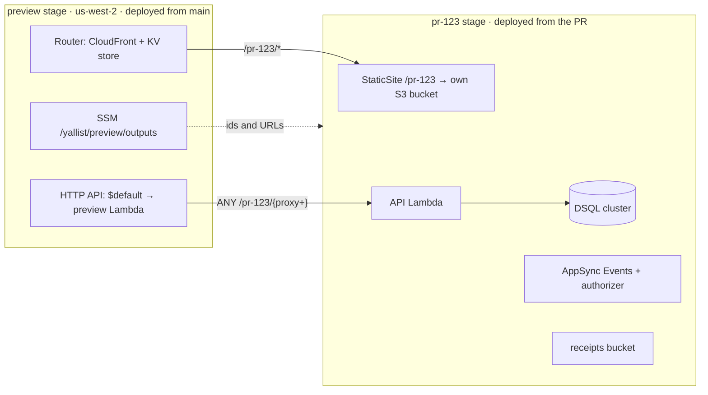

# PR preview environments and live e2e tests

**Status:** built in #91 (base path), #93 (infra), #94 (workflows) and the docs PR, and running since the first preview (pr-108). [Measured](#measured) has the first runs' numbers; [As built](#as-built) lists where the code differs from this design. Replaces the earlier "fresh AWS stage per run" design (2026-10-25), which created CloudFront, DSQL and AppSync on every run and gave nothing to click on before merging.

## Summary

- Every PR from this repo gets a **live environment on real AWS** at `https://<preview-cdn>/pr-<n>/`, with its own API Lambda, DSQL cluster, realtime API and receipts bucket. It's created on open, updated on every push, posted as a sticky PR comment, and removed on close or **6 hours** after the last push.
- The slow, shared pieces (CloudFront, API Gateway) are created **once** by a `preview` SST stage. A PR's `pr-<n>` SST stage only adds fast resources, so a push is live in **about 4–5 minutes** and `sst remove --stage pr-<n>` is the whole teardown.
- **Every AWS resource is in the app's SST code** (`infra/app`, one file per kind of stage, §3); nothing is created by hand or by CLI. The one thing that isn't an AWS resource, the stage's **SST passphrase and state**, is deleted by the cleanup job.
- The Maestro web flows ([ui-tests.md](ui-tests.md)) run against the preview with `WEB_URL`, which replaces the Playwright plan.
- Previews deploy with a **least-privilege OIDC role** that only this repo's `preview`-environment jobs can assume; the admin deploy role keeps its current trust ([§6](#6-security)).

## 1. Shape



- **Web:** `https://<router>/pr-123/`. The site is an SST `StaticSite` with `router: { instance: sst.aws.Router.get(...), path: '/pr-123' }`: it uploads to its own bucket and registers the prefix in the Router's KV store. SST's Router is one CloudFront behavior plus a CloudFront Function that routes by KV lookup, so a PR adds **KV entries, not cache behaviors** ([Router](https://sst.dev/docs/component/aws/router/)). The SPA fallback goes to `/pr-123/index.html` (SST's `custom404` with a route `base`).
- **API:** `https://<preview-api>/pr-123/<route>`. The PR stage adds an `aws.apigatewayv2.Integration`, a `Route` (`ANY /pr-123/{proxy+}`) and a `lambda.Permission` to the shared HTTP API; SST has no `ApiGatewayV2.get`, so these are plain Pulumi resources in the same file. The Hono app is mounted under `/pr-123`. Routes and integrations are separate AWS resources, so the `pr-123` state owns only its own; the `$default` route stays with `preview`.
- **Database, realtime and receipts** are per PR, exactly as in `dev`, so `client.ts`, `migrate.ts`, `realtime.ts` and `receipts.ts` are unchanged and the PR's own authorizer code is what gets tested. DSQL clusters create "in seconds" since Dec 2025 ([AWS](https://aws.amazon.com/about-aws/whats-new/2025/12/amazon-aurora-dsql-cluster-creation-in-seconds/)); the first rollout measures create-to-`ACTIVE`.

## 2. Shared or per PR

| Resource              | Owner     | Why                                                                                          |
| --------------------- | --------- | -------------------------------------------------------------------------------------------- |
| CloudFront (`Router`) | `preview` | Takes minutes to create. Per-PR path via KV store, shared across stages with `Router.get`.   |
| HTTP API              | `preview` | Per-PR route and integration, 300 each per API.                                              |
| SSM outputs parameter | `preview` | One JSON parameter with the API id and URL and the Router distribution id.                   |
| Budget, IAM roles     | `global`  | The preview role, its workload boundary, a `us-west-2` budget.                               |
| API Lambda + role     | `pr-<n>`  | `yallist-pr-123-ApiFunction-…`; the stage prefix is what IAM scoping keys on.                |
| Route + integration   | `pr-<n>`  | Plain `aws.apigatewayv2.*` resources on the shared API.                                      |
| DSQL cluster          | `pr-<n>`  | No deletion protection, `Name` tag `yallist-pr-123-database`. 20 clusters per region.        |
| StaticSite + bucket   | `pr-<n>`  | Expo export with `experiments.baseUrl: '/pr-123'`, uploaded by SST.                          |
| AppSync Events + auth | `pr-<n>`  | Same code as `dev`; 50 Event APIs per region.                                                |
| Receipts bucket       | `pr-<n>`  | `removal: 'remove'` empties it on `sst remove`.                                              |
| Secrets               | `pr-<n>`  | `BetterAuthSecret` from the `preview` GitHub environment. No Google client, no GitHub token. |

## 3. SST code

One SST app, three kinds of stage, one file each: `dev`/`production` (unchanged) in `stacks/app.ts`, `preview` in `stacks/preview-shared.ts` and `/^pr-\d+$/` in `stacks/preview-pr.ts`; `sst.config.ts` picks the region and dispatches. `app.ts` and `preview-pr.ts` build the app from the same parts (`core.ts`). A separate SST app for `preview` was considered: it would only split the state and deploy command, while the SSM contract and the API's CORS would be shared across apps. A PR stage is the app minus the HTTP API and the CDN:

```ts
const outputs = aws.ssm.getParameterOutput({ name: '/yallist/preview/outputs' }).value.apply(JSON.parse);
const router = sst.aws.Router.get('Router', outputs.distributionId);
const prefix = `/${$app.stage}`; // "/pr-123"
const database = new sst.aws.Dsql('Database'); // as in dev
const api = new sst.Linkable('Api', { properties: { url: $interpolate`${outputs.apiUrl}${prefix}` } });
const fn = new sst.aws.Function('ApiFunction', { handler: '../../apps/api/src/lambda.handler', link: [database, api, …], environment: { BASE_PATH: prefix } });
new aws.apigatewayv2.Integration('ApiIntegration', { apiId: outputs.apiId, integrationType: 'AWS_PROXY', integrationUri: fn.arn, payloadFormatVersion: '2.0' });
new aws.apigatewayv2.Route('ApiRoute', { apiId: outputs.apiId, routeKey: `ANY ${prefix}/{proxy+}`, target: $interpolate`integrations/${integration.id}` });
new sst.aws.StaticSite('Web', { router: { instance: router, path: prefix }, environment: { EXPO_PUBLIC_BASE_PATH: prefix, … } });
```

- `preview` is deployed by `deploy.yml` after `global`. Its `$default` Lambda is the API on its own cluster, which doubles as a smoke target. It writes the SSM parameter and returns its URLs.
- `pr-*` stages: `removal: 'remove'`, `protect: false`, `region: 'us-west-2'`, refused unless `CI` is set, `$transform(aws.iam.Role)` adds the workload boundary, default tags add `expires-at`.
- SST keeps **one state file and lock per stage**, so PR stages deploy concurrently and never wait on each other or on `preview` ([CLI](https://sst.dev/docs/reference/cli/)). Reading the SSM parameter is a lookup, not a lock.
- App changes: `app.config.ts` sets `experiments.baseUrl` from `EXPO_PUBLIC_BASE_PATH` ([Expo](https://docs.expo.dev/guides/publishing-websites/)); `lambda.ts` mounts the app under `BASE_PATH`; `createAuth` passes `baseURL: <api>/pr-123/api/auth`, because a path in Better Auth's `baseURL` sets its `basePath` ([options](https://www.better-auth.com/docs/reference/options)); `trustedOrigins` compares origins only, so the Router origin covers every PR.

## 4. Data, not resources

- **Migrations:** `db:migrate` under `sst shell --stage pr-<n>`, unchanged, after the deploy (the cluster endpoint is only known then). Each push replays only new migrations, so the DSQL migration path is exercised on every PR.
- **SST passphrase and state** (`/sst/passphrase/yallist/pr-<n>`, the stage's state objects): created by `sst deploy`, deleted by the cleanup job after `sst remove`.
- **Fallback if clusters are slow:** one shared cluster with a schema per PR (`search_path = pr_<n>`, set by `client.ts` from the stage). DSQL supports `CREATE SCHEMA`, schema-level `GRANT`s and `SET search_path` ([considerations](https://docs.aws.amazon.com/aurora-dsql/latest/userguide/considerations.html)), but allows **10 schemas per database, not adjustable** ([quotas](https://docs.aws.amazon.com/aurora-dsql/latest/userguide/CHAP_quotas.html)), so at most about 8 live previews, and `DROP SCHEMA` isn't in the supported-DDL table.

## 5. Workflow and timing

`preview.yml`: `pull_request` (`opened`, `synchronize`, `reopened`, `closed`). Concurrency group `preview-<n>`, cancel in progress, except on `reopened`, which waits for the close's remove to finish. Its `deploy` and `remove` jobs also hold `preview-stage-<n>`, which never cancels. Stale stages are removed by a separate workflow, `preview-cleanup.yml` (hourly, `workflow_dispatch`).

| Job                   | When                               | Steps                                                                                                                                                                                                                                                                                                                                                                                                                                                                |
| --------------------- | ---------------------------------- | -------------------------------------------------------------------------------------------------------------------------------------------------------------------------------------------------------------------------------------------------------------------------------------------------------------------------------------------------------------------------------------------------------------------------------------------------------------------- |
| `deploy`              | open, push; head repo is this repo | OIDC → preview role; `sst unlock`, `sst deploy --stage pr-<n>`; `db:migrate`; `/health` and site smoke; sticky PR comment with the URLs. Then two `ui-shard` jobs (no AWS role) run the Maestro flows with `WEB_URL=https://<router>/pr-<n>/`, as ui-tests.yml shards them, and `ui-tests` fails unless both passed.                                                                                                                                                 |
| `remove`              | PR closed                          | `sst unlock`, `sst remove --stage pr-<n>`, delete passphrase and state, fail if `tag:GetResources` still finds `stage=pr-<n>`.                                                                                                                                                                                                                                                                                                                                       |
| `preview-cleanup.yml` | hourly, dispatch                   | `find`: every `pr-*` stage with a resource tagged `app=yallist` in us-west-2 ([preview-stale.sh](../../scripts/preview-stale.sh)); stale if its PR is closed, merged or gone, or its Lambda's `expires-at` (6 h after its last deploy) has passed. `remove`, one matrix job per stale stage, `fail-fast: false`: in the PR's `preview-stage-<n>` concurrency group, re-check, then the `remove` steps. Fails when it cleaned a closed PR's stage, which notifies me. |

Estimated time per push, `ubuntu-latest` (the first measurements are in [Measured](#measured)):

| Step                                                   | Estimate    | Notes                                                                                                                                                                                                                               |
| ------------------------------------------------------ | ----------- | ----------------------------------------------------------------------------------------------------------------------------------------------------------------------------------------------------------------------------------- |
| Runner, checkout, `pnpm install`, SST and Metro caches | 60–90 s     | Same as [ui-tests.yml](../../.github/workflows/ui-tests.yml) today.                                                                                                                                                                 |
| `sst deploy --stage pr-<n>`                            | 2.5–3.5 min | Startup and esbuild 20 s; IAM role → Lambda → route 30–45 s, AppSync 15 s and the DSQL cluster ("seconds", **unmeasured**) in parallel; then `expo export` 60–90 s, upload and KV route 15 s. The export waits for the AppSync URL. |
| `db:migrate` (~45 DDL, one transaction each)           | 45–90 s     | After the deploy on the first push; a few seconds on later pushes.                                                                                                                                                                  |
| Smoke and PR comment                                   | 10 s        | **Preview is usable here: about 4–5 min after the push, 5–6 on the first push.**                                                                                                                                                    |
| Maestro web flows                                      | ~2.5 min    | 5 flows, serial, as measured locally; shard later if it grows.                                                                                                                                                                      |
| Teardown (`sst remove`, off the critical path)         | 1–2 min     |                                                                                                                                                                                                                                     |

Later speed-ups if wanted: poll for the cluster by tag and migrate while the site still builds (hides the first-push migration); serve the realtime host from `GET /config` so the export no longer waits for AppSync (about a minute).

## 6. Security

**Decision:** the admin deploy role keeps trusting `…:environment:*`. Who can trigger previews is whoever can push a branch here, which today is only the owner.

1. **Workflow guard.** The jobs run only if `github.event.pull_request.head.repo.full_name == github.repository`. `pull_request_target` is never used. Fork PRs get no OIDC token and no secrets anyway ([events](https://docs.github.com/en/actions/writing-workflows/choosing-when-your-workflow-runs/events-that-trigger-workflows)).
2. **Preview role trust.** `StringEquals` on the `sub` `repo:nadavgihasi@37207301/yallist@1431912139:environment:preview`, so only `preview`-environment jobs of this repo can assume it.
3. **The `preview` environment** allows all branches (it must, PR branches deploy) and holds one secret, `BETTER_AUTH_SECRET`.

An earlier version of this design added a user allowlist (a `PREVIEW_ALLOWED_ACTORS` variable in the workflow, `actor_id` in the OIDC subject template and in the preview role's trust) and the "require approval for all external contributors" setting. They were dropped: only collaborators can push branches and fork PRs get no secrets or OIDC token, so with a single collaborator they added setup without adding protection. Revisit when adding collaborators.

**Preview role `yallist-global-github-preview`** (in `infra/global`): 1-hour sessions; a region-lock deny outside `us-west-2` (except IAM, STS, CloudFront and the global SSM read); `lambda`, `logs`, `s3`, `ssm`, `dsql` scoped to `yallist-pr-*` names and tags, SST's `us-west-2` state and asset buckets, `/sst/passphrase/yallist/pr-*`; `iam:CreateRole`/`PassRole` only on `role/yallist-pr-*` and only with the `yallist-preview-workload-boundary`; `apigateway` only on `/apis/<preview api id>/*`; `cloudfront-keyvaluestore` and `CreateInvalidation` only on the preview Router; `appsync` region-locked; `tag:GetResources`. The boundary limits every `pr-*` Lambda role to its own cluster, bucket, realtime API and logs. The first runs will surface missing actions; iterate with CloudTrail.

**Why keep the limited role when the admin role stays broad:** it's what the preview workflow runs with, so a bug in the app's SST code or the workflow can only touch `yallist-pr-*` resources in `us-west-2`, never `dev`, `production` or `global`. It doesn't stop a deliberate attacker.

**Residual risk, accepted:** any collaborator (or anyone holding their GitHub session or laptop) can push a branch whose workflow sets `environment: preview` and assumes the admin role, since it trusts every environment. Who can push is the control; the admin role's trust is not. Revisit if a second contributor joins.

**Previews are public URLs** with guest sign-in. No PII, 6-hour life, no Google client, no GitHub feedback token.

## 7. Limits found

| Limit                                       | Value                                        | Effect                                                                                                                                                           |
| ------------------------------------------- | -------------------------------------------- | ---------------------------------------------------------------------------------------------------------------------------------------------------------------- |
| DSQL clusters per region                    | 20, adjustable                               | The cap on live previews (minus `preview`). [Quotas](https://docs.aws.amazon.com/aurora-dsql/latest/userguide/CHAP_quotas.html)                                  |
| DSQL schemas per database                   | 10, not adjustable                           | Why schema-per-PR is only the fallback ([§4](#4-data-not-resources)).                                                                                            |
| DSQL DDL                                    | 1 DDL per transaction, 3,000 rows            | Same as today; `migrate.ts` already complies.                                                                                                                    |
| HTTP API routes / integrations per API      | 300 / 300 (integrations not adjustable)      | Far above the cluster cap. [HTTP API quotas](https://docs.aws.amazon.com/apigateway/latest/developerguide/http-api-quotas.html)                                  |
| API Gateway control plane                   | 10 requests/s per account                    | Each PR deploy makes a handful of calls; fine.                                                                                                                   |
| CloudFront cache behaviors per distribution | 75 (default), adjustable                     | Not hit: the Router routes by KV store. [CloudFront quotas](https://docs.aws.amazon.com/AmazonCloudFront/latest/DeveloperGuide/cloudfront-limits.html)           |
| CloudFront KV store                         | 5 MB, 1 KB per value, functions ≤ 10 KB      | SST stores a few entries per site ("only top-level assets get individual entries"); thousands of PRs would fit.                                                  |
| CloudFront invalidations                    | 1,000 paths/month free, then $0.005 per path | SST invalidates `/pr-<n>/*` once per deploy (one path).                                                                                                          |
| AppSync Event APIs per region               | 50, adjustable                               | One per PR plus `preview`. [AppSync quotas](https://docs.aws.amazon.com/general/latest/gr/appsync.html)                                                          |
| Lambda concurrency                          | 1,000, lower on new accounts                 | Previews and `preview` share it with nothing else in `us-west-2`.                                                                                                |
| Expo `experiments.baseUrl`                  | Export only, ignored by the dev server       | Fine: previews are exports. A refresh-drops-the-prefix bug was fixed in Dec 2024 ([expo#33400](https://github.com/expo/expo/issues/33400)); re-check on the SDK. |

## 8. Cost

- **Idle:** about $0. DSQL bills DPUs on use and storage ($0.33/GB-month), with 100,000 DPUs and 1 GB free per month per account ([pricing](https://aws.amazon.com/rds/aurora/dsql/pricing/)); an idle cluster costs nothing but its storage. CloudFront, API Gateway, Lambda, AppSync and S3 have no per-resource charge and generous free tiers.
- **Per push:** under $0.02 (a few hundred Lambda invocations, a few thousand DSQL DPUs, one invalidation). About 170 pushes a month stays within $1–5. The `us-west-2` budget is $5 with alerts at 80% actual and 100% forecast.

## 9. Not covered by previews

- **Changes to the shared stage** (`preview`'s HTTP API and its CORS, Router, SSM parameter) and to `infra/global`: a PR only deploys `pr-<n>`. Fallback: a `sst diff --stage preview` check in the PR when `infra/**` changes (read-only, the preview role can do it), and the `dev` deploy on merge, as today.
- **CloudFront settings** of the real sites (security headers policy, SPA error responses), since previews ride on the Router. Covered by the `dev` smoke check after merge.
- Google sign-in, GitHub feedback issues, Android and iOS, `production`'s region and deletion protection.
- Migrations against a non-empty database: each PR cluster starts empty. Covered by the `dev` deploy.

## 10. What you must do

Moved to [deploy.md, Set up](../deploy.md#set-up), with the exact commands.

## 11. Decisions

| Topic              | Decision                                                                                                                                             |
| ------------------ | ---------------------------------------------------------------------------------------------------------------------------------------------------- |
| Database           | A DSQL cluster per PR, in the `pr-<n>` stage. Measured at about 7 s to create, so the schema-per-PR fallback isn't needed.                           |
| Realtime, receipts | Per PR. Seconds to create, no app changes, the PR's authorizer is tested, removed with the stage.                                                    |
| Trigger            | Every PR from a branch of this repo. Never forks.                                                                                                    |
| URLs and lifetime  | Public, posted as a sticky PR comment, 6-hour TTL after the last push, removed on close.                                                             |
| Admin role trust   | Unchanged (`environment:*`). Access is limited by who can push branches; the preview role trusts only the `preview` environment ([§6](#6-security)). |
| Shared pieces      | Router, HTTP API, SSM parameter in `preview`; roles, boundary and budget in `global`.                                                                |

**Still open**

1. **Where the flows run:** in the preview job after the smoke, or in `ui-tests.yml`? _Recommendation: the preview job; keep the local-Postgres `ui-tests.yml` as the fast required check and make the preview flows required once stable._

## 12. Rollout

| #   | PR                                                                 | Acceptance                                                                                                                                                     |
| --- | ------------------------------------------------------------------ | -------------------------------------------------------------------------------------------------------------------------------------------------------------- |
| 1   | `docs(plans): design PR preview environments` (this)               | Reviewed and merged.                                                                                                                                           |
| 2   | `feat(infra): preview role, boundary, budget, us-west-2 bootstrap` | Policy simulator denies other regions and unbounded roles. A `preview`-environment job assumes the role; DSQL cluster create time measured.                    |
| 3   | `feat(infra): preview and pr-* stages`; `feat(app): base path`     | `preview` deploys from `main`; a `pr-*` stage deploys and removes cleanly against it; `expo export` under `/pr-<n>` loads and refreshes.                       |
| 4   | `ci(preview): deploy on PR, remove on close, hourly expiry`        | A PR gets a working URL in a comment; closing removes everything; a stage leaked on purpose is expired. Timings recorded against [§5](#5-workflow-and-timing). |
| 5   | `test(preview): Maestro flows against the preview`                 | The 5 flows pass on a preview URL over 10 runs.                                                                                                                |

## Measured

From the first real runs:

- **DSQL cluster create: about 7 s.** It's not on the critical path, so a cluster per PR stays; the schema-per-PR fallback ([§4](#4-data-not-resources)) isn't needed.
- **First full preview (pr-108):** deployed and migrated, then all 8 Maestro flows passed against it in 3 min 40 s.
- **Two workers (pr-111):** the same 8 flows in two `ui-shard` jobs took 2 min 44 s from deploy to both shards done (1 min 47 s and 2 min 42 s per job).
- **First-run race:** a PR's preview job that runs while `preview-stage.yml` is still bootstrapping SST in `us-west-2` fails with a 403 creating SST's bucket, because the preview role can't create it. Only the first run can hit it; re-run the job once the bootstrap is done.

## As built

Where the code differs from the sections above:

- **`preview` has no `$default` Lambda or cluster.** It holds only the Router, the HTTP API and the SSM parameter. Nothing answers outside a PR's prefix, and it leaves all 20 DSQL clusters for PRs. The smoke checks are per PR.
- **`preview` deploys from its own workflow**, [preview-stage.yml](../../.github/workflows/preview-stage.yml), with the admin role in the `global` environment. It runs when the preview stage's code (`infra/app/sst.config.ts`, `core.ts`, `stacks/preview-shared.ts`) changes on `main`. `deploy.yml` is unchanged, and the first run bootstraps SST in `us-west-2`, so no laptop step is needed.
- **The API's prefix comes from its URL.** `withBasePath` mounts the app under the path of `Resource.Api.url`, so there's no `BASE_PATH` on the Lambda. `createAuth` always passes `<api>/api/auth` as Better Auth's `baseURL`. The web export reads `BASE_PATH`, not `EXPO_PUBLIC_BASE_PATH`.
- **`expires-at` is a tag on the PR's API Lambda only**, not a default tag. That way a deploy doesn't retag every resource. Cleanup finds stages by any resource tagged with them, so a stage whose deploy failed before the Lambda (no `expires-at`) is removed only once its PR closes.
- **Expiry is its own workflow**, [preview-cleanup.yml](../../.github/workflows/preview-cleanup.yml), not a job in `preview.yml`. Its per-stage jobs join `preview-stage-<n>` (groups are per repo), a group that `preview.yml`'s deploy and remove jobs also hold and that never cancels. A cleanup removal waits for the PR's deploy or remove, then re-checks the stage before removing it. A push during a removal can't cancel it, because `preview.yml` only cancels within its run-level `preview-<n>` group. The push's deploy waits for the removal to finish and redeploys from scratch. A removal cancelled halfway would leave state listing deleted resources, which is how pr-111 broke.
- **Cleanup fails only for a stage a closed PR left behind.** A 6-hour expiry is routine, and failing on it would notify on every PR.
- **The stage's SST state is left to `sst remove`.** The script deletes only the passphrase. Check `sst-state-*` after the first removal.
- **Each PR invalidates only `/pr-<n>/*`**, not the whole Router.
- **Preview-only UI tests** (Playwright, [ui-tests.md](ui-tests.md#preview-only-tests-playwright)) run after the Maestro flows: photos to the PR's S3 bucket, two sessions (invite link, approval, AppSync Events) and CORS on the real API. `pr-<n>` stages output `realtime`, the AppSync HTTP host, for them.
- **Known gaps:** `public/index.html` links the apple-touch icon at `/`. (Web invite links used to drop the `/pr-<n>` prefix; the preview-only join test caught it.)
