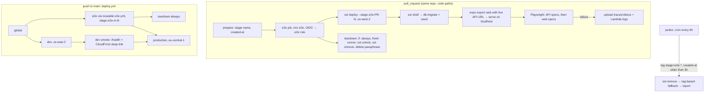

# Live end-to-end tests on ephemeral AWS stages

**Status:** design only. Nothing here is built yet. See [Rollout](#12-rollout) for the PRs.

## Goal

Check that full user flows still work against a brand-new environment created during CI. The tests are live: real Lambda, API Gateway, Aurora DSQL and AppSync Events, with no mocks or emulators. Each run gets its own SST stage in one dedicated region and destroys it afterwards, whether the tests pass or fail. Concurrent runs don't affect each other.

**Fits on top of:** the `infra/app` + `infra/global` layout (`@yallist/infra`, #18), and the Phase 1 backend stack in [phase-1-backend.md](phase-1-backend.md): #14 API, #15 DB, #19 auth, then trips/items/claims, expenses, realtime and the app switch.

## Summary of decisions

| #   | Decision                                                                                                                                                                                                                                                                                                                          |
| --- | --------------------------------------------------------------------------------------------------------------------------------------------------------------------------------------------------------------------------------------------------------------------------------------------------------------------------------- |
| 1   | E2E runs on every same-repo PR that touches code, and on `main` between the `global` and `production` deploys. `production` waits for e2e and `dev`.                                                                                                                                                                              |
| 2   | Stage `e2e-<pr>-<run_number>`, or `e2e-m-<run_number>` on `main`. At most 16 characters, matched by a regex in `sst.config.ts`. Always `removal: 'remove'`, never `protect`.                                                                                                                                                      |
| 3   | All e2e stages run in **`us-west-2` (Oregon)**. Every service we use is there, it's not dev's or production's region, and it's not `us-east-1`, so a region lock cleanly separates regional resources from global ones.                                                                                                           |
| 4   | A separate **`yallist-global-github-e2e`** role, trusted only from GitHub environment `e2e`. It is locked to `us-west-2` (except IAM/STS), name-scoped to `yallist-e2e-*`, and can only create roles that carry an e2e permission boundary. The deploy role's trust narrows from `environment:*` to the three named environments. |
| 5   | No CloudFront and no StaticSite in e2e stages. The runner exports the web app pointed at the live API and serves it on `localhost`. CloudFront stays covered by `dev`'s real deploy and a smoke check.                                                                                                                            |
| 6   | Guests (Better Auth anonymous) are the only sign-in method in e2e. No test-only login for now. A per-run `BetterAuthSecret` comes from `SST_SECRET_BetterAuthSecret`.                                                                                                                                                             |
| 7   | Playwright in a new `e2e/` workspace package (`@yallist/e2e`): API specs through the typed Hono `hc` client, plus web specs using two browser contexts for multi-user and realtime flows.                                                                                                                                         |
| 8   | Teardown is a separate `if: always()` job on a fresh runner. A janitor workflow every 6 hours removes stages older than 3 hours by tag. A `us-west-2` budget is the last line of defence.                                                                                                                                         |

## CI flow



## 1. Triggers and gating

- **PRs:** a new `.github/workflows/e2e.yml` runs on `pull_request` for same-repo branches. The job is skipped for forks (see [§5](#5-security)) and for PRs that only touch `docs/**`, `**/*.md` or `apps/mobile/plugins/**`. The workflow always starts and decides inside a small `changes` job, so a required check never sits waiting on a path-filtered workflow that didn't run.
- **`main`:** `deploy.yml` calls the same workflow (`workflow_call`) right after `global`. It runs alongside `dev`, and `production` needs both `dev` and `e2e`. Running in parallel with `dev` means the gate adds roughly `max(0, e2e − dev)` minutes, about 5–10 minutes, to the production deploy instead of the full e2e time.
- **Manual:** `workflow_dispatch` (input: ref), for debugging and for re-running after a flake.
- **Required check:** turn it on for PRs once the suite has been stable for about two weeks ([Rollout](#12-rollout) PR 8). Until then it only reports.
- **Rejected options:**
  - **Label-only (`e2e` label):** easy to forget, and agents open most PRs here.
  - **Merge queue:** this is a personal-account repo. As far as I know, merge queue needs an organization-owned repo. Not verified for this account.
  - **Nightly only:** catches breakage a day late, after it has already reached production.
  - **E2E against `dev` itself instead of a fresh stage:** doesn't meet the "new environment" requirement. It also shares data, and concurrent runs would interfere.
- **Cost and time:** AWS cost is cents per run ([§11](#11-cost)). The repo is public, so GitHub-hosted minutes are free. The real cost is about 15 minutes of wall-clock time per PR, which is acceptable because it runs in parallel with `check`.

## 2. Stage naming and lifecycle

- **Name:** `e2e-<pr number>-<run_number>`, for example `e2e-42-317`, or `e2e-m-<run_number>` on `main`. `run_number` belongs to the calling workflow (`e2e.yml` or `deploy.yml`), and the prefixes differ, so names never collide. A re-run attempt reuses the name. That's harmless: the previous attempt's teardown has already removed the stage, and if it hasn't, SST simply updates the stage.
- **Length cap: 16 characters.** SST's `prefixName` (`.sst/platform/src/components/naming.ts`, verified) shortens the _app name_ first when `app + stage + logical name` exceeds the limit. For a Lambda, the limit is 64 minus a 9-character suffix. `ApiRoute<hash6>HandlerFunction` is 29 characters, so a stage of 16 or fewer keeps the full `yallist-` prefix. Any logical name up to about 31 characters is safe. Longer stages would produce names like `e2e-42-317-ApiRoute…` and break the IAM name scoping, which fails closed (AccessDenied) rather than open.
- **`infra/app/sst.config.ts`:**
  - Extract the stage rules into `infra/app/stages.ts`, which is pure and covered by a Vitest test: `stageConfig(stage) → { region, removal, protect, profile, e2e }`.
  - `dev` and `production` keep exactly today's values. Anything matching `/^e2e-(\d{1,5}|m)-\d{1,6}$/` (16 characters at most) gets `{ region: 'us-west-2', removal: 'remove', protect: false, profile: undefined, e2e: true }`. Everything else still throws.
  - Running e2e locally (`--stage e2e-…` on a laptop) is refused unless `CI` is set, so the only credentials ever used for it are the e2e role's.
  - For e2e, `run()` skips `StaticSite`. It passes `webURL = http://localhost:4173` to the API instead of `web.url`, for Better Auth `trustedOrigins`, and sets `deletionProtectionEnabled: false` plus `forceDestroy: true` on the DSQL cluster.
- **Concurrency:**
  - PRs use `group: e2e-pr-<number>` with `cancel-in-progress: true`. A new push cancels the old run, and the old run's teardown still runs, because `always()` jobs run after a cancel.
  - Each run has its own stage, so the new run never waits on the old one's state lock.
  - `main` uses `group: e2e-main` without cancelling, inside the existing `deploy` group.
- **Cancelled or crashed runs:** teardown runs as its own job. It gets the stage name from `prepare`'s output, so it works even if the e2e job died mid-deploy. It runs `sst unlock --stage $STAGE` (the killed deploy may still hold the lock), then `sst remove`. If the whole workflow is lost, for example GitHub drops it, the janitor ([§9](#9-teardown-guarantees)) catches it.

## 3. Region: `us-west-2`

| Service                                                | In `us-west-2`?                 | Source                                                                                                                                          |
| ------------------------------------------------------ | ------------------------------- | ----------------------------------------------------------------------------------------------------------------------------------------------- |
| Aurora DSQL                                            | Yes                             | [DSQL region table](https://docs.aws.amazon.com/aurora-dsql/latest/userguide/what-is-aurora-dsql.html#region-availability) (checked 2026-10-24) |
| AppSync Events                                         | Yes (AppSync region since 2018) | Launch post: Events is "available in all regions supported by AppSync". No Events-only region list exists. **Re-check in the realtime PR.**     |
| Lambda, API Gateway HTTP API, S3, CloudWatch Logs, SSM | Yes                             | Core services, present in every commercial region                                                                                               |
| CloudFront                                             | Global (API in `us-east-1`)     | Not used by e2e ([§6](#6-speed-and-fidelity))                                                                                                   |

- **Why `us-west-2`:**
  - It isn't dev's (`us-east-2`) or production's (`eu-central-1`) region.
  - It isn't `us-east-1`. Global services (IAM, CloudFront, budgets) sign requests for `us-east-1`, so a lock on `aws:RequestedRegion = us-west-2` can't be confused with them.
  - GitHub-hosted runners are in the US (not verified per run), so the many test round trips stay short.
- **Alternative: `eu-west-1`.** It's closer to production's behaviour and to developers in Israel, but each test step pays about 150 ms more round trip from US runners. That trade-off is open question 1.
- **SST bootstrap and state** (from [sst.dev/docs/state](https://sst.dev/docs/state)):
  - The first deploy in a region creates `sst-asset-<hash>`, the `sst-asset` ECR repo and the SSM parameter `/sst/bootstrap`.
  - The `home` region gets `sst-state-<hash>` and `/sst/passphrase/<app>/<stage>`. The home region follows the `aws` provider's region, so all e2e state lives in `us-west-2`, apart from dev's and production's.
  - Bootstrap runs **once, by hand** with admin credentials (any `sst deploy --stage e2e-0-0` from a laptop with `CI=1`, then `sst remove`). The e2e role then never needs to create buckets or ECR repos, and its S3 permissions can name the exact two buckets.
  - The global stack reads them from `/sst/bootstrap` with `aws.ssm.getParameterOutput` through a `us-west-2` provider.
  - `sst remove` leaves state and the passphrase behind, so teardown and the janitor delete those too.

## 4. Isolation

- **Per-run resources** (all removed by `sst remove`):
  - The Lambdas.
  - The HTTP API and its log group (`/aws/vendedlogs/apis/yallist-e2e-…`).
  - IAM roles (`yallist-<stage>-…`).
  - The DSQL cluster (`Name` tag `yallist-<stage>-database`).
  - The AppSync Events API, named per stage.
  - The SST secret value and the passphrase.
  - Nothing is shared between runs. Each run has its own empty database, so tests never see another run's users or trips.
- **Tags:** `defaultTags` for e2e stages adds the following to `app=yallist`, `stage=<stage>` and SST's `sst:app` / `sst:stage`:
  - `e2e=true`
  - `e2e-run=<github.run_id>`
  - `e2e-pr=<n|main>`
  - `e2e-sha=<sha7>`
  - `created-at=<ISO time from prepare>`

  The values come from env vars that `prepare` sets once, so teardown evaluates the same config. The `ttl` is a janitor constant of 3 hours, not a tag, so it can change without redeploying.

- **Shared, and why that's safe:**

| Shared                                                                | Why it's safe                                                                                                                                                |
| --------------------------------------------------------------------- | ------------------------------------------------------------------------------------------------------------------------------------------------------------ |
| AWS account                                                           | Isolation from dev and production comes from region, name and IAM boundaries ([§5](#5-security)). A separate account would be stronger: see open question 6. |
| `us-west-2` SST bootstrap (asset and state buckets, `/sst/bootstrap`) | Created once. SST writes per-stage keys, and runs use different stage names, so they never write the same object or lock.                                    |
| OIDC provider, e2e role, workload boundary                            | Read-only from a run's point of view. They're managed by the protected `global` stack.                                                                       |
| DSQL / Lambda account quotas in `us-west-2`                           | Leaked stages eat into these, so the janitor matters. DSQL has a per-region cluster quota (I believe 20 by default; **not verified**).                       |
| Account budget                                                        | Covered by the `us-west-2` budget ([§9](#9-teardown-guarantees)).                                                                                            |

## 5. Security

### Who can get credentials

- **Fork PRs never do.**
  - GitHub doesn't issue an OIDC token (`id-token: write`) to `pull_request` runs from forks.
  - The job also has `if: github.event.pull_request.head.repo.full_name == github.repository`.
  - We never use `pull_request_target`.
  - First-time fork contributors already need approval before workflows run (public-repo default).
- **New GitHub environment `e2e`.** It has no branch restriction, because PR branches must use it. It has no secrets: credentials come only from OIDC. Variable: `AWS_E2E_ROLE_ARN`.
- **Required fix in the same PR: narrow the deploy role.** Its trust today is `…:environment:*`. As soon as an `e2e` environment open to PR branches exists, any same-repo PR could edit a workflow and assume the **admin** deploy role. The trust must become `StringEquals sub ∈ {…:environment:global, …:environment:dev, …:environment:production}`.
- **E2E role trust:** `sub = repo:nadavgihasi@37207301/yallist@1431912139:environment:e2e` and `aud = sts.amazonaws.com`, with a 1-hour max session.
- **Threat model:** the actor is anyone who can push a branch, which in practice means me and coding agents. They can edit the workflow and do anything the e2e role allows. The role is the boundary, not the workflow.

### Role `yallist-global-github-e2e` (in `infra/global`)

| Statement         | Effect | What                                                                                                                                                                                                                                                                                                                                                                                                                               |
| ----------------- | ------ | ---------------------------------------------------------------------------------------------------------------------------------------------------------------------------------------------------------------------------------------------------------------------------------------------------------------------------------------------------------------------------------------------------------------------------------- |
| RegionLock        | Deny   | `NotAction: [iam:*, sts:*]` when `aws:RequestedRegion ≠ us-west-2`. Nothing regional in `us-east-2` or `eu-central-1` can be touched, which covers all of dev and production apart from IAM.                                                                                                                                                                                                                                       |
| Regional services | Allow  | `lambda:*` on `function:yallist-e2e-*`. `logs:*` on `/aws/lambda/yallist-e2e-*` and `/aws/vendedlogs/apis/yallist-e2e-*`. `apigateway:*` and `appsync:*` (IDs are random, so the scope is the region lock). `dsql:*` (create requires `aws:RequestTag/stage` like `e2e-*`, delete and connect require `aws:ResourceTag/stage` like `e2e-*`; **tag-condition support for DSQL not verified**, and the region lock is the fallback). |
| SST state         | Allow  | `s3:*Object`, `s3:ListBucket` on the two bootstrap buckets by exact name. `ssm:Get/Put/DeleteParameter` on `parameter/sst/passphrase/yallist/e2e-*` and read on `/sst/bootstrap`.                                                                                                                                                                                                                                                  |
| IAM, create       | Allow  | `iam:CreateRole` on `role/yallist-e2e-*` **only with** `iam:PermissionsBoundary = policy/yallist-e2e-workload-boundary`.                                                                                                                                                                                                                                                                                                           |
| IAM, manage       | Allow  | `iam:Delete/Get/Tag/UntagRole`, `Put/Delete/GetRolePolicy`, `Attach/DetachRolePolicy` (restricted with `iam:PolicyARN` to `AWSLambdaBasicExecutionRole`), and `iam:PassRole` to `lambda.amazonaws.com`/`appsync.amazonaws.com`, all on `role/yallist-e2e-*`.                                                                                                                                                                       |
| Guardrails        | Deny   | `iam:DeleteRolePermissionsBoundary`, `iam:PutRolePermissionsBoundary`, `iam:CreatePolicyVersion`/`DeletePolicy` on the boundary, anything on `role/yallist-global-*`, `role/yallist-dev-*`, `role/yallist-production-*` and the OIDC provider, plus `budgets:*` and `organizations:*`.                                                                                                                                             |

- **Workload boundary `yallist-e2e-workload-boundary`:** the ceiling for every role SST creates in e2e. It allows:
  - Lambda logging.
  - `dsql:DbConnect*` and `appsync:EventPublish`/`appsync:Connect`/`Subscribe` in `us-west-2`.
  - `ssm:GetParameter` for SST links, if any.

  It denies `iam:*` and everything outside `us-west-2`. Even if a PR attaches `AdministratorAccess` to its own Lambda role, the Lambda gets only this.

- **How roles get the boundary:** `infra/app/sst.config.ts` does this for e2e stages only:

  ```ts
  $transform(aws.iam.Role, (args) => {
    args.permissionsBoundary = E2E_BOUNDARY_ARN;
  });
  ```

  `$transform` covers raw Pulumi resources (`component.ts`, verified). If a role skips it, `CreateRole` fails.

### Limits of IAM scoping

- **API Gateway, AppSync and DSQL** IDs are random, so only the region lock separates runs from each other. One e2e run _could_ delete another's API. That's acceptable: the role can't reach dev or production, and runs don't do it by accident because each uses its own stage state.
- **IAM is global.** Name prefixes plus the boundary are the only controls, which is why the stage length cap matters.
- **CloudFront** would need `cloudfront:*` on random distribution IDs in `us-east-1`. That's a big reason to keep it out of e2e. Dev's and production's distributions would otherwise be reachable.
- **The first real run will surface missing actions.** SST and the Pulumi providers call some describe and list APIs that are hard to predict. Iterate with `SST_PRINT_LOGS=1` and CloudTrail AccessDenied events in the rollout PR. Expect two or three rounds. **Not verified** until it runs.

## 6. Speed and fidelity

- **Estimates** (from docs and experience, not measured here):
  - CloudFront distribution: about 3–5 minutes to create. Deletion first disables the distribution, waits for that to propagate, then deletes, so about 5–15 minutes.
  - DSQL cluster: about 1–2 minutes to create (AWS describes it as "minutes"). Deletion is similar.
  - Lambda, HTTP API and AppSync Events: seconds each.

| Option                                                                                               | Deploy + remove | Fidelity lost                                                                             | IAM                         |
| ---------------------------------------------------------------------------------------------------- | --------------- | ----------------------------------------------------------------------------------------- | --------------------------- |
| A. Full `StaticSite` (S3 + CloudFront)                                                               | +8–20 min       | none                                                                                      | needs global `cloudfront:*` |
| B. S3 website endpoint                                                                               | +1 min          | HTTP only, needs a public bucket (fights Block Public Access), no SPA rewrite at the edge | S3 only                     |
| **C. Export on the runner, serve on `localhost:4173` (`serve -s dist`), live API, DSQL and AppSync** | **0**           | CloudFront config: SPA fallback function, cache headers, HTTPS on our domain              | regional only               |

- **Recommendation: C.**
  - The flows under test live in the app, the API, the DB and realtime, and all of those are live.
  - The browser still calls the API cross-origin, so CORS and bearer auth are exercised as in production.
- **The lost fidelity is covered elsewhere.** The `dev` deploy really deploys CloudFront on every `main` push. A small `dev-smoke` step runs after it:
  - `curl $WEB/j/does-not-exist` returns 200 with `index.html`, which proves the SPA fallback.
  - `curl $API/health` returns 200.
- **Target wall time:** about 12–18 minutes per run.

| Step                                                 | Time         |
| ---------------------------------------------------- | ------------ |
| Install, with pnpm and SST providers cached          | ~2 minutes   |
| `sst deploy`                                         | ~3–5 minutes |
| Migrate                                              | <1 minute    |
| Web export                                           | ~1 minute    |
| Tests                                                | ~3–5 minutes |
| Teardown, in its own job and not blocking the result | ~2–4 minutes |

- **Cache:** the SST platform and providers, keyed on the `sst` version. The exact cache path on Linux is **not verified**.

## 7. Secrets and auth in e2e stages

- **`BetterAuthSecret`:** `prepare` creates a fresh value per run (`openssl rand -base64 32`, masked with `::add-mask::`). Deploy and teardown receive it as `SST_SECRET_BetterAuthSecret`. `sst.Secret` reads `process.env["SST_SECRET_" + name]` (`secret.ts`, verified). Nothing is stored and nothing outlives the run.
- **Google:** OAuth can't be automated, and e2e stages have no Google client.
  - `GOOGLE_CLIENT_IDS` (from #19) has no e2e entry, and `SST_SECRET_GoogleClientSecret=unused-e2e`.
  - The Google button still renders. Tests never press it.
  - Linking a guest to a Google account (`onLinkAccount` → `mergeUser`) stays covered by API unit tests against Postgres, not by e2e.
- **Users:** every test user is a guest. The web flow taps "continue as guest". API specs call `POST /api/auth/sign-in/anonymous { name }` and keep the bearer token. Each Playwright browser context is a separate user.
- **Test-only sign-in: not now.** Guests already give us as many independent users as we need. If we need one later, for example email/password to sign back in as the same user on a second device, the guard is:
  1. `stageConfig` sets `E2E_TEST_AUTH=1` on the API function only when `e2e` is true. That's possible only for the e2e stage regex, in `us-west-2`, under `CI`.
  2. The API turns the plugin on only if `E2E_TEST_AUTH === '1'` **and** `Resource.App.stage` starts with `e2e-`. Otherwise it throws at cold start if the flag is set.
  3. A Vitest test asserts that `stageConfig('dev')` and `stageConfig('production')` never set the flag.
  4. The workload boundary means a mistakenly deployed stage could only ever be an e2e stage.
- **Rate limits (risk):** Better Auth rate-limits sign-in per IP. All tests come from one runner IP, and the default rules for sign-in are tight (**defaults not verified**). Mitigation: sign each user in once per worker and reuse the token or `storageState`. Don't weaken the limiter for e2e stages.

## 8. Test tooling and layout

```
e2e/                         @yallist/e2e (workspace package)
  package.json               @playwright/test, hono (hc), @yallist/api (types only)
  playwright.config.ts       projects: api, web (chromium, he-IL, RTL); webServer: serve -s ../apps/mobile/dist -l 4173
  src/env.ts                 API_URL, REALTIME_URL from infra/app/.sst/outputs.json (or env)
  src/api.ts                 hc<AppType>(API_URL, { headers: bearer }) + signInGuest(name)
  src/fixtures.ts            `guest` and `twoUsers` fixtures (one browser context each)
  api/*.spec.ts              fast rule checks over HTTP
  web/*.spec.ts              user flows in the browser
```

- **Selectors:** use roles and accessible names. Import the Hebrew strings from `apps/mobile/src/i18n/he.ts`, so a copy change doesn't break tests. Add `testID` only where no accessible name exists.
- **Data:** every test creates its own trip through the API or UI. There's no shared seed beyond `template_items`, and no cleanup inside a run, because the stage is destroyed.
- **Waiting:** no fixed sleeps. Realtime assertions use `expect(locator).toHaveText(…, { timeout: 15_000 })` or `expect.poll`.
- **Retries:**
  - `retries: 1` in CI. A test that passes on retry is reported as flaky in the job summary. That doesn't fail the build, but it's tracked.
  - A test that's flaky twice in a week is fixed or quarantined with `test.fixme` and an issue.
  - `workers: 2` to start with, which also keeps sign-in rates low.
- **Artifacts on failure:**
  - Playwright `trace: 'on-first-retry'`, `screenshot: 'only-on-failure'` and `video: 'retain-on-failure'`.
  - Upload `playwright-report/` and `test-results/` with `actions/upload-artifact`, kept 7 days.
  - Before teardown, `aws logs tail` the stage's API and authorizer log groups (last 15 minutes) into the artifact.
- **Scenarios, in priority order:**

| P   | Scenario                                                                                                                                                                                                                                                    | Needs             |
| --- | ----------------------------------------------------------------------------------------------------------------------------------------------------------------------------------------------------------------------------------------------------------- | ----------------- |
| P0  | **Smoke:** `/health` 200. Guest sign-in returns a token, and `/me` returns the profile. Migrations applied and templates seeded.                                                                                                                            | #14, #15, #19     |
| P0  | **Create trip from template:** a guest creates a "camp" trip and the trip screen shows the template's bring and buy items with a missing count.                                                                                                             | trips API, app    |
| P0  | **Invite and join:** A opens Invite and reads the link. B, in a fresh context, opens `/j/<token>`, sees the preview (name, missing items), enters a name and joins. A's People tab shows B.                                                                 | trips API, app    |
| P0  | **Claim, cap and realtime:** B taps "אני אביא" on a single item, and **A's open screen** shows it as taken by B without reloading. On a `qty` item, A and B together fill the cap, and the stepper stops at the cap.                                        | realtime, app     |
| P1  | **Rules (API):** over-claim rejected, including two concurrent claims racing for the last unit where exactly one wins. A non-member gets 403 on the trip. A pending member can't read it. A rotated token is rejected. The last organizer can't be removed. | trips API         |
| P1  | **Add item:** A adds an item with "אני אביא את זה" on, and B sees it live.                                                                                                                                                                                  | app, realtime     |
| P1  | **Expense and settle up:** A adds ₪90 shared by A, B and C. Money shows the balances and the transfers B→A ₪30 and C→A ₪30. B marks a payment, A confirms it, and the suggestion disappears.                                                                | expenses API      |
| P2  | **Approval:** `require_approval` is on. B is pending and sees nothing, then A approves, and B's pending page updates live.                                                                                                                                  | members, realtime |
| P2  | **Session and deep link:** reloading `/trips/<id>` keeps the guest signed in and loads the trip.                                                                                                                                                            | app               |

## 9. Teardown guarantees

1. **In the run:** the `teardown` job has `needs: [prepare, e2e]`, `if: always() && needs.prepare.result == 'success'`, and `environment: e2e`. Steps:
   - `sst unlock` (ignore errors).
   - `sst remove --stage $STAGE`, retried twice with a 30-second backoff for IAM and DSQL eventual consistency.
   - Delete `/sst/passphrase/yallist/$STAGE`.
   - Fail loudly if `tag:GetResources` still finds `stage=$STAGE`.
2. **Janitor:** `.github/workflows/e2e-janitor.yml`, `cron: '17 */6 * * *'` plus `workflow_dispatch`, environment `e2e`.
   - Find stages: `tag:GetResources` in `us-west-2` for `app=yallist`, `e2e=true`. Group by `stage`. Keep stages whose `created-at` is more than 3 hours old. Add `iam list-roles` entries prefixed `yallist-e2e-` and passphrase parameters with no resources.
   - Remove each one with `sst remove --stage <s>` from `main`. `remove` destroys from state and only evaluates `app()`, so the stage regex must keep accepting old names.
   - Fallback when the state is missing or broken, by tag or name, in dependency order:
     1. AppSync APIs
     2. HTTP APIs
     3. Lambdas
     4. Log groups
     5. DSQL clusters, after disabling deletion protection
     6. Inline and attached role policies, then the roles
   - Delete orphaned passphrases and the state objects of removed stages.
   - The job fails, which notifies me, whenever it had to clean something up, so leaks don't go unnoticed.
3. **Budget:** a second budget in `infra/global`, `yallist-global-e2e-monthly`, filtered to region `us-west-2`, $3/month, alerting at 80% actual and 100% forecast. The account-wide $10 budget stays as it is.
4. **Timeouts:** `timeout-minutes` is 30 for the e2e job and 20 for teardown. The OIDC session lasts 1 hour, which is longer than either job.

## 10. Migrations and seed on a fresh database

- After `sst deploy`: `pnpm sst shell --stage $STAGE -- pnpm --filter @yallist/api db:migrate`. That's the same command #15 adds to `deploy.yml`, so e2e also tests the migration runner against a real, empty DSQL cluster on every run.
  - The runner applies every migration from zero, rewriting indexes to `CREATE INDEX ASYNC` and adding constraints as `NOT VALID`.
  - It then reseeds `template_items` from `@yallist/domain`, and Better Auth's tables come from the same Drizzle schema.
- Async indexes may still be building when the tests start. That only affects speed, not correctness, so we don't wait for them.
- A dev or production database that has picked up migrations step by step can still drift from a fresh one. The `main` run of e2e covers the fresh path, and `dev`'s deploy covers the incremental one.

## 11. Cost

- **Per run** (estimates, `us-west-2` list prices):
  - Lambda, API Gateway and AppSync Events: a few thousand requests or messages, under $0.01.
  - DSQL: migrations and tests use well under 100K DPUs. The free tier is 100K DPUs + 1 GB per month, but it's shared with dev and production, and **I haven't verified whether it's per account or per region**. Beyond it, about $8 per million DPUs, so roughly $0.01–0.05 per run.
  - CloudWatch Logs, SSM standard parameters and S3 state: negligible.
  - **Total: about $0.02–0.06 per run.** GitHub Actions minutes are free on this public repo.
- **Per month:** about 5 PR runs plus 3 `main` runs per working day comes to about 170 runs, or **$1–10/month** in the worst case, usually closer to $1–3. A leaked stage costs almost nothing while idle (DSQL is $0 when idle), so a leak shows up mostly as quota pressure rather than money.

## 12. Rollout

Small PRs, each with CI green and an end-to-end check where noted.

| #   | PR                                                                         | Depends on                      | Acceptance                                                                                                                                                                                                                                                                                                                              |
| --- | -------------------------------------------------------------------------- | ------------------------------- | --------------------------------------------------------------------------------------------------------------------------------------------------------------------------------------------------------------------------------------------------------------------------------------------------------------------------------------- |
| 1   | `docs(plans): design live e2e tests on ephemeral AWS stages` (this)        | none                            | Reviewed and merged.                                                                                                                                                                                                                                                                                                                    |
| 2   | `feat(infra): e2e deploy role, workload boundary and region budget`        | #18                             | The deploy role trust lists only global, dev and production. The e2e role is assumable only from env `e2e`. The IAM policy simulator denies any `us-east-2` or `eu-central-1` action and `iam:CreateRole` without the boundary. Manual steps: one-time `us-west-2` SST bootstrap, create the `e2e` environment, set `AWS_E2E_ROLE_ARN`. |
| 3   | `feat(infra): ephemeral e2e stages`                                        | #14, #15, #19 merged            | `stages.ts` has Vitest coverage: dev and production are unchanged, the e2e regex holds, other names are refused, there's no local e2e, and the 16-character cap holds. E2E stages get the boundary transform, no StaticSite, a DSQL cluster without deletion protection, and the extra tags.                                            |
| 4   | `ci(e2e): deploy, migrate, smoke and teardown`                             | 2, 3                            | `workflow_dispatch` and PR runs create `e2e-…`, pass the P0 smoke (`/health`, guest sign-in, `/me`), and destroy everything, so `tag:GetResources` is empty. A run cancelled during deploy is still cleaned up. Fork PRs skip.                                                                                                          |
| 5   | `ci(e2e): janitor for leaked stages`                                       | 4                               | A stage leaked on purpose (job killed and teardown skipped) is removed by a manual janitor run, which reports a failure. Orphaned passphrases are deleted.                                                                                                                                                                              |
| 6   | `test(e2e): Playwright package with API scenarios`                         | 4, trips API, expenses API      | The P1 rules and the expense balance specs pass on a live stage. Artifacts are uploaded on a forced failure.                                                                                                                                                                                                                            |
| 7   | `test(e2e): web flows with two users and realtime`                         | 6, realtime, app on the API     | P0 web scenarios: create, invite and join, claim with realtime. Then P1 add item and P2. The web app is served from the runner against the live API.                                                                                                                                                                                    |
| 8   | `ci(deploy): gate production on e2e and the dev smoke; require e2e on PRs` | 7, about 2 weeks of stable runs | `production` needs `dev`, `dev-smoke` and `e2e`. Branch protection requires the `e2e` check. The flake rate stays under 5% (retried passes as a share of runs).                                                                                                                                                                         |

## 13. Open questions

1. **Region: `us-west-2` or `eu-west-1`?** _Recommendation: `us-west-2`_, because it's next to the runners and the region lock is clean. Pick `eu-west-1` if you'd rather e2e behave like an EU region.
2. **Run on every code PR, or only on a label?** _Recommendation: every same-repo code PR_. It's cheap and agents won't remember labels. Add an `e2e:skip` label for emergencies.
3. **Gate `production` on e2e?** _Recommendation: yes_, once the suite is stable (PR 8). Until then e2e only reports on `main`.
4. **Test-only sign-in method?** _Recommendation: no_. Guests are enough. The guard design in [§7](#7-secrets-and-auth-in-e2e-stages) is there if it's ever needed.
5. **E2E budget amount?** _Recommendation: $3/month for `us-west-2`_, on top of the $10 account budget.
6. **Separate AWS account for e2e** (an Organization member account) instead of a region in the shared account? _Recommendation: not now._ Region lock, name prefixes and the boundary are enough for a solo project. Move to a separate account when production gets real users or a second contributor joins. It removes the whole "IAM is global" caveat.

## Not verified

- AppSync Events availability in `us-west-2` specifically (inferred from AppSync availability).
- DSQL tag-based IAM conditions, the cluster quota, and whether the free tier is per account or per region.
- The exact AWS API actions SST and Pulumi need, which will be found by running.
- That `sst remove` without a lock or state behaves as described.
- SST writing `infra/app/.sst/outputs.json`.
- The SST cache path on Linux runners.
- Better Auth's default sign-in rate limits.
- That merge queue is unavailable on personal-account repos.
- CloudFront and DSQL timings (estimates, not measurements).
