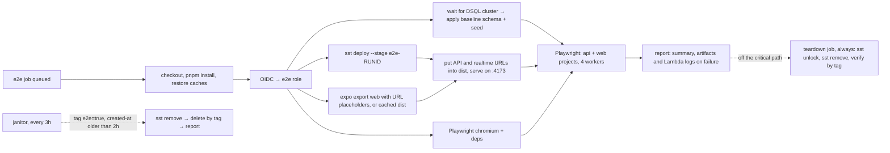

# Live end-to-end tests on a fresh AWS stage per run

**Status:** design only. Nothing here is built yet. See [Rollout](#10-rollout).

## Summary

- **Every run gets a brand-new SST stage**, `e2e-<run_id>`, in **`us-west-2`**. It's created for the run and destroyed after it. Nothing is reused between runs. Tests are live against real Lambda, API Gateway, Aurora DSQL and AppSync Events, with no mocks or emulators. Concurrent runs share nothing but the account, the region and the SST bootstrap.
- **Realistic time:** about **4.5–5.5 minutes**, from the e2e job being queued to the results being reported, with teardown excluded. The best case is about 3.5 minutes. A slow deploy (IAM propagation retries, AppSync) can take it to about 6. All of these are estimates. [Rollout](#10-rollout) PR 4 measures them.
- **The biggest costs:** creating the stage (`sst deploy`, 75–150 s), the Playwright suite (60–75 s), and setup (install and caches, about 60–90 s).
- **How it's fast:**
  - One runner does the deploy, the web build and the Playwright install at the same time.
  - pnpm, SST providers, Playwright and Metro are all cached.
  - The DB schema is created from one baseline SQL file as soon as the cluster exists, while the rest of the stage is still deploying.
  - The web app is built before the API URL is known.
  - Teardown runs in its own job, off the critical path.
- **Cleanup is guaranteed** by a teardown job that always runs, a janitor every 3 hours, and a `us-west-2` budget.
- **Recorded decisions:** build e2e only after the backend and the app's switch to the API land. No long-lived or reused e2e environments. When e2e runs (triggers) is still open ([Q1](#11-open-questions)). The pipeline works with any trigger.

## 1. Flow

## 2. Stage lifecycle

- **Name:** `e2e-<github.run_id>`, for example `e2e-18234567890` (15 characters).
  - `run_id` is unique across workflows, so concurrent PR and `main` runs never collide.
  - A re-run attempt starts only after the earlier attempt's teardown has finished, so it can safely reuse the name.
  - In `infra/app/stages.ts` (pure, covered by Vitest), the rule is `/^e2e-\d{1,12}$/`: `{ region: 'us-west-2', removal: 'remove', protect: false, e2e: true }`. Running it locally is refused unless `CI` is set. `dev` and `production` are unchanged.
  - **16-character cap:** SST's `prefixName` (`.sst/platform/src/components/naming.ts`, verified) shortens the app name when `app + stage + logical name` gets too long. Up to 16 characters keeps the `yallist-e2e-` prefix that IAM name scoping relies on.
- **What the stage has:**
  - the API Lambda and HTTP API;
  - a DSQL cluster, with deletion protection off;
  - the AppSync Events API and its authorizer;
  - IAM roles under the e2e permission boundary ([§5](#5-security));
  - log groups with 1-day retention.

  It has no `StaticSite` and no CloudFront, because CloudFront takes minutes to create and delete and needs global IAM rights. The runner serves the web export on `localhost:4173`, and that origin is passed in as Better Auth's `webURL`. CloudFront stays covered by `dev`'s real deploy and a `curl` smoke check after it, for the SPA fallback and `/health`.

- **Tags:** `app`, `stage`, `e2e=true`, `e2e-run`, `e2e-sha` and `created-at`, all from env vars set once at the start of the job.
- **Concurrency:** for PRs, `group: e2e-pr-<n>` with `cancel-in-progress: true`. A cancelled run's teardown still runs, and the new run uses a different stage, so it never waits on the old one's state lock.

## 3. Time budget (critical path, teardown excluded)

The clock starts when the e2e job is queued and stops when the check conclusion and job summary are posted. Runner: standard `ubuntu-latest`, which has 4 vCPU and 16 GB on public repos and is free. All numbers are **estimates, not measured**.

| #   | Step                                                                                                                            | Budget        | Notes                                                                                                                                                                                        |
| --- | ------------------------------------------------------------------------------------------------------------------------------- | ------------- | -------------------------------------------------------------------------------------------------------------------------------------------------------------------------------------------- |
| 1   | Runner pickup                                                                                                                   | 10–20 s       | Starting the trigger with an `if:` on the job, not a separate "decide" job, avoids a second runner.                                                                                          |
| 2   | Checkout, Node, `pnpm install --frozen-lockfile` with the store cached                                                          | 35–50 s       |                                                                                                                                                                                              |
| 3   | Restore caches: SST CLI home, `infra/app/.sst/platform`, `~/.cache/ms-playwright`, Metro cache, `dist`                          | 15–25 s       | SST's aws provider plugin alone is 801 MB (measured locally).                                                                                                                                |
| 4   | OIDC, plus a random `BetterAuthSecret`                                                                                          | ~5 s          |                                                                                                                                                                                              |
| 5   | **In parallel** (background processes, logs to files, printed in `::group::`s):                                                 | **75–150 s**  | The deploy is the longest branch.                                                                                                                                                            |
|     | a. `sst deploy --stage e2e-<id>` (create everything)                                                                            | 75–150 s      | Startup, platform eval and esbuild take 15–25 s. Then the longest dependency chain: IAM role → (propagation) Lambda → integration → route. AppSync Events and DSQL are created alongside it. |
|     | b. Wait for the DSQL cluster to be `ACTIVE`, then apply the baseline schema and seed                                            | 20–45 s total | Hidden behind (a) ([§4](#4-schema-setup)).                                                                                                                                                   |
|     | c. `expo export -p web` with URL placeholders, or reuse `dist` cached by a hash of `apps/mobile`, `packages/*` and the lockfile | 0–90 s        | It doesn't wait for the deploy.                                                                                                                                                              |
|     | d. `playwright install --with-deps chromium` (browsers cached, apt deps still install)                                          | 20–40 s       |                                                                                                                                                                                              |
| 6   | Put the URLs into `dist`, `serve -s dist`, call `/health` to warm the Lambda                                                    | 5–10 s        |                                                                                                                                                                                              |
| 7   | Playwright: `api` and `web` projects, `workers: 4`                                                                              | 60–75 s       | A hard budget: only the P0 flows run in the browser ([§7](#7-tests)). The first requests from each worker pay for a Lambda cold start.                                                       |
| 8   | Report: summary, plus artifacts and a Lambda log tail on failure                                                                | 5–15 s        |                                                                                                                                                                                              |
|     | **Total**                                                                                                                       | **3.5–6 min** | **About 4.5–5.5 min is realistic.** The deploy in step 5a decides it. Measuring will show whether 5 minutes holds.                                                                           |
| —   | Teardown job: `sst remove` (DSQL, roles, AppSync, Lambda, API)                                                                  | 2–5 min       | Off the critical path.                                                                                                                                                                       |

Each step's duration is written to the job summary.

### Speed-ups and how sure they are

| Technique                                                                                                    | Saves         | Status                                                                                                                                                                                                                                                                                          |
| ------------------------------------------------------------------------------------------------------------ | ------------- | ----------------------------------------------------------------------------------------------------------------------------------------------------------------------------------------------------------------------------------------------------------------------------------------------- |
| One job with background processes, not separate deploy/build/test jobs                                       | 60–80 s       | Separate jobs would cost a second runner pickup, a second install and an artifact hand-off.                                                                                                                                                                                                     |
| Web build with placeholders (`EXPO_PUBLIC_API_URL=__E2E_API_URL__`), replaced in `dist/**/*.js` after deploy | 45–90 s       | Expo inlines `EXPO_PUBLIC_*` at build time, so the export can't otherwise start before the deploy. The `sed` is safe as long as the placeholder is a unique literal. A Vitest test asserts it appears in the bundle.                                                                            |
| `dist` cache keyed on the app's inputs                                                                       | 45–90 s       | Hits whenever the PR doesn't touch the app.                                                                                                                                                                                                                                                     |
| Cache SST's home and `.sst/platform` (key: sst version + `provider-lock.json`)                               | 15–40 s       | The Linux path `~/.config/sst/{bin,plugins}` is **inferred** from Go's `os.UserConfigDir`. On macOS it's `~/Library/Application Support/sst/{bin,plugins}` (verified locally).                                                                                                                  |
| `SST_SKIP_DEPENDENCY_CHECK=true`                                                                             | a few seconds | The variable exists in the sst 4.17.2 binary (verified with `strings`). It skips SST's provider and dependency check on start. Safe only when the cache is restored for the exact `provider-lock.json`. Its exact effect is **not verified**.                                                   |
| No refresh                                                                                                   | —             | `sst deploy` has no refresh flag. Refresh is a separate `sst refresh` command ([CLI docs](https://sst.dev/docs/reference/cli)), and a fresh stage has no state to refresh anyway. There's no flag for Pulumi parallelism either, and Pulumi already creates independent resources in parallel.  |
| Keep the dependency graph shallow                                                                            | 10–30 s       | Nothing waits on resources it doesn't need. In e2e there's no `StaticSite` link. The Lambda depends on the cluster only for its endpoint, and DSQL now creates in seconds ([AWS, Dec 2025](https://aws.amazon.com/about-aws/whats-new/2025/12/amazon-aurora-dsql-cluster-creation-in-seconds)). |
| `SST_BUILD_CONCURRENCY_FUNCTION`                                                                             | ~0            | It defaults to 4 already, and there are only 2 functions (API and authorizer).                                                                                                                                                                                                                  |
| Teardown in its own job                                                                                      | 2–5 min       | It doesn't count against the run time.                                                                                                                                                                                                                                                          |
| Rejected: larger runners, the Playwright container image (about 1.5 GB pull), sharding across jobs           | —             | Larger runners cost money. The pull and the extra job setup cost more than they save.                                                                                                                                                                                                           |

## 4. Schema setup

- **The problem:** the migration runner (#15) replays every statement one transaction at a time, because DSQL allows one DDL statement per transaction. It also records each statement in `__migrations`. Today that's 43 DDL statements (14 tables, 8 indexes, 21 `ALTER TABLE … ADD CONSTRAINT`) and 43 bookkeeping inserts, and the count grows with every feature. At an estimated 0.5–1 s per DDL statement (**not verified**), that's 45–90 s.
- **Baseline schema for e2e:** `pnpm --filter @yallist/api db:baseline` writes one SQL file from the current `schema.ts`, for example with `drizzle-kit export`. **The `export` command is not verified for 0.31.**
  - Foreign keys and checks go inline in `CREATE TABLE`, which removes the 21 `ALTER`s. Indexes go through `toDsql()` and become `ASYNC`.
  - That's about 22 statements and no bookkeeping. The seed reloads `template_items`.
  - It's generated in CI, not committed, so it always matches the PR's `schema.ts`.
- **Start early:** a background step polls `aws dsql list-clusters` for the stage's `Name` tag. As soon as the cluster is `ACTIVE`, it runs the baseline. The migrate CLI gets `SST_RESOURCE_Database='{"endpoint":…,"region":"us-west-2"}'`, because the `sst` SDK reads `SST_RESOURCE_*` env vars (`node_modules/sst/dist/resource/shared.js`, verified). So it doesn't wait for `sst deploy` to finish.
- **Trade-off:** the baseline doesn't test the real migration files on DSQL. Three things keep that covered:
  1. **Replay mode:** runs on `main` (the run before production) and on PRs that touch `apps/api/drizzle/**` replay every migration with the real runner. This adds about 30–60 s, partly hidden behind the deploy.
  2. **Equivalence check** in `ci.yml` against the existing Postgres service: apply every migration to one database and the baseline to another, then compare `information_schema` (tables, columns, constraints, indexes). It catches drift between the two in seconds.
  3. **The incremental path** on real DSQL is still tested by `dev`'s deploy on every `main` push.
- **Async indexes** build on empty tables, and the tests don't wait for them.

## 5. Security

- **Fork PRs never get credentials.** GitHub doesn't give fork PRs an OIDC token, the job's `if:` requires the PR's head repo to be this repo, and we never use `pull_request_target`.
- **The e2e role, `yallist-global-github-e2e`, in `infra/global`:**
  - Trust: only `…:environment:e2e`, with a 1-hour session.
  - A region-lock deny outside `us-west-2`, except IAM and STS.
  - `lambda` and `logs` access scoped to `yallist-e2e-*`. `apigateway`, `appsync` and `dsql` limited by the region lock.
  - `iam:CreateRole` only on `role/yallist-e2e-*`, and only with the permission boundary `yallist-e2e-workload-boundary`. `$transform(aws.iam.Role)` adds the boundary in e2e stages.
  - Guardrail denies on the boundary, the OIDC provider, `yallist-{global,dev,production}-*`, `budgets` and `organizations`.
  - S3 limited to the two `us-west-2` SST bootstrap buckets. SSM limited to `/sst/passphrase/yallist/e2e-*` plus read on `/sst/bootstrap`.

  The bootstrap is created once by hand with admin credentials. The first runs will surface missing actions. Iterate with CloudTrail AccessDenied events.

- **Dependency: the admin deploy role's trust.** Today the deploy role trusts `…:environment:*`, so a job in any GitHub environment open to PR branches could assume the **admin** role. You **declined narrowing it for now.** So:
  - Until it's narrowed to `global`, `dev` and `production`, the `e2e` environment must accept only `main` (deployment branch rule). That allows e2e on `main` and `workflow_dispatch` from `main`.
  - Running e2e on PRs requires narrowing that trust first.
- **Auth in e2e:** `BetterAuthSecret` is random per run, through `SST_SECRET_BetterAuthSecret`. There's no Google client. Every user is a Better Auth anonymous guest. There's no test-only sign-in.

## 6. Cleanup guarantees

1. **Teardown job:** `needs: e2e`, `if: always()`, so it also runs after a cancel. It runs on its own runner with a 20-minute timeout and gets the stage name from the job outputs. Steps:
   - `sst unlock`, then `sst remove`, retried twice for IAM and DSQL eventual consistency.
   - Delete the stage's passphrase and state objects.
   - Fail if `tag:GetResources` still finds `stage=<stage>`.
2. **Janitor** (`e2e-janitor.yml`, every 3 hours, plus `workflow_dispatch`):
   - Finds stages tagged `e2e=true` whose `created-at` is more than 2 hours old, plus `yallist-e2e-*` roles and passphrases that have no stage.
   - Runs `sst remove`, then deletes by tag in dependency order if the state is broken.
   - Fails whenever it cleaned something up, which notifies me.
3. **Budget:** `yallist-global-e2e-monthly`, filtered to `us-west-2`, $3, with alerts at 80% actual and 100% forecast.
4. **Quota:** at most 20 single-Region DSQL clusters per region ([quotas](https://docs.aws.amazon.com/aurora-dsql/latest/userguide/CHAP_quotas.html)). That's plenty for concurrent runs plus leaks waiting for the janitor.

## 7. Tests

> **Update 2026-10-25:** browser flows are Maestro now, not Playwright's `web` project. The same flows run on web, Android and iOS ([ui-tests.md](ui-tests.md)); against a stage, they get its site as `WEB_URL`.

- **Package:** `e2e/` (`@yallist/e2e`), with Playwright and two projects:
  - `api`: specs through the typed Hono `hc` client and guest bearer tokens.
  - `web`: Chromium, `he-IL`, RTL, two browser contexts for multi-user and realtime flows. It serves `apps/mobile/dist` on `:4173`.

  Selectors use roles and accessible names, with strings imported from `apps/mobile/src/i18n/he.ts`. No fixed sleeps. Realtime checks use `expect(…).toHaveText(…, { timeout: 15_000 })`.

- **Keeping it under 75 s:**
  - Business rules are tested in `api` specs. The browser suite holds only the P0 flows.
  - Every test creates its own trip, so tests are parallel-safe.
  - Users sign in once per worker and reuse the token or `storageState`. That also stays under Better Auth's per-IP sign-in limits (**defaults not verified**).
  - `retries: 1`. A test that passes on retry is reported as flaky.

| P   | Project | Scenario                                                                                                                                                                                               |
| --- | ------- | ------------------------------------------------------------------------------------------------------------------------------------------------------------------------------------------------------ |
| P0  | api     | `/health`. Guest sign-in, then `/me`. Templates are seeded.                                                                                                                                            |
| P0  | web     | A guest creates a "camp" trip from the template and sees the bring and buy items with the missing count.                                                                                               |
| P0  | web     | Invite and join: B opens `/j/<token>`, sees the preview and joins. A's People tab shows B.                                                                                                             |
| P0  | web     | Claim with realtime: B claims, and A's open screen updates without reloading. On a `qty` item, A and B fill the cap.                                                                                   |
| P1  | api     | Over-claim rejected, including two concurrent claims for the last unit where exactly one wins. Non-member and pending reads are rejected. Rotated token rejected. The last organizer can't be removed. |
| P1  | api     | An expense split three ways gives the expected balances and transfers. Marking a payment and confirming it works.                                                                                      |
| P2  | web     | Add item seen live. Approval flow. Deep link reload keeps the session. These go in only if the 75 s budget allows.                                                                                     |

- **On failure:** trace on the first retry, screenshots and video kept for failures, the Playwright report, and the last 10 minutes of the Lambda logs. Uploaded as artifacts kept for 7 days.

## 8. Region: `us-west-2`

It isn't `us-east-2` (dev), `eu-central-1` (production) or `us-east-1` (global services), so a region lock separates e2e cleanly. It's also close to GitHub's runners. DSQL is available there ([region table](https://docs.aws.amazon.com/aurora-dsql/latest/userguide/what-is-aurora-dsql.html#region-availability)). AppSync Events availability there is inferred from AppSync's and should be **re-checked in the realtime PR**.

## 9. Cost

- **Per run:** Lambda, API Gateway and AppSync are under $0.01. DSQL is about $0.01–0.05. CloudWatch Logs, SSM and S3 state are negligible. GitHub minutes are free on this public repo.
- **Per month:** about $1–10 at roughly 170 runs. A leaked stage costs almost nothing while idle, so leaks show up as quota pressure, and the janitor handles them.

## 10. Rollout

| #   | PR                                                              | Depends on                              | Acceptance                                                                                                                                                                                                                                         |
| --- | --------------------------------------------------------------- | --------------------------------------- | -------------------------------------------------------------------------------------------------------------------------------------------------------------------------------------------------------------------------------------------------- |
| 1   | `docs(plans): design live e2e tests` (this)                     | —                                       | Reviewed and merged.                                                                                                                                                                                                                               |
| 2   | `feat(infra): e2e role, workload boundary, us-west-2 budget`    | #18                                     | The policy simulator denies other regions and roles without the boundary. Manual steps: bootstrap `us-west-2`, create the `e2e` environment limited to `main` ([§5](#5-security)), set `AWS_E2E_ROLE_ARN`.                                         |
| 3   | `feat(infra): e2e stages` and `feat(api): baseline schema`      | #14, #15, #19 and the app on the API    | `stages.ts` has Vitest coverage. Every role gets the boundary, there's no StaticSite, and the tags are in place. `db:baseline` exists, and the migrations-versus-baseline equivalence test runs in `ci.yml`.                                       |
| 4   | `ci(e2e): fresh stage, parallel setup, smoke, teardown, timing` | 2, 3                                    | A dispatched run creates the stage, passes the P0 smoke and removes everything. A cancelled run is still cleaned up. **Each step's timing is recorded. Compare it with [§3](#3-time-budget-critical-path-teardown-excluded) and trim from there.** |
| 5   | `ci(e2e): janitor`                                              | 4                                       | A stage leaked on purpose is removed and reported.                                                                                                                                                                                                 |
| 6   | `test(e2e): API specs`                                          | 4, trips and expenses APIs              | The P0 and P1 `api` specs pass.                                                                                                                                                                                                                    |
| 7   | `test(e2e): web flows with two users and realtime`              | 6, realtime, app on the API             | The P0 web flows pass, and the timing is recorded over 10 runs.                                                                                                                                                                                    |
| 8   | `ci(e2e): triggers and gating`                                  | 7, [Q1](#11-open-questions), Q2 for PRs | Wires up whatever triggers are chosen. It can make `production` wait for e2e and make e2e a required PR check.                                                                                                                                     |

## 11. Open questions

1. **When does e2e run?** Every code PR, PRs with an `e2e` label, `main` before `production`, or a combination. Nothing is decided yet. _Recommendation: start with `main` before `production`, which needs no trust change. Add a PR label once Q2 is done._
2. **Narrow the admin deploy role's trust** to `global`, `dev` and `production`? You declined this for now. It's required before e2e can run on PR branches. _Recommendation: do it in the PR that enables PR triggers._
3. **Baseline schema on PRs, with the real migration replay on `main` and on migration PRs?** It saves about 30–60 s, but most PR runs don't test the migration files on DSQL. _Recommendation: yes, together with the equivalence test._
4. **Over 5 minutes: warn or fail?** _Recommendation: warn in the summary._ The realistic total is close to 5 minutes, and failing a correct change over AWS latency adds noise.
5. **Separate AWS account for e2e later?** _Recommendation: not now._ Revisit when production has real users or a second contributor joins.

## Not verified

- Every timing in [§3](#3-time-budget-critical-path-teardown-excluded). PR 4 measures them.
- DSQL's per-statement DDL latency, and whether the DSQL free tier is per account or per region.
- Whether `drizzle-kit export` works on 0.31, and exactly what `SST_SKIP_DEPENDENCY_CHECK` does.
- The SST CLI home on Linux (`~/.config/sst`), which is inferred.
- AppSync Events in `us-west-2`, Better Auth's default rate limits, and the exact IAM actions SST and Pulumi need.
