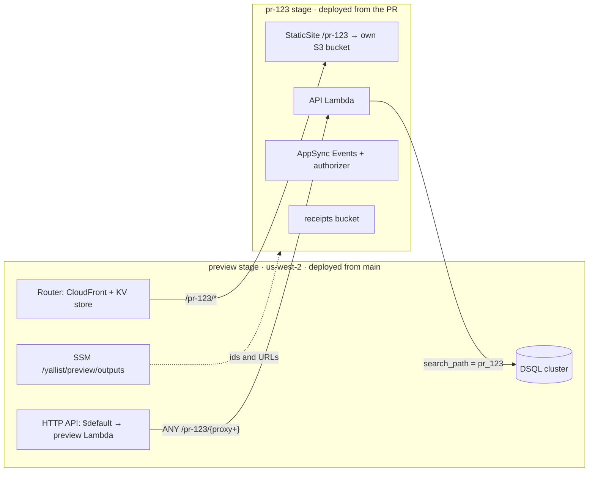

# PR preview environments and live e2e tests

**Status:** design only, nothing is built. Replaces the earlier "fresh AWS stage per run" design (2026-10-25): a brand-new stage per run paid for CloudFront, DSQL and AppSync creation on every run and gave nothing to click on before merging.

## Summary

- Every PR gets a **live environment on real AWS** at `https://<preview-cdn>/pr-<n>/` with its own API Lambda, realtime API, receipts bucket and database schema. It's created on open, updated on every push, removed on close or after **6 hours** without a push.
- The slow, shared pieces (DSQL cluster, CloudFront, API Gateway) are created **once** by a `preview` SST stage. A PR's `pr-<n>` SST stage only adds fast resources to them, so a push is live in **about 4–5 minutes** and `sst remove --stage pr-<n>` is the whole teardown.
- **Every AWS resource is in `infra/app/sst.config.ts`** (stage-conditional), nothing is created by hand or by CLI. The two things that aren't AWS resources, the PR's **database schema** and the stage's **SST passphrase**, are handled by `db:migrate` and the cleanup job ([§4](#4-data-not-resources)).
- The Maestro web flows ([ui-tests.md](ui-tests.md)) run against the preview with `WEB_URL`, which replaces the Playwright plan.
- A separate **least-privilege OIDC role** deploys previews; the admin deploy role stays `main`-only ([§6](#6-security)).

## 1. Shape



- **Web:** `https://<router>/pr-123/`. The site is an SST `StaticSite` with `router: { instance: sst.aws.Router.get(...), path: '/pr-123' }`: it uploads to its own bucket and registers the prefix in the Router's KV store. SST's Router is one CloudFront behavior plus a CloudFront Function that routes by KV lookup, so a PR adds **KV entries, not cache behaviors** ([Router](https://sst.dev/docs/component/aws/router/)). The SPA fallback goes to `/pr-123/index.html` (SST's `custom404` with a route `base`).
- **API:** `https://<preview-api>/pr-123/<route>`. The PR stage adds an `aws.apigatewayv2.Integration`, a `Route` (`ANY /pr-123/{proxy+}`) and a `lambda.Permission` to the shared HTTP API; SST has no `ApiGatewayV2.get`, so these are plain Pulumi resources in the same file. The Hono app is mounted under `/pr-123`. Routes and integrations are separate AWS resources, so the `pr-123` state owns only its own; the `$default` route stays with `preview`.
- **Realtime and receipts** are per PR, created in seconds, removed with the stage. A per-PR AppSync Events API means the PR's authorizer code is what gets tested, with no namespace or token tricks. A per-PR bucket means `receipts.ts` is unchanged.
- **Database:** one shared cluster; the PR connects as `admin` with `search_path = pr_123` ([§4](#4-data-not-resources)).

## 2. Shared or per PR

| Resource              | Owner     | Why                                                                                          |
| --------------------- | --------- | -------------------------------------------------------------------------------------------- |
| DSQL cluster          | `preview` | Per-PR schema. Capped at 10 schemas per database, see [§7](#7-limits-found).                 |
| CloudFront (`Router`) | `preview` | Takes minutes to create. Per-PR path via KV store, shared across stages with `Router.get`.   |
| HTTP API              | `preview` | Per-PR route and integration, 300 each per API.                                              |
| SSM outputs parameter | `preview` | One JSON parameter with the API id/URL, cluster id/endpoint, Router distribution id.         |
| Budget, IAM roles     | `global`  | The preview role, its workload boundary, a `us-west-2` budget.                               |
| API Lambda + role     | `pr-<n>`  | `yallist-pr-123-ApiFunction-…`; the stage prefix is what IAM scoping keys on.                |
| Route + integration   | `pr-<n>`  | Plain `aws.apigatewayv2.*` resources on the shared API.                                      |
| StaticSite + bucket   | `pr-<n>`  | Expo export with `experiments.baseUrl: '/pr-123'`, uploaded by SST.                          |
| AppSync Events + auth | `pr-<n>`  | Same code as `dev`; 50 Event APIs per region.                                                |
| Receipts bucket       | `pr-<n>`  | `removal: 'remove'` empties it on `sst remove`.                                              |
| Secrets               | `pr-<n>`  | `BetterAuthSecret` from the `preview` GitHub environment. No Google client, no GitHub token. |

## 3. `sst.config.ts`

One file, three kinds of stage: `dev`/`production` (unchanged), `preview`, and `/^pr-\d+$/`. The per-PR branch is today's config minus the DSQL cluster, the HTTP API and the CDN:

```ts
const outputs = aws.ssm.getParameterOutput({ name: '/yallist/preview/outputs' }).value.apply(JSON.parse);
const database = sst.aws.Dsql.get('Database', { id: outputs.clusterId });
const router = sst.aws.Router.get('Router', outputs.distributionId);
const prefix = `/${$app.stage}`; // "/pr-123"
const api = new sst.Linkable('Api', { properties: { url: $interpolate`${outputs.apiUrl}${prefix}` } });
const fn = new sst.aws.Function('ApiFunction', { handler: '../../apps/api/src/lambda.handler', link: [database, api, …], environment: { BASE_PATH: prefix } });
new aws.apigatewayv2.Integration('ApiIntegration', { apiId: outputs.apiId, integrationType: 'AWS_PROXY', integrationUri: fn.arn, payloadFormatVersion: '2.0' });
new aws.apigatewayv2.Route('ApiRoute', { apiId: outputs.apiId, routeKey: `ANY ${prefix}/{proxy+}`, target: $interpolate`integrations/${integration.id}` });
new sst.aws.StaticSite('Web', { router: { instance: router, path: prefix }, environment: { EXPO_PUBLIC_BASE_PATH: prefix, … } });
```

- `preview` is deployed by `deploy.yml` after `global` (it has no migrations of its own; its `$default` Lambda is the API on the `public` schema, which doubles as a smoke target). It writes the SSM parameter and returns its URLs.
- `pr-*` stages: `removal: 'remove'`, `protect: false`, `region: 'us-west-2'`, refused unless `CI` is set, `$transform(aws.iam.Role)` adds the workload boundary, default tags add `expires-at`.
- SST keeps **one state file and lock per stage**, so PR stages deploy concurrently and never wait on each other or on `preview` ([CLI](https://sst.dev/docs/reference/cli/)). Reading the SSM parameter is a lookup, not a lock.
- App changes: `app.config.ts` sets `experiments.baseUrl` from `EXPO_PUBLIC_BASE_PATH` ([Expo](https://docs.expo.dev/guides/publishing-websites/)); `lambda.ts` mounts the app under `BASE_PATH`; `createAuth` passes `baseURL: <api>/pr-123/api/auth`, because a path in Better Auth's `baseURL` sets its `basePath` ([options](https://www.better-auth.com/docs/reference/options)); `trustedOrigins` compares origins only, so the Router origin covers every PR.

## 4. Data, not resources

| What                     | Create                                                                                                              | Remove                                                                               |
| ------------------------ | ------------------------------------------------------------------------------------------------------------------- | ------------------------------------------------------------------------------------ |
| Schema `pr_123`          | `db:migrate` under `sst shell --stage pr-123`: `CREATE SCHEMA IF NOT EXISTS`, then the usual one-DDL-per-tx replay. | Cleanup job: drop each table, then `DROP SCHEMA`, under `sst shell --stage preview`. |
| `search_path`            | `client.ts` derives the schema from `Resource.App.stage` and sets it on every connection.                           | —                                                                                    |
| SST passphrase and state | Created by `sst deploy`.                                                                                            | Cleanup deletes `/sst/passphrase/yallist/pr-123` and the stage's state objects.      |

- DSQL supports `CREATE SCHEMA`, schema-level `GRANT`s and `SET search_path`; after DDL, "run `SET search_path` again to refresh the catalog cache" ([considerations](https://docs.aws.amazon.com/aurora-dsql/latest/userguide/considerations.html)). `DROP SCHEMA` isn't in the supported-DDL table but the same page describes errors "after dropping a schema"; **verify in rollout PR 2**, with per-table drops as the fallback.
- The migration runs in parallel with `sst deploy`: the cluster endpoint is known from the SSM parameter, so `SST_RESOURCE_Database` can be set by hand before the stage exists (the `sst` SDK reads `SST_RESOURCE_*`). Each push replays only new migrations.
- The same `migrate.ts` serves `dev` and `production` with `search_path = public`, so the DSQL migration path is exercised on every PR, not only on `main`.

## 5. Workflow and timing

`preview.yml`: `pull_request` (`opened`, `synchronize`, `reopened`, `closed`), `schedule` hourly, `workflow_dispatch`. Concurrency group `preview-pr-<n>`, cancel in progress.

| Job      | When                               | Steps                                                                                                                                                                                                     |
| -------- | ---------------------------------- | --------------------------------------------------------------------------------------------------------------------------------------------------------------------------------------------------------- |
| `deploy` | open, push; head repo is this repo | OIDC → preview role; `sst deploy --stage pr-<n>` and `db:migrate` in parallel; `/health` and site smoke; sticky PR comment with the URLs; Maestro flows with `WEB_URL=https://<router>/pr-<n>/`.          |
| `remove` | PR closed                          | `sst unlock`, `sst remove --stage pr-<n>`, drop the schema, delete passphrase and state, fail if `tag:GetResources` still finds `stage=pr-<n>`.                                                           |
| `expire` | hourly, dispatch                   | List `yallist-pr-*` Lambdas by tag; for each with `expires-at` in the past (6 h after its last deploy) or whose PR is closed, run the `remove` steps. Fails when it cleaned something, which notifies me. |

Estimated time per push, `ubuntu-latest`, nothing measured yet:

| Step                                                   | Estimate    | Notes                                                                                                                                                                                 |
| ------------------------------------------------------ | ----------- | ------------------------------------------------------------------------------------------------------------------------------------------------------------------------------------- |
| Runner, checkout, `pnpm install`, SST and Metro caches | 60–90 s     | Same as [ui-tests.yml](../../.github/workflows/ui-tests.yml) today.                                                                                                                   |
| `sst deploy --stage pr-<n>`                            | 2.5–3.5 min | Startup and esbuild 20 s; IAM role → Lambda → route 30–45 s and AppSync 15 s in parallel; then `expo export` 60–90 s, upload and KV route 15 s. The export waits for the AppSync URL. |
| `db:migrate` (schema + ~45 DDL)                        | 45–90 s     | Hidden behind the deploy.                                                                                                                                                             |
| Smoke and PR comment                                   | 10 s        | **Preview is usable here: about 4–5 min after the push.**                                                                                                                             |
| Maestro web flows                                      | ~2.5 min    | 5 flows, serial, as measured locally; shard later if it grows.                                                                                                                        |
| Teardown (`sst remove`, off the critical path)         | 1–2 min     |                                                                                                                                                                                       |

A first push and a later push cost the same: nothing slow is ever created. Later speed-up if wanted: serve the realtime host from `GET /config` instead of inlining it, so the export no longer waits for AppSync and runs beside the deploy (saves about a minute).

## 6. Security

- **Fork PRs never get credentials.** GitHub issues no OIDC token to `pull_request` runs from forks and passes no secrets; the job also has `if: github.event.pull_request.head.repo.full_name == github.repository`, and `pull_request_target` is never used ([events](https://docs.github.com/en/actions/writing-workflows/choosing-when-your-workflow-runs/events-that-trigger-workflows)). Only collaborators can push branches here.
- **Preview role `yallist-global-github-preview`** (in `infra/global`), trusting only `…:environment:preview`, 1-hour sessions. The `preview` GitHub environment allows all branches (it has to: PR branches deploy) and holds one secret, `BETTER_AUTH_SECRET`. Permissions: a region-lock deny outside `us-west-2` (except IAM, STS, CloudFront and the global SSM read); `lambda`, `logs`, `s3`, `ssm` scoped to `yallist-pr-*` names, SST's `us-west-2` state and asset buckets, `/sst/passphrase/yallist/pr-*`; `iam:CreateRole`/`PassRole` only on `role/yallist-pr-*` and only with the `yallist-preview-workload-boundary`; `apigateway` only on `/apis/<preview api id>/*`; `cloudfront-keyvaluestore` and `CreateInvalidation` only on the preview Router; `dsql:DbConnectAdmin` only on the preview cluster; `appsync` region-locked; `tag:GetResources`. The first runs will surface missing actions, iterate with CloudTrail.
- **Narrow the admin deploy role's trust** from `environment:*` to `global`, `dev`, `production`. This is a prerequisite: today a job in any environment could assume the admin role.
- **Workload boundary** on every `pr-*` role: `dsql:DbConnectAdmin` on the preview cluster, `appsync:EventPublish`, `s3` on its own bucket, `logs`. A PR Lambda can't touch `dev`, `production` or other PRs' buckets.
- **Shared database, shared admin.** A PR Lambda connects as `admin`, so a malicious PR could read another PR's schema. All of it is throwaway test data from collaborators. Hardening later: a DB role per schema mapped to the PR's Lambda role (`AWS IAM GRANT`), which DSQL supports.
- **Previews are public URLs** with guest sign-in. No PII, 6-hour life, no Google client, no GitHub feedback token.

## 7. Limits found

| Limit                                       | Value                                             | Effect                                                                                                                                                                                                                                                                                                                                                                                   |
| ------------------------------------------- | ------------------------------------------------- | ---------------------------------------------------------------------------------------------------------------------------------------------------------------------------------------------------------------------------------------------------------------------------------------------------------------------------------------------------------------------------------------- |
| DSQL schemas per database                   | **10, not adjustable**; 1 database per cluster    | **The real cap: at most about 8 live previews** (`public` and system schemas count against it, exactly which is unverified). The deploy job fails early with a clear message when the cluster is full; the hourly expiry and PR-close cleanup keep it low. Fallback in [§11 Q1](#11-open-questions). [Quotas](https://docs.aws.amazon.com/aurora-dsql/latest/userguide/CHAP_quotas.html) |
| DSQL clusters per region                    | 20, adjustable                                    | Room for the per-PR-cluster fallback.                                                                                                                                                                                                                                                                                                                                                    |
| DSQL DDL                                    | 1 DDL per transaction, 3,000 rows per transaction | Same as today; `migrate.ts` already complies. `CREATE SCHEMA` is supported; `DROP SCHEMA` unverified.                                                                                                                                                                                                                                                                                    |
| HTTP API routes / integrations per API      | 300 / 300 (integrations not adjustable)           | Far above the schema cap. [HTTP API quotas](https://docs.aws.amazon.com/apigateway/latest/developerguide/http-api-quotas.html)                                                                                                                                                                                                                                                           |
| API Gateway control plane                   | 10 requests/s per account                         | Each PR deploy makes a handful of calls; fine.                                                                                                                                                                                                                                                                                                                                           |
| CloudFront cache behaviors per distribution | 75 (default), adjustable                          | Not hit: the Router routes by KV store. [CloudFront quotas](https://docs.aws.amazon.com/AmazonCloudFront/latest/DeveloperGuide/cloudfront-limits.html)                                                                                                                                                                                                                                   |
| CloudFront KV store                         | 5 MB, 1 KB per value, functions ≤ 10 KB           | SST stores a few entries per site ("only top-level assets get individual entries"); thousands of PRs would fit.                                                                                                                                                                                                                                                                          |
| CloudFront invalidations                    | 1,000 paths/month free, then $0.005 per path      | SST invalidates `/pr-<n>/*` once per deploy (one path).                                                                                                                                                                                                                                                                                                                                  |
| AppSync Event APIs per region               | 50, adjustable                                    | One per PR plus `preview`. [AppSync quotas](https://docs.aws.amazon.com/general/latest/gr/appsync.html)                                                                                                                                                                                                                                                                                  |
| Lambda concurrency                          | 1,000, lower on new accounts                      | Previews and `preview` share it with nothing else in `us-west-2`.                                                                                                                                                                                                                                                                                                                        |
| Expo `experiments.baseUrl`                  | Export only, ignored by the dev server            | Fine: previews are exports. A refresh-drops-the-prefix bug was fixed in Dec 2024 ([expo#33400](https://github.com/expo/expo/issues/33400)); re-check on the current SDK.                                                                                                                                                                                                                 |
| GitHub environment branch rules             | Matched against `GITHUB_REF`                      | `preview` uses "No restriction"; `pull_request` runs would otherwise need a `refs/pull/*/merge` rule.                                                                                                                                                                                                                                                                                    |

## 8. Cost

- **Idle:** about $0. DSQL bills DPUs on use and storage ($0.33/GB-month), with 100,000 DPUs and 1 GB free per month ([pricing](https://aws.amazon.com/rds/aurora/dsql/pricing/)); CloudFront, API Gateway, Lambda, AppSync and S3 have no per-resource charge and generous free tiers. The shared `preview` Lambda and cluster cost nothing between runs.
- **Per push:** under $0.02 (a few hundred Lambda invocations, a few thousand DSQL DPUs, one invalidation). About 170 pushes a month stays within $1–5. The `us-west-2` budget is set to $5 with alerts at 80% actual and 100% forecast.

## 9. Not covered by previews

- **Changes to the shared stage** (`preview`'s cluster, HTTP API and its CORS, Router, SSM parameter) and to `infra/global`: a PR only deploys `pr-<n>`. Fallback: a `sst diff --stage preview` check in the PR when `infra/**` changes (read-only, the preview role can do it), and the `dev` deploy on merge, as today.
- **CloudFront settings** of the real sites (security headers policy, SPA error responses) since previews ride on the Router. Covered by the `dev` smoke check after merge.
- Google sign-in, GitHub feedback issues, Android and iOS, `production`'s region and deletion protection.
- Migrations against a non-empty database: each PR schema starts empty. Covered by the `dev` deploy.

## 10. What you must do

1. Create the `preview` GitHub environment: no branch restriction, secret `BETTER_AUTH_SECRET`.
2. Deploy `global` (from `main`, via `deploy.yml`) once rollout PR 2 lands: it creates the preview role and boundary, narrows the admin role's trust, and outputs `previewRoleArn`. Then `gh variable set AWS_PREVIEW_ROLE_ARN`.
3. Bootstrap SST in `us-west-2` once with admin credentials (the `sst-state-*` and `sst-asset-*` buckets); the preview role can't create them.
4. Pick the limit behaviour in [Q1](#11-open-questions) and whether previews run on every PR or on a label ([Q3](#11-open-questions)).

## 11. Open questions

1. **10 schemas per database.** Keep the schema-per-PR design with an 8-preview cap, or give each PR its own cluster in its stage? Clusters create "in seconds" since Dec 2025 ([AWS](https://aws.amazon.com/about-aws/whats-new/2025/12/amazon-aurora-dsql-cluster-creation-in-seconds/)), it's still all SST, and it needs no `search_path` code. _Recommendation: build schema-per-PR as designed, but measure a cluster's create-to-ACTIVE time in PR 2; if it's under 30 s, switch to a cluster per PR and drop §4's schema code._
2. **AppSync and receipts per PR, not shared.** This deviates from "shared everything" on purpose ([§1](#1-shape)). _Recommendation: keep per PR; they cost seconds and remove two cleanup steps and a token hack._
3. **Trigger.** Every PR, or only PRs with a `preview` label? _Recommendation: every PR from this repo while traffic is low; move to a label if the schema cap bites._
4. **Flows in the preview job or in `ui-tests.yml`?** _Recommendation: in the preview job, after the smoke, and keep the local-Postgres `ui-tests.yml` as the fast required check; make the preview flows required later, once they're stable._
5. **Preview URL secrecy.** Public guest access is fine for now. _Recommendation: revisit when someone outside the repo needs to see previews._

## 12. Rollout

| #   | PR                                                                                               | Acceptance                                                                                                                                                     |
| --- | ------------------------------------------------------------------------------------------------ | -------------------------------------------------------------------------------------------------------------------------------------------------------------- |
| 1   | `docs(plans): design PR preview environments` (this)                                             | Reviewed and merged.                                                                                                                                           |
| 2   | `feat(infra): preview role, boundary, budget, us-west-2 bootstrap`; `feat(api): schema-aware db` | Policy simulator denies other regions and unbounded roles. `DB_SCHEMA` migrate and drop verified on real DSQL, `DROP SCHEMA` and cluster create time measured. |
| 3   | `feat(infra): preview and pr-* stages`                                                           | `preview` deploys from `main`; a `pr-*` stage deploys and removes cleanly against it; `expo export` under `/pr-<n>` loads and refreshes.                       |
| 4   | `ci(preview): deploy on PR, remove on close, hourly expiry`                                      | A PR gets a working URL in a comment; closing removes everything; a stage leaked on purpose is expired. Timings recorded against [§5](#5-workflow-and-timing). |
| 5   | `test(preview): Maestro flows against the preview`                                               | The 5 flows pass on a preview URL over 10 runs.                                                                                                                |
