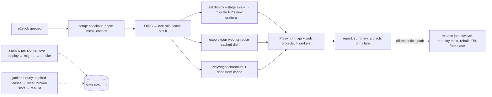

# Live end-to-end tests on leased AWS slots

**Status:** design only. Nothing here is built yet. See [Rollout](#10-rollout).

## Summary

- **Target:** a full run, from the moment the e2e job is queued to the moment results are reported, takes **at most 5 minutes** (budget about 3.5–4.5). Tests are live against AWS (Lambda, API Gateway, Aurora DSQL, AppSync Events), with no mocks or emulators. Everything runs in **`us-west-2`**.
- **How:** a small pool of long-lived, pre-provisioned e2e stages (`e2e-1`…`e2e-3`, called slots). Each run **leases** a free slot with a DynamoDB conditional write, `sst deploy`s its commit into the slot in place, applies only its own new migrations, and tests. The web build and browser install run in parallel with the deploy, on the same runner.
- **Reset is off the critical path:** after each run, a `release` job (`if: always()`) redeploys `main`, rebuilds the slot's database from zero to `main`'s migrations, and frees the lease. Every run starts on a clean, freshly migrated, empty database.
- **Main trade-off:** a run gets an exclusive, reset environment, not a brand-new one. Creating a stage from nothing is still tested **nightly**: each slot is removed and rebuilt, then smoke-tested. Isolation between concurrent runs stays strong, because each slot has its own Lambda, API, AppSync API, IAM roles and DSQL cluster.
- **Nothing left behind:** lease expiry, the `release` job, an hourly janitor and a `us-west-2` budget. The pool is a fixed, tagged set of resources that cost $0 when idle. One workflow removes all of it.
- **Recorded decision:** build e2e only after the backend and the app's switch to the API have landed. When e2e runs (triggers) is still open ([Q1](#11-open-questions)). The pipeline works with any trigger.

## 1. Why not a fresh stage per run

The first version of this design created and destroyed a whole stage per run and estimated 12–18 minutes. Even with every speed-up in this doc applied, a fresh stage stays at about 5–7 minutes:

| Step on the critical path                                      | Fresh stage per run   | Leased slot (chosen)                      |
| -------------------------------------------------------------- | --------------------- | ----------------------------------------- |
| `sst deploy`                                                   | 90–150 s (create all) | 40–70 s (diff: function code, PR's infra) |
| Migrations                                                     | 45–90 s (from zero)   | 5–15 s (only the PR's new ones)           |
| Web build: has to wait for the API URL?                        | yes, unless decoupled | no, the slot URL is known at lease        |
| Lambda cold starts, IAM propagation retries, async index build | every run             | only after the slot's nightly rebuild     |
| Teardown                                                       | 2–4 min, off path     | the `release` reset, 1–3 min, off path    |
| **Total**                                                      | **~5–7 min**          | **~3.5–4.5 min**                          |

All the numbers are estimates, **not measured**. [Rollout](#10-rollout) PR 4 measures them.

- **DSQL cluster creation is no longer the bottleneck.** Since December 2025, AWS says clusters are created "in seconds" ([what's new](https://aws.amazon.com/about-aws/whats-new/2025/12/amazon-aurora-dsql-cluster-creation-in-seconds)). The slow parts are now Pulumi creating about 20 resources (IAM roles, then Lambda waiting for the role to propagate) and migrations from zero.
- **Migrations from zero are a real cost on DSQL.** DSQL allows one DDL statement per transaction. The runner (#15) runs each of the 43 statements so far (14 tables, 8 indexes, 21 constraints) on its own and records each one. That count grows with every feature. **Per-statement DDL latency on DSQL is not verified.** I've assumed about 1 s per statement.
- **Rejected: one shared DSQL cluster with a schema per run.** DSQL has one database per cluster, but it supports `CREATE SCHEMA`. However:
  - It allows **at most 10 schemas per database** ([quotas](https://docs.aws.amazon.com/aurora-dsql/latest/userguide/CHAP_quotas.html)).
  - The API would need a schema or `search_path` setting in its production connection code.
  - A per-run schema still pays for migrations from zero.

  A cluster per slot gives the same isolation without changing any app code.

- **Rejected: deploy only the Lambda code (`aws lambda update-function-code`).** It saves about 30 s, but it skips any infra changes in the PR. Then a second code path would decide when to fall back to a full deploy. `sst deploy` into a slot that already exists is fast enough, and it tests the same incremental path that `dev` and `production` deploys use.

## 2. Architecture

### Slots

- **Stages** `e2e-1`…`e2e-N` with N = 3 to start, matched by `/^e2e-[1-9]$/` in `infra/app/stages.ts`. Each slot is a normal SST stage in `us-west-2`. It has:
  - the API Lambda and HTTP API;
  - its own DSQL cluster, with deletion protection off;
  - the AppSync Events API and its authorizer;
  - IAM roles under the e2e permission boundary ([§5](#5-security));
  - log groups with 3-day retention.

  It has no `StaticSite` and no CloudFront. The runner serves the web app on `localhost:4173`, and `webURL` for Better Auth `trustedOrigins` is that origin. CloudFront stays covered by `dev`'s real deploy and a `curl` smoke check for the SPA fallback and `/health`.

- **Short, fixed names** remove the old 16-character stage cap problem. IAM names always keep the `yallist-e2e-` prefix.
- **Idle cost is about $0.** Lambda, HTTP API, AppSync and DSQL compute cost nothing when idle. DSQL storage for an almost empty database is negligible.

### Lease

- **Table:** DynamoDB `yallist-e2e-leases`, on demand, in `us-west-2`, owned by `infra/global`. There's one item per slot: `{ slot, state: free|leased|broken, runId, sha, expiresAt }`.
- **Acquire:** go through the slots in a random order and try `UpdateItem … ConditionExpression: state = free OR (state = leased AND expiresAt < now)`. The first slot that succeeds is ours. `expiresAt` is now plus 20 minutes, which is longer than the 15-minute job timeout.
  - If every slot is busy, poll every 10 s for up to 10 minutes. This wait **does count** against the 5 minutes, so the pool must be big enough that it's rare.
  - An expired lease that gets taken over is reset inline first (slow, but rare).
- **Why not GitHub concurrency groups?** A group holds exactly one resource, so it can't hand out "any free one of N". It also cancels queued runs beyond one pending run.
- **Release:** the `release` job sets `state = free` only after the reset succeeds. If the reset fails, it sets `broken`, which notifies me through the failed job, and the janitor rebuilds the slot.

### Per-run isolation and reset

- **Between concurrent runs:** a slot is leased to exactly one run, so concurrent runs share no data plane and no state: not the cluster, the API, the AppSync API or the SST state lock. The only shared things are the account, the region, the bootstrap buckets, the lease table and the e2e role.
- **Each run starts from:** the slot deployed at a recent `main`, and a database built **from zero** to `main`'s migrations, seeded with `template_items`, with no rows from users. The run then deploys its own commit and applies only its own new migrations. That's the same incremental path production takes.
- **Reset (the `release` job, about 1–3 minutes, off the critical path):**
  1. Check out `origin/main` and run `sst deploy --stage e2e-k`. This undoes any infra or code the PR added.
  2. Drop every table in `public` in reverse foreign-key order, then run `db:migrate` from zero. **Not verified:** whether DSQL supports `DROP … CASCADE`. One `DROP TABLE` per transaction works either way.
  3. Free the lease.

  Step 2 also tests the migrations-from-zero path for every merged migration, close to every run.

- **Nightly rebuild:** for each slot, lease it, `sst remove`, `sst deploy` from scratch, migrate, run the P0 smoke, then free it. This keeps the "brand-new environment works" check, catches drift, and covers cold-start and IAM propagation paths. A failure makes the slot `broken` and fails the workflow.

## 3. Time budget (critical path)

The clock starts when the e2e job is queued. "Results reported" means the check conclusion and job summary are posted. Runner: standard `ubuntu-latest`, which has 4 vCPU and 16 GB for public repos and is free. All numbers are **estimates, not measured**.

| #   | Step                                                                                                      | Budget           | Notes                                                                                                                                                                                                                                                   |
| --- | --------------------------------------------------------------------------------------------------------- | ---------------- | ------------------------------------------------------------------------------------------------------------------------------------------------------------------------------------------------------------------------------------------------------- |
| 1   | Runner pickup                                                                                             | 10–20 s          | Starting the trigger with an `if:` on the job, not a separate "decide" job, saves a whole extra runner.                                                                                                                                                 |
| 2   | Checkout, Node, `pnpm install --frozen-lockfile` with the store cached                                    | 35–50 s          | The `setup-node` pnpm cache already exists in `ci.yml`.                                                                                                                                                                                                 |
| 3   | Restore caches: SST CLI home, `infra/app/.sst/platform`, Playwright browsers, Metro cache, and `dist`     | 15–25 s          | SST's aws provider plugin alone is 801 MB (measured on macOS). Linux path `~/.config/sst/{bin,plugins}` is **inferred** from Go's `os.UserConfigDir` (`~/Library/Application Support/sst` on macOS, verified). Key: sst version + `provider-lock.json`. |
| 4   | OIDC, then lease                                                                                          | ~5 s             |                                                                                                                                                                                                                                                         |
| 5   | In parallel (background processes, logs to files, printed in `::group::`s):                               | **60–90**        | The longest branch sets this step's length.                                                                                                                                                                                                             |
|     | a. `sst deploy --stage e2e-k`, then `sst shell -- db:migrate`                                             | 50–85 s          | Pulumi doesn't refresh by default. The diff is mostly the function's code. A PR that changes infra adds its own create time.                                                                                                                            |
|     | b. `expo export -p web`, or reuse `dist` cached by a hash of `apps/mobile`, `packages/*` and the lockfile | 0–90 s           | Built with the slot's URLs, which are known at lease time (stored on the lease item).                                                                                                                                                                   |
|     | c. `playwright install --with-deps chromium` (browsers cached; apt deps still install)                    | 20–40 s          |                                                                                                                                                                                                                                                         |
| 6   | `serve -s dist`, wait for `/health`                                                                       | ~5 s             |                                                                                                                                                                                                                                                         |
| 7   | Playwright: `api` and `web` projects, `workers: 4`                                                        | 60–75 s          | **Hard budget.** The browser suite is only the P0 flows ([§7](#7-tests)). The step summary flags it when it goes over 75 s.                                                                                                                             |
| 8   | Report: job summary, plus artifacts only on failure                                                       | 5–15 s           | On failure, also `aws logs tail` the slot's API logs from the last 10 minutes.                                                                                                                                                                          |
|     | **Total**                                                                                                 | **~3.5–4.5 min** | About 30–90 s of margin. A slot wait or an infra-heavy PR can push it past 5 minutes.                                                                                                                                                                   |
| —   | `release` job: redeploy `main`, rebuild the DB, free the lease                                            | 1–3 min          | Off the critical path, on its own runner, `if: always()`.                                                                                                                                                                                               |

- **One job, not three.** Running deploy, build and browser install in separate jobs would cost a second runner pickup, a second `pnpm install` and an artifact hand-off, about 60–80 s. Background processes on one 4-vCPU runner are cheaper. The deploy mostly waits on the network, and the export uses the CPU.
- **Not worth it:** larger runners cost money. The Playwright container image is about 1.5 GB to pull. Sharding Playwright across jobs pays for runner pickup and install again.
- **Each step's duration** is written to the job summary, so it's obvious when the budget breaks.

## 4. Region: `us-west-2`

Kept from the first design. It isn't `us-east-2` (dev), `eu-central-1` (production) or `us-east-1` (global services), so a region lock separates e2e cleanly. It's close to GitHub's runners. DSQL is available there ([region table](https://docs.aws.amazon.com/aurora-dsql/latest/userguide/what-is-aurora-dsql.html#region-availability)). AppSync Events availability there is inferred from AppSync's and **should be re-checked in the realtime PR**. The SST bootstrap (asset bucket, state bucket, `/sst/bootstrap`) in `us-west-2` is created once by hand with admin credentials.

## 5. Security

- **Fork PRs never get credentials.** GitHub doesn't give fork PRs an OIDC token, the job's `if:` requires the PR's head repo to be this repo, and we never use `pull_request_target`.
- **The e2e role, `yallist-global-github-e2e`, in `infra/global`:**
  - Trust: only `…:environment:e2e`.
  - A region-lock deny outside `us-west-2`, except IAM and STS.
  - `lambda`, `logs` and `iam` access scoped by name to `yallist-e2e-*`.
  - `iam:CreateRole` only with the permission boundary `yallist-e2e-workload-boundary`, which `$transform(aws.iam.Role)` adds to every role in e2e stages.
  - Guardrail denies on the boundary, the OIDC provider, `yallist-{global,dev,production}-*`, `budgets` and `organizations`.
  - S3 limited to the two bootstrap buckets. SSM limited to `/sst/passphrase/yallist/e2e-*`.
  - DynamoDB access only on the lease table.

  The statements are the same as in the first design. The first runs will surface missing actions. Iterate with CloudTrail AccessDenied events.

- **Dependency: the admin deploy role's trust.** Today the deploy role trusts `…:environment:*`. Any job that runs in a GitHub environment open to PR branches could assume the **admin** role. You **declined narrowing it for now.** So:
  - Until it's narrowed to `global`, `dev` and `production`, the `e2e` environment must accept only `main` (deployment branch rule). That allows e2e on `main` and `workflow_dispatch` from `main`.
  - Running e2e on PRs requires narrowing that trust first. It's a one-line change in `infra/global`.
- **Secrets:** `BetterAuthSecret` is a random value per run (`SST_SECRET_BetterAuthSecret`). Updating it on every deploy is harmless, because the database is reset anyway. There's no Google client in e2e. Every test user is a Better Auth anonymous guest. There's no test-only sign-in.

## 6. Cleanup guarantees

1. **`release` job:** `needs: e2e`, `if: always()`, so it also runs after a cancel. It gets the slot from the e2e job's outputs and has a 15-minute timeout. It frees the slot, or marks it `broken`.
2. **Lease expiry:** a run whose `release` never happens holds its slot for at most 20 minutes. After that, the next acquirer or the janitor resets the slot.
3. **Janitor** (`e2e-janitor.yml`, hourly, plus `workflow_dispatch`):
   - Resets expired leases and rebuilds `broken` slots.
   - Finds anything tagged `e2e=true` in `us-west-2` that's not in a known slot, plus `yallist-e2e-*` roles and passphrases left without a stage, and removes it (`sst remove`, then deletion by tag).
   - Fails whenever it had to clean up, which notifies me.
4. **Whole pool:** `e2e-pool.yml` with `workflow_dispatch` and the input `remove` tears down every slot, the state and the passphrases.
5. **Budget:** `yallist-global-e2e-monthly`, filtered to `us-west-2`, $3, with alerts at 80% actual and 100% forecast.

## 7. Tests

- **Package:** `e2e/` (`@yallist/e2e`), with Playwright and two projects:
  - `api`: specs through the typed Hono `hc` client and guest bearer tokens.
  - `web`: Chromium, `he-IL`, RTL, two browser contexts for multi-user and realtime flows. It serves `apps/mobile/dist` on `:4173`.

  Selectors use roles and accessible names, with strings imported from `apps/mobile/src/i18n/he.ts`. No fixed sleeps. Realtime checks use `expect(…).toHaveText(…, { timeout: 15_000 })`.

- **Keeping it under 75 s:**
  - Business rules are tested in `api` specs, which take milliseconds each and run in parallel.
  - The browser suite holds only the P0 flows.
  - Every test creates its own trip, so tests are independent and parallel-safe.
  - Users sign in once per worker and reuse the token or `storageState`. That also stays under Better Auth's per-IP sign-in limits (**defaults not verified**).
  - `retries: 1`. A test that passes on retry is reported as flaky.
- **Scenarios:**

| P   | Project | Scenario                                                                                                                                                                                               |
| --- | ------- | ------------------------------------------------------------------------------------------------------------------------------------------------------------------------------------------------------ |
| P0  | api     | `/health`. Guest sign-in, then `/me`. Templates are seeded.                                                                                                                                            |
| P0  | web     | A guest creates a "camp" trip from the template and sees the bring and buy items with the missing count.                                                                                               |
| P0  | web     | Invite and join: B opens `/j/<token>`, sees the preview and joins. A's People tab shows B.                                                                                                             |
| P0  | web     | Claim with realtime: B claims, and A's open screen updates without reloading. On a `qty` item, A and B fill the cap.                                                                                   |
| P1  | api     | Over-claim rejected, including two concurrent claims for the last unit where exactly one wins. Non-member and pending reads are rejected. Rotated token rejected. The last organizer can't be removed. |
| P1  | api     | An expense split three ways gives the expected balances and transfers. Marking a payment and confirming it works.                                                                                      |
| P2  | web     | Add item seen live. Approval flow. Deep link reload keeps the session. These go in only if the 75 s budget allows.                                                                                     |

- **On failure:** trace on the first retry, screenshots and video kept for failures, `playwright-report/`, `test-results/` and the Lambda log tail. Uploaded as artifacts kept for 7 days.

## 8. Migrations

- **Per run:** `sst shell --stage e2e-k -- pnpm --filter @yallist/api db:migrate` applies only the PR's new migrations. It's the same command `deploy.yml` uses after #15.
- **Async indexes:** new `CREATE INDEX ASYNC` builds run on empty tables, so we don't wait for them. Indexes from `main` were built during the previous reset.
- **From zero:** tested by every `release` reset and every nightly rebuild, not on the critical path. A precomputed schema snapshot would add a second schema source that could drift from the migrations, so we don't use one.

## 9. Cost

- **Idle pool:** about $0, plus pennies of DSQL storage and logs.
- **Per run:** Lambda, API Gateway, AppSync and DynamoDB are under $0.01. DSQL, including the reset's from-zero migrations, is about $0.01–0.05 at about $8 per million DPUs beyond the free tier. **Not verified:** whether the free tier is per account or per region.
- **Per month:** about 170 runs plus 90 nightly rebuilds comes to roughly **$2–10**. GitHub minutes are free on this public repo.

## 10. Rollout

| #   | PR                                                                        | Depends on                              | Acceptance                                                                                                                                                                                                                                   |
| --- | ------------------------------------------------------------------------- | --------------------------------------- | -------------------------------------------------------------------------------------------------------------------------------------------------------------------------------------------------------------------------------------------- |
| 1   | `docs(plans): design live e2e tests` (this)                               | —                                       | Reviewed and merged.                                                                                                                                                                                                                         |
| 2   | `feat(infra): e2e role, workload boundary, lease table, us-west-2 budget` | #18                                     | The policy simulator denies other regions and roles without the boundary. Manual steps: bootstrap `us-west-2`, create the `e2e` environment limited to `main` ([§5](#5-security)), set `AWS_E2E_ROLE_ARN`.                                   |
| 3   | `feat(infra): e2e slot stages`                                            | #14, #15, #19 and the app on the API    | `stages.ts` has Vitest coverage: dev and production are unchanged, the `e2e-[1-9]` rule holds, nothing local. Slots have the boundary, no StaticSite, tags and short log retention.                                                          |
| 4   | `ci(e2e): pool build, lease and release, smoke, timing`                   | 2, 3                                    | `e2e-pool.yml` builds 3 slots. A dispatched run leases, deploys, passes the P0 smoke and releases. A cancelled run is freed. **Each step's timing is recorded. If the budget doesn't hold, revisit [§1](#1-why-not-a-fresh-stage-per-run).** |
| 5   | `ci(e2e): janitor and nightly rebuild`                                    | 4                                       | A slot leaked on purpose is reset. A broken slot is rebuilt. An untracked tagged resource is removed and reported.                                                                                                                           |
| 6   | `test(e2e): API specs`                                                    | 4, trips and expenses APIs              | The P0 and P1 `api` specs pass on a slot.                                                                                                                                                                                                    |
| 7   | `test(e2e): web flows with two users and realtime`                        | 6, realtime, app on the API             | The P0 web flows pass. The whole run takes 5 minutes or less on 10 consecutive runs.                                                                                                                                                         |
| 8   | `ci(e2e): triggers and gating`                                            | 7, [Q1](#11-open-questions), Q4 for PRs | Wires up whatever triggers are chosen. It can make `production` wait for e2e and make e2e a required PR check.                                                                                                                               |

## 11. Open questions

1. **When does e2e run?** Every code PR, PRs with an `e2e` label, `main` before `production`, or a combination. Nothing is decided yet, and the pipeline works with any of them. _Recommendation: `main` before `production` first, since it needs no trust change. Then PRs through a label once Q4 is done. Move to every code PR if runs stay at 5 minutes or less and stable._
2. **Pool size?** _Recommendation: 3._ Concurrent runs above N wait in the queue, and that wait counts against the 5 minutes. The cost is the same for any N, so raise it if the wait time in the job summary is often above zero.
3. **Is a reset slot plus a nightly fresh rebuild faithful enough** compared with a brand-new stage per run (about 5–7 minutes)? _Recommendation: yes._ Isolation between runs is the same. What's lost on each run is only the create-from-nothing path and cold starts, and the nightly rebuild covers them. A `workflow_dispatch` input could run a single fresh stage on demand if you want one.
4. **Narrow the admin deploy role's trust** to `global`, `dev` and `production`? You declined this for now. It's required before e2e can run on PR branches ([§5](#5-security)). _Recommendation: do it in the same PR that enables PR triggers._
5. **Over 5 minutes: warn or fail?** _Recommendation: warn in the summary._ Failing a correct change because of AWS latency adds noise.
6. **Separate AWS account for e2e later?** _Recommendation: not now._ Revisit when production has real users or a second contributor joins.

## Not verified

- Every timing in [§1](#1-why-not-a-fresh-stage-per-run) and [§3](#3-time-budget-critical-path). PR 4 measures them.
- DSQL's per-statement DDL latency, whether it supports `DROP … CASCADE`, and whether the free tier is per account or per region.
- The SST CLI home on Linux (`~/.config/sst`), which is inferred.
- AppSync Events in `us-west-2`, and Better Auth's default rate limits.
- The exact IAM actions SST and Pulumi need.
