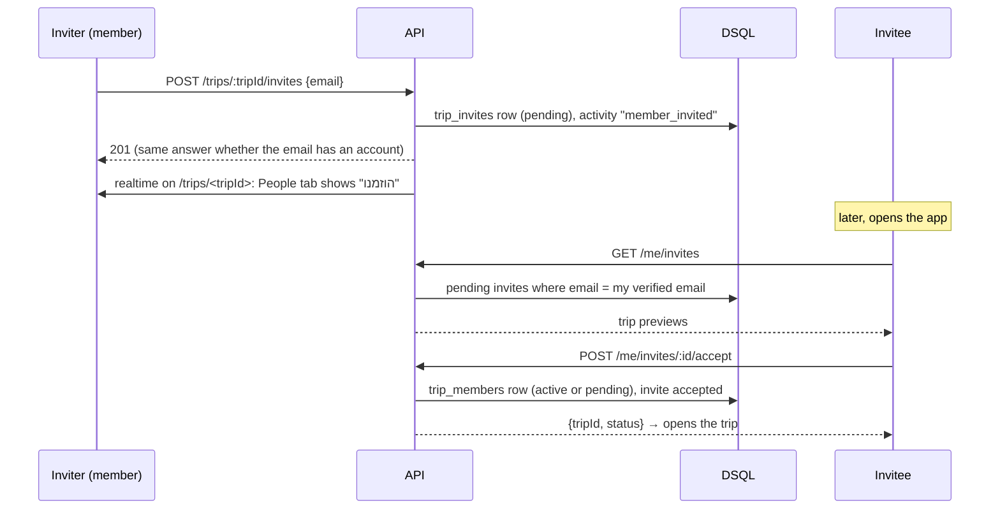

# Invite to a trip by email

**Status:** design, nothing built (2026-11-18).

## Summary

A trip member types a friend's email in the invite sheet. The next time that friend opens the app (Android or web), signed in with that email, an invitation card is at the top of the home screen: "הוזמנת לטיול". One tap joins.

No email is sent in this version: the app has no mail provider yet ([email-signup.md](email-signup.md) is blocked on the domain). The invitation lives in the database and waits for the invitee to open the app. Sending a notification email is a later step that reuses the same rows ([Later](#later)).

The invite link stays the main way in. Email invites are for people who already use the app, or will sign in with Google anyway.

## How it works



### Rules

1. **Who can invite:** any active member, as with the link, which any member can already share. Organizers can cancel any invite, and members can cancel their own.
2. **Matching is by verified email only.** An invite shows up for a user whose `users.email` equals the invited address (trimmed, lower-cased) and whose `email_verified` is true. Today that means Google accounts. Guests have no real email, so they see nothing until they sign in with Google. Unverified password accounts (once email sign-up ships) see nothing until they verify the address, so nobody can register someone else's address and pick up their invites.
3. **No enumeration.** The inviter gets the same answer whether or not the address has an account, and never learns whether the invitee has seen the invite. The People tab only says "הוזמנו · עוד לא הצטרפו".
4. **Accepting:**
   - An invite from an **organizer** makes the invitee an active member even when the trip requires approval, because the organizer already chose them.
   - An invite from a **member** follows the trip's approval switch, as the link does: active, or pending for an organizer to approve.
   - A member who left can come back through an invite. A member an organizer removed can only come back through an invite from an organizer; one from a member gets the same 403 as the link.
   - Their display name is their profile name, as on a link join.
   - Already a member: accepting changes nothing and opens the trip.
5. **Declining** ("לא תודה") hides the invite from the invitee. Inviters aren't told: the invite simply leaves "הוזמנו". Someone can invite again later, which shows a new card.
6. **One pending invite per trip and address.** Inviting the same address again only bumps `created_at` and `invited_by`. Inviting someone who's already an active member answers "כבר בטיול" (they are visible to members anyway, so this leaks nothing).
7. **Expiry:** an invite shows only while the trip is `planning` and for 30 days after it was sent. Expired invites leave "הוזמנו" too.
8. **Limits:** at most 20 new invites per trip per day and 50 pending per trip (429 with a Hebrew message). This keeps the feature from being used to spam strangers' inboxes once emails go out.
9. **Rotating the link doesn't cancel invites.** They don't depend on the token.

## Data

New table `trip_invites` (no cascades on DSQL, so deletes are explicit, as elsewhere):

| Column         | Type        | Notes                                               |
| -------------- | ----------- | --------------------------------------------------- |
| `id`           | uuid        | pk                                                  |
| `trip_id`      | uuid        | → `trips.id`                                        |
| `email`        | text        | trimmed, lower-cased                                |
| `invited_by`   | uuid        | → `users.id`                                        |
| `status`       | text        | `pending` \| `accepted` \| `declined` \| `canceled` |
| `created_at`   | timestamptz | bumped on re-invite; expiry counts from here        |
| `responded_at` | timestamptz | nullable                                            |

- Unique `(trip_id, email)`: one row per address per trip, reused on re-invite (DSQL has no partial indexes).
- Index on `email`, for `GET /me/invites`.
- **Trip deleted:** `deleteTrip` deletes its invites.
- **Account deleted:** `deleteUser` deletes the invites they sent that are still pending. Invites to their address stay harmless: nobody with that verified email can see them unless they sign up again, and then they're valid.
- **Guest merged into a Google user:** nothing to do; invites are keyed by email.
- New activity kind `member_invited` (who invited, not the address: the activity feed is for everyone in the trip, and so is the People tab, so this is a choice of noise, not privacy).

## API

| Route                                 | Who                  | What                                                                                                                                                                                              |
| ------------------------------------- | -------------------- | ------------------------------------------------------------------------------------------------------------------------------------------------------------------------------------------------- |
| `POST /trips/:tripId/invites {email}` | active member        | Creates or bumps the invite. 201 `{ id }`. 409 "כבר בטיול" for an active member's address. 429 over the limits. Publishes on the trip channel.                                                    |
| `DELETE /trips/:tripId/invites/:id`   | organizer or inviter | Sets `canceled`. Publishes.                                                                                                                                                                       |
| `GET /me/invites`                     | signed in            | Pending, unexpired invites to my verified email, each with the invite preview the join page already gets (name, dates, cover, members, missing) and the inviter's display name. Empty for guests. |
| `POST /me/invites/:id/accept`         | the invitee          | Joins (rules 4). `{ tripId, status }`. Publishes. 404 for an invite that isn't theirs, so ids reveal nothing.                                                                                     |
| `POST /me/invites/:id/decline`        | the invitee          | Sets `declined`. Publishes (so "הוזמנו" updates).                                                                                                                                                 |

- The trip snapshot (`loadTrips`) gains `invites: { id, email, invitedBy, createdAt }[]` (pending, unexpired), for active members only. The invite preview for strangers (`GET /invites/:token`) doesn't get it.
- The invite preview built in `routes/invites.ts` moves to a shared function, so `GET /me/invites` and the join page show the same thing.
- Invitee freshness: there is no per-user realtime channel, and none is needed for "next time they use the app". Home fetches `GET /me/invites` with the trip list, on start and when the app returns to the foreground (`AppState`, as `useToday` does), and on pull to refresh.

## Screens

Five changes, one new page. Hebrew copy below is a draft.

### 1. Invite sheet: by email (changed)

`/(app)/trips/[tripId]/invite`. Under the existing WhatsApp message and share button, a divider "או בהזמנה לפי מייל" and an email field with a send button. Sent invites list underneath with a cancel X, so the inviter sees what they just did without leaving the sheet.

```
┌──────────────────────────────────────┐
│ הזמנת חברים                        ✕ │
│ זו ההודעה שתישלח, עם הקישור לטיול    │
│ ┌──────────────────────────────────┐ │
│ │ בואו לגליל (3–5.12)! מצטרפים…   │ │
│ └──────────────────────────────────┘ │
│        yallist.app/j/••••••          │
│   [   שליחת ההזמנה   ]               │
│   העתקת הקישור בלבד                  │
│ ───────  או בהזמנה לפי מייל  ─────── │
│ ┌───────────────────────┐ [ הזמנה ]  │
│ │ name@gmail.com        │            │
│ └───────────────────────┘            │
│ יראו את ההזמנה כשייכנסו לאפליקציה    │
│ עם המייל הזה                         │
│                                      │
│  dana@gmail.com · עכשיו          ✕   │
│  yoni@gmail.com · אתמול          ✕   │
└──────────────────────────────────────┘
```

- Email keyboard, `autoComplete="email"`, trimmed. Invalid format: inline error "המייל לא נראה תקין".
- After sending: toast "ההזמנה נשמרה. dana@gmail.com תראה אותה בכניסה הבאה" (gender-neutral phrasing in the final copy), field clears.
- The hint line matters: it tells the inviter no email goes out, so they still message their friend.

### 2. People tab: "הוזמנו" group (changed)

`PeopleTab`, below "מחכים לאישור" and above the members. Visible to all active members; the X only for organizers and the inviter.

```
 הוזמנו
 ┌──────────────────────────────────────┐
 │ ✉  dana@gmail.com                 ✕  │
 │    הזמין/ה: יוני · לפני יומיים        │
 ├──────────────────────────────────────┤
 │ ✉  avi@walla.co.il                ✕  │
 │    הזמנת · היום                       │
 └──────────────────────────────────────┘
```

- A grey envelope stands in for the avatar: they aren't a member yet.
- The "עוד חברים מצטרפים?" callout gets a second button, "לפי מייל", that opens the sheet focused on the email field.

### 3. Home: invitation cards (changed)

`/(app)/index`, above the trip grid, one card per invite, newest first. Also on the empty home (`FirstHome`), above the explainer: a first-time user who was invited should see the invite, not "עוד אין טיולים".

```
┌──────────────────────────────────────┐
│ [ cover scene of the trip         ]  │
│ הוזמנת לטיול                          │
│ גליל עם החבר'ה                        │
│ 3–5 בדצמבר · יוני הזמין/ה             │
│ (●)(●)(●) +4   · 12 דברים עוד חסרים   │
│                                      │
│  [  הצטרפות  ]      לא תודה          │
└──────────────────────────────────────┘
```

- **הצטרפות**: accept, then open the trip (or the pending page when approval is needed, as after a link join). The card leaves with the trip appearing in the grid.
- **לא תודה**: decline with a 5-second undo toast, then the card leaves.
- Tapping the card body opens the invitation page (4).
- More than two invites: show two and a "עוד 3 הזמנות" row that opens the list (5).

### 4. Invitation page (new)

`/(app)/invites/[inviteId]`. The same preview as the web join page `/j/[token]` (cover, dates, who's in, what's still missing), with "יוני הזמין/ה אותך" on top and the same two buttons. It reuses the join page's preview component, so both stay in step. An invite that's gone (canceled, expired, accepted on another device) shows "ההזמנה כבר לא בתוקף" with a button home.

### 5. Invitations list (new, small)

`/(app)/invites`. Only reachable from the "עוד N הזמנות" row: the cards of (3), stacked. Most users will never see it.

### Not changed

- Sign-in: no new screen. A guest who was invited by email sees nothing until they sign in with Google; the profile's existing "sign in with Google" prompt is where they'd do it. See open question 3.
- The web join page `/j/[token]` and the link flow.

## Tests

- API (`routes/email-invites.test.ts`): invite, re-invite bumps, member's address → 409, limits → 429, cancel permissions, `GET /me/invites` matches only a verified email and is empty for guests, expiry and ended trips, accept with and without approval and by organizer vs member, removed member rules, decline, another user's invite id → 404, trip and account deletion clean up.
- Domain/unit: email normalizing.
- UI (Maestro, web): member A invites B's email; B signs in, sees the card, joins, lands in the trip; A's People tab drops the row.

## Build order

1. Table, migration, DAL, the five routes, snapshot field, tests.
2. Invite sheet email field and the People tab group.
3. Home cards, the invitation page and list, foreground refresh, UI test.

Each is one PR.

## Open questions

1. **Who can invite:** any member (proposed, matches the link) or organizers only?
2. **Organizer invites skip approval** (proposed). Or should every invite follow the approval switch?
3. **Guests:** should the invite sheet say "they need to sign in with Google to see it"? Or, for guests on home, a hint "הוזמנת במייל? התחברו עם Google"? Proposed: the sheet's hint line only.
4. **Tell the inviter about a decline?** Proposed: no, the row just leaves.

## Later

- **Email the invitee** through SES once the domain is verified ([email-signup.md](email-signup.md)): "יוני מזמין/ה אותך לגליל", with a link to the invitation page (which also works for someone without the app: sign in with Google, see the card). Rule 8's limits are there for this.
- **Push** when the app has notifications: the same event.
- **Invite from past trip-mates:** suggest people from my other trips instead of typing an email.
