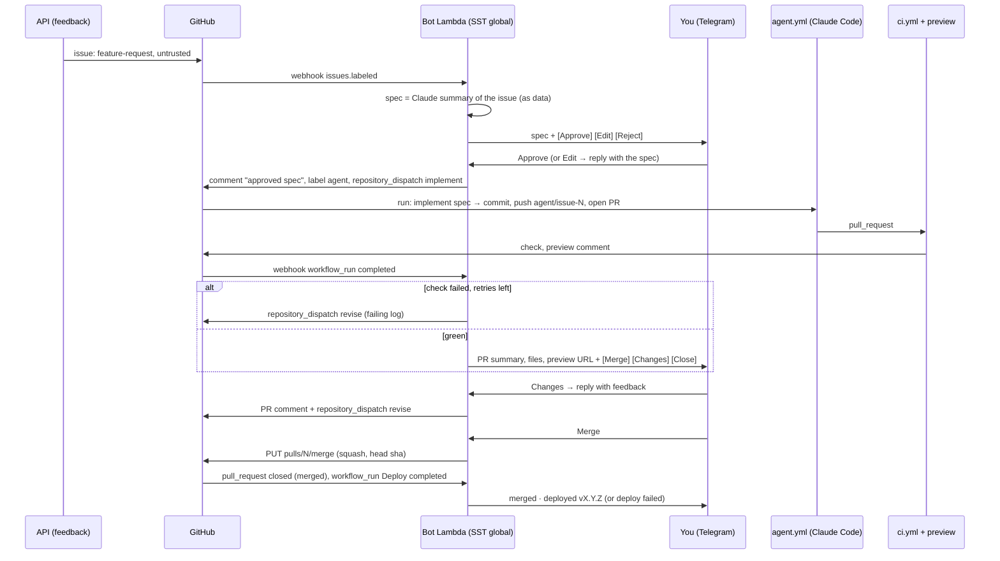

# Remote feature pipeline: request → Telegram → Claude → PR → merge

**Status:** design, nothing built. Facts checked against the linked official pages on 2026-10-26.

## Summary

A user asks for a feature in the app; it's already a GitHub issue labelled `feature-request` + `untrusted` ([deploy.md](../deploy.md#feature-requests-to-github-optional)). From there, without a laptop:

1. A **Telegram** bot sends you a short spec written from the issue, with **Approve / Edit / Reject** buttons.
2. Approve dispatches a GitHub Actions run of **Claude Code** (`anthropics/claude-code-action@v1`) that implements the approved spec, never the raw issue text, and opens a PR.
3. When CI (and the [PR preview](e2e-live-environments.md)) is green, the bot sends the PR summary and preview URL with **Merge / Changes / Close**.
4. Merge squashes through the bot's GitHub App, so `main`'s ruleset stays enforced; the bot reports the merge and the `deploy.yml` outcome.

Everything AWS is one Lambda and one DynamoDB table in `infra/global`. Expect **about $5 per feature** (range $2–12), almost all of it Claude tokens, and **about $100/month at 20 features**.

## Flow

## Components

| Component                    | Where                                                                       | Does                                                                                                                                                                                                                                                                                                                                                                                                                                                                                                                                                                                                                            |
| ---------------------------- | --------------------------------------------------------------------------- | ------------------------------------------------------------------------------------------------------------------------------------------------------------------------------------------------------------------------------------------------------------------------------------------------------------------------------------------------------------------------------------------------------------------------------------------------------------------------------------------------------------------------------------------------------------------------------------------------------------------------------- |
| Feedback → issue             | API Lambda (exists)                                                         | Unchanged. Both stages open issues in this repo; the bot handles `production` issues and only notifies about `dev` ones (stage is in the issue body).                                                                                                                                                                                                                                                                                                                                                                                                                                                                           |
| **Bot Lambda**               | `infra/global`: `sst.aws.Function('Bot', { url: true })`, arm64, Node 24    | One function, two webhook paths: `/telegram` (checks the `X-Telegram-Bot-Api-Secret-Token` header, [setWebhook](https://core.telegram.org/bots/api#setwebhook)) and `/github` (checks `X-Hub-Signature-256` with `timingSafeEqual`, [docs](https://docs.github.com/en/webhooks/using-webhooks/validating-webhook-deliveries)). Writes the spec, sends Telegram messages, comments, labels, dispatches and merges through the GitHub App. A Function URL is HTTPS on 443, as Telegram requires; no API Gateway.                                                                                                                  |
| **State table**              | `infra/global`: `sst.aws.Dynamo('Pipeline')`, on-demand, TTL                | Last Telegram `update_id` (replay), per-issue state (`spec`, `pr`, `retries`, Telegram message ids), monthly spend counter, `paused` flag. GitHub labels mirror the state (`agent`, `agent:ready`, `agent:blocked`) so the issue and PR are readable without the table.                                                                                                                                                                                                                                                                                                                                                         |
| Secrets                      | `sst.Secret` in `infra/global`, values from the `global` GitHub environment | `TelegramBotToken`, `TelegramWebhookSecret`, `GithubAppId`, `GithubAppPrivateKey`, `GithubWebhookSecret`, `AnthropicApiKey` (spec summaries). Set like the app's secrets ([deploy.md](../deploy.md#secrets)).                                                                                                                                                                                                                                                                                                                                                                                                                   |
| **GitHub App `yallist-bot`** | Your account, installed on this repo only                                   | Permissions: Contents RW (push, dispatch, merge), Pull requests RW, Issues RW, Actions R, Checks R; **no Workflows permission**, so no token from it can change `.github/workflows` ([permissions](https://docs.github.com/en/rest/authentication/permissions-required-for-fine-grained-personal-access-tokens)). Installation tokens live 1 hour ([docs](https://docs.github.com/en/apps/creating-github-apps/authenticating-with-a-github-app/generating-an-installation-access-token-for-a-github-app)); nothing long-lived to rotate. Webhook → the Lambda's `/github`.                                                     |
| **`agent.yml`**              | GitHub Actions, `ubuntu-latest`, `concurrency: agent` (one run at a time)   | `on: repository_dispatch: [implement, revise]`. Runs only the workflow on `main` ([dispatch](https://docs.github.com/en/rest/repos/repos#create-a-repository-dispatch-event)). Steps: checkout `main` (or the PR branch for `revise`), `pnpm install`, `anthropics/claude-code-action@v1` in automation mode with the spec as `prompt` ([docs](https://code.claude.com/docs/en/github-actions)), then a **path guard**, then commit, push and `gh pr create` with a 1-hour App token. CI runs on the PR because the push isn't from `GITHUB_TOKEN` ([docs](https://docs.github.com/en/actions/concepts/security/github_token)). |
| Claude (agent)               | Anthropic API, `claude-opus-5-5`                                            | `claude_args: --model claude-opus-5-5 --max-turns 80 --max-budget-usd 10 --allowedTools "Read,Glob,Grep,Edit,Write,Bash(pnpm *),Bash(git diff *),Bash(git log *),Bash(git status)"`. No `gh`, `curl`, `git push` or web tools: it edits files and runs the repo's checks, nothing else.                                                                                                                                                                                                                                                                                                                                         |
| Claude (spec)                | Anthropic API from the Bot Lambda, `claude-sonnet-5-5`                      | One structured-output call: issue text inside a `<untrusted_issue>` block → `{ title, spec (≤6 lines), outOfScope, risk }`. About $0.02 per issue.                                                                                                                                                                                                                                                                                                                                                                                                                                                                              |
| CI, preview, deploy          | `ci.yml`, `preview.yml` (planned), `deploy.yml` (exist)                     | Unchanged. The bot reads results from `workflow_run` webhooks and the preview URL from the sticky comment.                                                                                                                                                                                                                                                                                                                                                                                                                                                                                                                      |

### Why these choices

- **Telegram, not WhatsApp.** Bots are free ([FAQ](https://core.telegram.org/bots/faq)), need no business account, templates or display name, and have the three primitives this needs: inline buttons with 64-byte `callback_data`, button disabling after use (Bot API 10.3, [changelog](https://core.telegram.org/bots/api-changelog)) and `ForceReply` for "reply with feedback". WhatsApp Cloud API needs a Meta business portfolio and a display-name-registered number, every bot-initiated message outside a 24-hour window is a pre-approved **template** ([pricing](https://developers.facebook.com/docs/whatsapp/pricing)), and since 2026-10-01 even service messages cost $0.0053 in Israel past 1,000 a month, with delivery stopped without a payment method ([update](https://developers.facebook.com/docs/whatsapp/pricing/updates-to-pricing)). The money is trivial (~$0.02 per feature at the Israel utility rate); the friction isn't.
- **Claude Code GitHub Action, not routines, Managed Agents or the Agent SDK on Lambda.** The action runs in the repo's own CI with the repo's `pnpm` checks, is triggered by `repository_dispatch` from the Lambda, takes an API key or a subscription token, and the workflow owns git and the PR, so Claude never holds a GitHub token. [Routines](https://code.claude.com/docs/en/routines) (cloud sessions with an API trigger, [fire](https://platform.claude.com/docs/en/api/claude-code/routines-fire)) are the zero-infrastructure alternative on a Pro/Max plan, but they commit **as you**, can't be path-restricted, and `gh pr` is blocked in their proxy ([cloud environments](https://code.claude.com/docs/en/cloud-environments)). [Managed Agents](https://platform.claude.com/docs/en/managed-agents/overview) can clone and push but add $0.08 per session-hour and a GitHub token inside a sandbox with network access. The [Agent SDK](https://code.claude.com/docs/en/agent-sdk/hosting) wants a long-lived process with a writable disk and a toolchain; Lambda's 15 minutes and read-only filesystem don't fit. The Lambda only decides and dispatches.
- **The workflow pushes, not Claude.** The action's own tools are limited to files and `pnpm`; a plain step commits, pushes and opens the PR. Least privilege without trusting the model.
- **Bot merges through the ruleset, not around it.** `main` requires a PR and the `check` status with no bypass actors. `PUT /repos/…/pulls/{n}/merge` with `merge_method: squash` and the head `sha` ([docs](https://docs.github.com/en/rest/pulls/pulls#merge-a-pull-request)) is refused until `check` passes; the App stays off the bypass list. Reviews required: 0, so the ruleset's "unattributed changes" option has no effect ([rules](https://docs.github.com/en/repositories/configuring-branches-and-merges-in-your-repository/managing-rulesets/available-rules-for-rulesets)).

## Approval and security model

Issue text is written by anonymous app users and can carry prompt injection. The model that edits code must never read it, and whoever does read it must not be able to act on it.

| Threat                                        | Control                                                                                                                                                                                                                                                                                                                                                                                                                                                                                                                                  |
| --------------------------------------------- | ---------------------------------------------------------------------------------------------------------------------------------------------------------------------------------------------------------------------------------------------------------------------------------------------------------------------------------------------------------------------------------------------------------------------------------------------------------------------------------------------------------------------------------------- |
| Injection reaches the coding agent            | The agent's prompt is the **approved spec comment** (fetched by comment id, written by the bot after your approval), never the issue body. It has no `gh`, `curl` or web tools, so it can't fetch the issue. The spec writer only produces a JSON spec with no tools; you read the exact spec before approving and can replace it with your own words (Edit → `ForceReply`).                                                                                                                                                             |
| Nothing runs without you                      | Two human gates: Approve (before any agent run) and Merge (after CI). `revise` runs only from your reply or from the bounded CI retry.                                                                                                                                                                                                                                                                                                                                                                                                   |
| Someone else presses the buttons              | The Lambda accepts Telegram updates only with the webhook secret header and only from `from.id == YOUR_TELEGRAM_ID` (a `sst.Secret`); everything else gets a 200 and is dropped. Buttons are disabled after one use. A chat with the bot is the only interface; no group.                                                                                                                                                                                                                                                                |
| Replayed or duplicated updates                | `update_id` must exceed the stored one ([getUpdates](https://core.telegram.org/bots/api#getupdates)); callback data is `a:<issue>:<nonce>` where the nonce is stored per message; state transitions are conditional DynamoDB writes, so a second Approve is a no-op.                                                                                                                                                                                                                                                                     |
| Forged GitHub events                          | HMAC check on every delivery; events are also re-read from the API (the PR's labels, head sha, check conclusion) before acting, so a webhook body alone never triggers a merge.                                                                                                                                                                                                                                                                                                                                                          |
| Agent edits workflows, infra or its own leash | The App token has no Workflows permission, so a push touching `.github/workflows` is rejected by GitHub. The **path guard** step fails the run if the diff touches `.github/`, `infra/`, `scripts/`, `.claude/` or `CLAUDE.md`. Dependency changes (`package.json`, lockfile) are allowed but called out in the Telegram summary.                                                                                                                                                                                                        |
| Agent reaches AWS                             | `agent.yml` has `permissions: { contents: read }` and no `id-token: write`, so no OIDC token exists to exchange; it sets no `environment:`, and only the workflow file on `main` runs for a dispatch, so the agent can't add one. The deploy role's `environment:*` trust is untouched. Secrets in the job: the Anthropic key and the App key for the push step only. `pull_request_target` is never used ([why](https://docs.github.com/en/actions/security-for-github-actions/security-guides/security-hardening-for-github-actions)). |
| Runaway cost                                  | Per run: `--max-turns 80`, `--max-budget-usd 10`, job `timeout-minutes: 45`. Per month: the API key lives in its own Console workspace with a monthly spend limit, and the Lambda keeps a counter and stops dispatching past `AGENT_MONTHLY_USD` (say $150). `/pause` in Telegram sets `paused`; revoking the key in the Console is the hard stop. `concurrency: agent` means one run at a time; the Lambda refuses to approve a 4th open agent PR.                                                                                      |
| Audit                                         | Every decision is a comment on the issue or PR from `yallist-bot` ("Approved from Telegram at …", the spec, the feedback), plus the Lambda's CloudWatch logs (30 days) and the Actions run logs. `show_full_output` stays off: the repo is public.                                                                                                                                                                                                                                                                                       |

**Residual risk, accepted:** your Telegram account (or phone) is the approval key. Telegram offers nothing beyond `from.id`, so turn on Telegram's two-step verification; the merge still needs green CI, and the diff is in the PR for anyone to read.

## Failure paths

| Case                           | Behaviour                                                                                                                                                                                  |
| ------------------------------ | ------------------------------------------------------------------------------------------------------------------------------------------------------------------------------------------ |
| Agent can't or won't implement | The action's structured output has `status: blocked, reason`; the workflow opens no PR, the bot labels the issue `agent:blocked` and sends the reason with **Retry / Edit spec / Reject**. |
| CI fails                       | The bot dispatches `revise` with the failing job's log tail (≤ 200 lines) as the prompt, at most **2** times; then it sends the failure summary with **Changes / Close**.                  |
| Changes from Telegram          | **Changes** → `ForceReply` → your text becomes a PR comment and the `revise` prompt. Unlimited, each run counts against the budget.                                                        |
| Preview isn't up               | The Merge message says so; the button still works (CI is the gate, the preview is for your eyes).                                                                                          |
| Merge refused (405/409)        | Branch behind, head moved or a check went red: the bot says why and re-sends the buttons after the next green `workflow_run`.                                                              |
| Deploy fails after merge       | `deploy.yml`'s `workflow_run` conclusion is reported with the failing job; fixing it is a normal feature request or a laptop.                                                              |
| Agent run stuck                | `timeout-minutes` cancels it; the bot sees `workflow_run: cancelled` and reports.                                                                                                          |

## Cost

Model prices from Anthropic's [pricing page](https://platform.claude.com/docs/en/about-claude/pricing) (Opus 5.5: $4 in, $20 out, $0.20 cache read, $5 cache write per MTok; Sonnet 5.5 half that). Anthropic publishes no per-run figure for the action; the [costs page](https://code.claude.com/docs/en/costs) gives ~$13 per developer per active day with ~90% of input tokens from cache. The estimate below assumes a small feature (2–5 files plus tests) is 40–100 API steps with the context growing to 120–180k tokens, 90% cache reads, 15–60k output tokens including thinking.

| Per feature                           | Low    | Typical | High    | Notes                                                                                                                                                           |
| ------------------------------------- | ------ | ------- | ------- | --------------------------------------------------------------------------------------------------------------------------------------------------------------- |
| Spec summary (Sonnet 5.5)             | $0.01  | $0.02   | $0.03   | One call, ~5k in, ~500 out.                                                                                                                                     |
| Implement run (Opus 5.5)              | $1.7   | $3.5    | $6.6    | 2M–8M input tokens processed, mostly cache reads. Sonnet 5.5 would be about half; see Q2.                                                                       |
| Revisions (CI retries + your changes) | $0     | $1.5    | $5      | Each revise run is cache-cold on a fresh runner but shorter: ~50% of a run. Typical: one.                                                                       |
| GitHub Actions                        | $0     | $0      | $0      | Free on public repos with standard runners ([billing](https://docs.github.com/en/billing/managing-billing-for-your-products/about-billing-for-github-actions)). |
| Preview environment                   | $0.02  | $0.05   | $0.10   | Under $0.02 per push ([e2e plan](e2e-live-environments.md#8-cost)).                                                                                             |
| Bot Lambda, DynamoDB, Function URL    | ~$0    | ~$0     | ~$0     | Tens of invocations; inside the Lambda free tier (1M requests, 400k GB-s) ([pricing](https://aws.amazon.com/lambda/pricing/)).                                  |
| Telegram                              | $0     | $0      | $0      | WhatsApp would be ~4 utility messages × $0.0053.                                                                                                                |
| **Total per feature**                 | **$2** | **$5**  | **$12** |                                                                                                                                                                 |

| Per month        | 5 features | 20 features | 50 features | Notes                                                                                                    |
| ---------------- | ---------- | ----------- | ----------- | -------------------------------------------------------------------------------------------------------- |
| Claude (typical) | $25        | $100        | $250        | Low/high: $10–60, $40–240, $100–600. Spend limit on the workspace: $150 at 20 features.                  |
| AWS fixed        | ~$1        | ~$1         | ~$1         | CloudWatch log storage, DynamoDB on-demand; everything else in free tiers. Previews: $0.25 / $1 / $2.50. |
| GitHub, Telegram | $0         | $0          | $0          |                                                                                                          |
| **Total**        | **~$26**   | **~$102**   | **~$254**   |                                                                                                          |

**Subscription instead of API key:** the action accepts `claude_code_oauth_token` from `claude setup-token` (Pro/Max/Team), and runs then draw from your plan's 5-hour and weekly limits instead of billing tokens ([authentication](https://code.claude.com/docs/en/authentication#generate-a-long-lived-token), [action docs](https://code.claude.com/docs/en/github-actions)). On a Max 5x plan ($100/month) 20 features a month likely fit, with [usage credits](https://support.claude.com/en/articles/12429409-extra-usage-for-paid-claude-plans) as overflow. It's cheaper if you already pay for Max and share your own usage with the pipeline; the API key gives a hard per-workspace cap and per-run cost in the run's JSON. Start with the key (Q1).

## Rollout

| #   | PR                                                              | Smallest useful slice                                                                                                                                                                                                |
| --- | --------------------------------------------------------------- | -------------------------------------------------------------------------------------------------------------------------------------------------------------------------------------------------------------------- |
| 1   | `docs(plans): design a remote feature-to-merge pipeline` (this) | Reviewed and merged.                                                                                                                                                                                                 |
| 2   | `feat(infra): bot Lambda, state table, GitHub App webhook`      | **Notify + approve.** Issue → spec in Telegram → Approve posts the spec comment and dispatches. Nothing listens yet; you can already triage requests from your phone. Includes `/pause`, sender check, replay check. |
| 3   | `ci(agent): implement an approved spec and open a PR`           | `agent.yml` with the action, path guard, push and PR. You merge from the GitHub app for now. Record the run cost from the action's output on each PR.                                                                |
| 4   | `feat(bot): CI result, preview link, merge, deploy report`      | `workflow_run` and `pull_request` webhooks → Merge / Changes / Close; merged and deployed messages. Full loop without a laptop.                                                                                      |
| 5   | `feat(bot): revise loop and retries`                            | Changes-from-Telegram and bounded CI retries; blocked-agent path; monthly spend counter.                                                                                                                             |

## Open questions

| #   | Question                                          | Recommendation                                                                                                                                                                                                                                      |
| --- | ------------------------------------------------- | --------------------------------------------------------------------------------------------------------------------------------------------------------------------------------------------------------------------------------------------------- |
| Q1  | API key or Max subscription token for the agent   | **API key** in a dedicated Console workspace with a spend limit: per-run `total_cost_usd` in the output, a hard monthly cap, no shared rate windows. Switch to the OAuth token if you take a Max plan anyway; the workflow change is one input.     |
| Q2  | Opus 5.5 or Sonnet 5.5 for the implement run      | **Opus 5.5** first, `--max-budget-usd 10`. Fewer revise rounds likely outweigh the 2× token price for a run you can't babysit. Measure the cost column on the first ten PRs; move to Sonnet 5.5 if it's within budget and the retry rate stays low. |
| Q3  | Who writes the spec                               | **A Sonnet 5.5 structured call in the Lambda.** Cheap, no tools, output is JSON you read. Alternative: show the defanged issue text itself and skip the model; worse for injection (you'd paste it) and for long requests.                          |
| Q4  | Which issues qualify                              | `feature-request` from `production` only; `bug` issues get a notify-only message in phase 2 and join the pipeline in phase 5 once the loop is proven.                                                                                               |
| Q5  | Should Merge wait for the preview's Maestro flows | **No, CI only**, until the preview plan's PR 5 makes the flows reliable; then make them a required check and the ruleset enforces it for free.                                                                                                      |
| Q6  | Bot in `infra/global` or a new SST app            | **`infra/global`**: one stage, already deployed by `deploy.yml`, right region. It makes the global deploy depend on the bot's secrets; acceptable for one function. Move it out if it grows a second function.                                      |
| Q7  | Where the agent's instructions live               | A `.claude/agent-prompt.md` on `main` (path-guarded, so the agent can't rewrite it) plus the repo's `CLAUDE.md`. Review it like code.                                                                                                               |
| Q8  | Retry count and concurrency                       | 2 CI retries, 1 concurrent run, 3 open agent PRs. Tune from the first month's numbers.                                                                                                                                                              |

**Unverified:** Anthropic's consumer terms on using a subscription token in CI (the docs describe it as supported for CI; no prohibition found). Whether a user-owned repo can list a GitHub App as a ruleset bypass actor (not needed here: the App isn't one).
